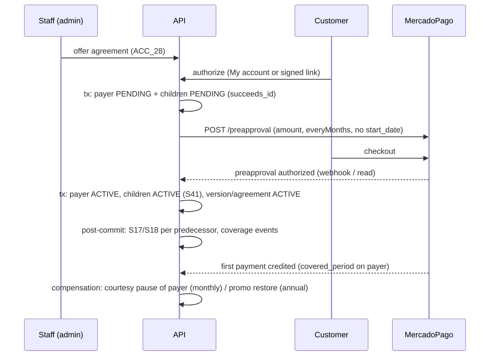

> **Superseded.** This is the full design as of review pass 6 (2026-11-15), before the owner cut
> HOS-2211 to a V1. It is NOT the spec to implement: see [`../spec.md`](../spec.md). It is kept as the
> starting point for the V2 (Linear HOS-2226). Code references point to `origin/staging` at
> `96756adfc4` and may be stale.


# Commercial agreements

> Code references in this spec were verified at `origin/staging` `96756adfc4` (after the
> HOS-1352 epic merged). Line numbers drift; the symbol names are the stable anchor.
> Migration, extras and seed numbers (0225, 0226, 058-060, 0177) are the next free ones at
> that commit and may move by implementation time.

## Part 1: Functional Specification

### Overview & Goals

- **Goal**: let staff sell one customer a single negotiated package that covers several
  verticals (accommodation, venue, experience, partner, tourist), charged as ONE recurring
  fee through ONE MercadoPago preapproval, built from private plans that never appear in
  the public catalog.
- **Motivation**: today each vertical is a separate subscription with its own preapproval
  and its own public plan. Commercial customers (hotel groups, complexes that also run a
  restaurant and excursions, partners) negotiate one price. Staff cannot express that, and
  the only admin-initiated precedent (action 6, `configurePartnerBilling` ->
  `startManualSubscription`) is MANUAL and Partner-only.
- **Success metrics**:
  - A SUPER_ADMIN builds and offers an agreement in under 10 minutes without touching code.
  - The customer authorizes once and is charged once per cycle; coverage in every
    included vertical never drops during the switch from prior subscriptions.
  - Zero double charges: every prior subscription is closed or reconciled, and its paid
    balance is compensated.
  - Zero private plans leak to any public surface (guarded).
- **Target users**: SUPER_ADMIN staff (sales and billing ops); multi-vertical customers.

### Glossary

| Term | Meaning |
|---|---|
| Agreement | `agreement` row: one customer, a lifecycle, and its versions. At most one live per customer. |
| Agreement version | `agreement_version` row: immutable commercial terms (amount, cycle, grace days, lines). Only its `status` (and timestamps) changes. |
| Line | `agreement_version_line`: one `(vertical, private plan version)` pair of a version. |
| Payer | The single `subscription` row of class `ACUERDO` (vertical NULL, no plan anchors, payment method `CARD`). It holds the preapproval (`provider_link`), payments, covered periods, receipts and the courtesy pause. |
| Child | An ordinary `PRINCIPAL` subscription, one per line, anchored to the line's private plan version, payment method `AGREEMENT`, pointing to the payer through `payer_subscription_id`. Coverage, My account, Tourist VIP, INV:8 and analytics keep working because children are PRINCIPALs. |
| Predecessor | A live PRINCIPAL of the customer in a line's vertical that the child replaces through the existing one-to-one succession (`succeeds_id`). |
| Private plan | `plan` with `visibility = 'PRIVATE'`: reusable across customers, never sellable through public checkout, never ranked. |
| Signed link | `signed_action_link` row: a single-use, expiring, hashed token that lets a customer authorize without logging in. Generic, reused by HOS-2196. |
| Compensation | The unused paid balance of the closed predecessors (and cancelled addons), turned into courtesy months (monthly) or a first-charge discount (annual). Stored in `agreement_compensation`. |

### Binding owner decisions (do not reopen)

| Id | Decision |
|---|---|
| 2a | The customer's prior subscriptions in the agreement's verticals close; their already-paid balance is compensated. |
| 3a | A price INCREASE or a cycle change is a new agreement version plus a MercadoPago re-authorization. |
| 4a | Private plans are reusable across customers. |
| P | Partner may be card-charged inside an agreement (never through public checkout S1; `PARTNER_MANUAL_ONLY` stays for S1). |
| D1 | Architecture "payer + child PRINCIPALs" (Glossary). |
| D2 | Authorization: primary path is My account ("Agreed plan" card, "Authorize"); secondary path is a signed no-login link copied by staff. Payment is bound to the agreement's customer, never to whoever opens the link. Regenerating invalidates the previous token. The link mechanism is generic for HOS-2196. |
| D3 | Prior subscriptions close when the payment is AUTHORIZED, through the existing succession. A failed predecessor cancel reuses the deferred-cancellation retry and the reconciliation mark; the agreement activates anyway. |
| D4 | Paid balance: sum of `readSuccessorCredit().unusedMinor` over predecessors (+ cancelled addons). Monthly: `N = ceil(credit / monthly price)` courtesy months as a COURTESY pause of the PAYER, first charge at authorization (no future `start_date`, EX-38/G11). Annual: a one-time first-charge discount through the promo machinery; any excess above `annual - ARS 15` becomes courtesy months. |
| D5 | Price DECREASE: new version + `changeAmount` on the live preapproval, customer email (M5: MP sends nothing), reconciliation verifies the next charge. Increase or cycle change: new version + re-authorization; the old agreement keeps running until the new one authorizes. |
| D6 | DB billing setting "partner card charging enabled", default OFF, SUPER_ADMIN-only; while OFF the wizard cannot include Partner (server enforced). HOS-2196 reuses it. |
| D7 | Addons of a replaced subscription are cancelled at authorization; the wizard review lists them; their unused balance joins the compensation. |
| D8 | Permanent grant and agreement on the same vertical are blocked both ways, with typed errors. |
| D9 | Grace days live on `agreement_version` (default from billing config, editable). They govern the payer; children follow. The private plans' own grace is ignored inside an agreement. |
| D10 | MP cap RP3 (ARS 2.000.000 per charge): wizard and server block a per-charge amount above a configurable cap. |
| D11 (ex OQ-1) | Until pause/resume of an `everyMonths: 12` preapproval is measured in the MP sandbox, wizard and server REFUSE an annual agreement whose compensation credit exceeds the first annual charge minus the ARS 15 floor. After the measurement: a new RP in `fake-lists.json`, reproduced in the fake, and the block is lifted in a small follow-up. |
| D12 (ex OQ-2) | Any change in composition (add or remove a vertical, swap a private plan version), even at the same price, is a new version that needs re-authorization. |
| D13 | If the payer's FIRST charge is declined after activation (predecessors already closed), the payer enters GRACE, not CHARGE_DECLINED (analogue of DEC-SUB-022), with the version's grace days; children keep covering; compensation applies only when the first payment is credited. |

### User Stories & Acceptance Criteria

#### US-1: Staff builds and offers an agreement

**As a** SUPER_ADMIN, **I want** a 4-step wizard (customer, verticals, charging, review),
**so that** I can offer one negotiated price for several verticals.

**Acceptance Criteria:**

- **AC-1.1** **Given** a SUPER_ADMIN, a customer with no live agreement, one or more lines
  whose plan versions are current PRIVATE versions of the line's vertical, and a per-charge
  amount between ARS 15 and the configured cap, **When** the wizard is submitted, **Then**
  one `agreement` (`OFFERED`) and one `agreement_version` (`version_number = 1`, `OFFERED`,
  `change_kind = 'INITIAL'`) with its immutable lines exist, and the act is audited as
  administrative action `ACC_28`.
- **AC-1.2** **Given** an actor without `BILLING_MANAGE_AGREEMENTS`, **When** any
  `/api/v1/admin/billing/agreements*` endpoint is called, **Then** it answers 403
  `FORBIDDEN`, and the admin menu entry Billing -> Agreements is not rendered.
- **AC-1.3** **Given** a per-charge amount above the cap or below the provider floor
  (`PROVIDER_AMOUNT_FLOOR_MINOR`, ARS 15), **When** the amount field loses focus in the
  charging step, **Then** the field shows the i18n message
  `billing.agreements.wizard.amountOutOfRange` (floor and cap interpolated) and "Next" is
  disabled; **and When** the same payload reaches the server, **Then** it answers 422
  `VALIDATION_ERROR`, `details.reason: 'AGREEMENT_AMOUNT_OUT_OF_RANGE'`.
- **AC-1.4** **Given** a customer with an `OFFERED` or `ACTIVE` agreement, **When** a new
  agreement is submitted for them, **Then** 409 `ALREADY_EXISTS`,
  `reason: 'AGREEMENT_ALREADY_LIVE'` (DB partial unique backs it).
- **AC-1.5** **Given** a vertical where the customer holds a live permanent grant, **When**
  a line for that vertical is submitted, **Then** 409 `ALREADY_EXISTS`,
  `reason: 'AGREEMENT_VERTICAL_HAS_PERMANENT_GRANT'`.
- **AC-1.6** **Given** `billing.partnerCardCharging.enabled = false`, **When** the wizard
  renders, **Then** Partner is not selectable, **and When** a Partner line is submitted
  anyway, **Then** 422 `VALIDATION_ERROR`, `reason: 'AGREEMENT_PARTNER_CARD_CHARGING_DISABLED'`.
- **AC-1.7** **Given** a customer with live PRINCIPALs, addons and courtesies in the chosen
  verticals, **When** the review step loads, **Then** it lists every predecessor that will
  be replaced, every addon that will be cancelled, every courtesy that will close, any
  Tourist VIP subscription that will be cancelled by inheritance, and a compensation preview
  computed by the same function the authorization uses.
- **AC-1.8** **Given** the charging step, **When** it opens, **Then** grace days default to
  `billing.agreementDefaults.defaultGraceDays`, **and When** grace days are not lower than
  the cycle length in days, **Then** 422 `reason: 'AGREEMENT_GRACE_NOT_BELOW_CYCLE'`.
- **AC-1.9** **Given** a tourist line and any other line whose plan version has
  `inherits_tourist_vip = true`, **When** submitted, **Then** 422
  `reason: 'AGREEMENT_TOURIST_VIP_REDUNDANT'`. **Also given** a tourist line and a live
  PRINCIPAL OUTSIDE the agreement (another vertical, not replaced by any line) whose plan
  version has `inherits_tourist_vip = true`, **When** previewed, submitted or authorized,
  **Then** the same 422 with `details.inheritingSubscriptionId`: the customer would pay the
  tourist line while already getting VIP for free (double payment), and the VIP sweep would
  try to cancel the tourist child.
- **AC-1.10** **Given** a vertical with a succession in progress (a live successor, judged
  by its status, already points to the predecessor) **When** previewed or submitted,
  **Then** 409 `ALREADY_EXISTS`, `reason: 'AGREEMENT_VERTICAL_BUSY'`, `details.vertical`.
- **AC-1.11** **Given** an annual cycle and a compensation credit greater than the first
  annual charge minus `PROVIDER_AMOUNT_FLOOR_MINOR`, **When** the review step loads, or the
  agreement (or a re-authorization version) is submitted or authorized, **Then** the wizard
  shows `billing.agreements.wizard.annualExcessBlocked` and the server answers 422
  `reason: 'AGREEMENT_ANNUAL_COMPENSATION_EXCESS'` (D11).

#### US-2: Staff defines reusable private plans

**As a** SUPER_ADMIN, **I want** to create a private plan "based on plan X" and edit its
keys, **so that** the agreement grants exactly what was negotiated and I can reuse it.

- **AC-2.1** **Given** a base plan version, **When** a private plan is created from it,
  **Then** a `plan` with `visibility = 'PRIVATE'`, `role = NULL` and one `plan_version`
  (`current`, `sellable`, `visibility = 'PRIVATE'`) exist, with the base entitlements and
  limits copied and the edits applied, and no `billing_option` row.
- **AC-2.2** **Given** a PRIVATE current sellable version, **When** the public catalog, the
  trial ratchet, the Tourist VIP pick, subscribe-destination, trial start, plan migration
  options, cycle price and partner setup read sellable versions, **Then** it never appears.
- **AC-2.3** **Given** any plan, **When** an `UPDATE` changes `plan.visibility` or
  `plan_version.visibility`, **Then** the database raises.
- **AC-2.4** **Given** a private plan version used by customer A's agreement, **When** staff
  builds customer B's agreement, **Then** the same version can be chosen.
- **AC-2.5** **Given** a PRIVATE plan version, **When** a `billing_option` is inserted for
  it, **Then** the database raises.
- **AC-2.6** **Given** a PRIVATE plan and a PUBLIC plan of the same vertical with the same
  `rank`, both current and sellable, **When** both exist, **Then** no unique violation.

#### US-3: Customer authorizes from My account

**As a** customer with an offered agreement, **I want** to see it in My account and press
"Authorize", **so that** I pay one fee for everything.

- **AC-3.1** **Given** an `OFFERED` version, **When** the customer opens
  `/{lang}/mi-cuenta/suscripcion/`, **Then** an "Agreed plan" card shows the verticals
  with their plan names, price, cycle, the compensation preview and an "Authorize" button.
- **AC-3.2** **Given** that card, **When** "Authorize" is pressed, **Then** one payer
  (`ACUERDO`, `CARD`, `PENDING_AUTHORIZATION`) and one child per line (`PRINCIPAL`,
  `AGREEMENT`, `PENDING_AUTHORIZATION`, `succeeds_id` = predecessor when one exists) are
  committed together, a preapproval is created with `amount = version amount` (minus the
  annual discount, D4), `everyMonths = 1 | 12`, reference = payer id, no `start_date` and no
  `free_trial`, and the browser is redirected to the checkout.
- **AC-3.3** **Given** two concurrent or repeated presses, **When** both run, **Then**
  exactly one payer exists for the version and both receive the same checkout URL.
- **AC-3.4** **Given** a version that is no longer `OFFERED`, **When** authorize is called
  with it, **Then** 409 `ALREADY_EXISTS`, `reason: 'AGREEMENT_VERSION_NOT_OFFERED'`,
  `details.offeredVersionId` (or `null`).
- **AC-3.5** **Given** the paid-signups freeze is on, **When** authorize is called, **Then**
  409 `NEW_PAID_SIGNUPS_FROZEN`.
- **AC-3.6** **Given** an agreement of another customer, **When** authorize is called,
  **Then** 404 `NOT_FOUND`.

#### US-4: Customer authorizes from a signed link (no login)

**As** staff, **I want** to copy a link and send it by email or WhatsApp, **so that** a
customer who does not log in can still authorize.

- **AC-4.1** **Given** an `OFFERED` version, **When** staff generates a link, **Then** the
  response carries the full URL exactly once, the DB stores only the SHA-256 hash of the
  token, and `expires_at = now + billing.agreementDefaults.linkExpiryDays` (default 14).
- **AC-4.2** **Given** a valid link, **When** it is opened, **Then** the page shows the
  agreement summary and "Authorize"; pressing it creates the payer for the LINK's customer,
  whatever session the browser has (or none).
- **AC-4.3** **Given** a link that was regenerated, **When** the old token is used, **Then**
  410 `GONE`, `reason: 'AGREEMENT_LINK_NO_LONGER_VALID'`, `details.cause: 'REPLACED'`.
- **AC-4.4** **Given** an expired link **Then** 410 with `cause: 'EXPIRED'`; **given** an
  unknown token **Then** 404 `NOT_FOUND`.
- **AC-4.5** **Given** a link whose payer is still `PENDING_AUTHORIZATION`, **When** it is
  opened and authorized again, **Then** the same checkout URL is returned (no new
  preapproval, M3); **given** that payer became `ABANDONED` or `CHARGE_DECLINED`, **Then**
  410 with `cause: 'USED'`.
- **AC-4.6** **Given** the link page, **Then** it reads no session (session-blind guard
  green), the token travels only in the URL fragment and in a POST body, API responses carry
  `Cache-Control: no-store`, and no log line contains the token.
- **AC-4.7** **Given** a version that becomes `SUPERSEDED`, `WITHDRAWN` or `ACTIVE` through
  another path, **Then** its open link is revoked and answers 410 with
  `cause: 'VERSION_CLOSED'` (or `USED` when it was the link's own payer that activated).
- **AC-4.8** **Given** a link is consumed (its Authorize created the payer), **Then** an
  `agreement-link-used` email is enqueued to the customer's account email, naming the
  verticals, the subscriptions that will be replaced on authorization, and how to contact
  staff; it is sent whoever pressed the button, because that act closes the customer's prior
  subscriptions once MP authorizes.
- **AC-4.9** **Given** a version whose `change_kind = 'DECREASE'`, **When** a link is
  requested or authorize is called for it, **Then** 409 `reason: 'AGREEMENT_VERSION_NOT_OFFERED'`
  (a decrease is never authorized by the customer; it lives in `APPLYING`, never `OFFERED`).

#### US-5: Authorization activates the agreement and replaces prior subscriptions

- **AC-5.1** **Given** a pending payer, **When** the provider authorizes it (webhook S2 or a
  fresh by-id read), **Then** in ONE transaction the payer becomes `ACTIVE`, every child
  becomes `ACTIVE` (S41), the version and the agreement become `ACTIVE`, the signed link is
  consumed, and the agreement-confirmed notice is enqueued.
- **AC-5.2** **Given** activation committed, **When** the post-commit effects run, **Then**
  each predecessor is cancelled through the REAL S17 (provider cancel for CARD, none for
  MANUAL), which confirms the successor's authorization through the PAYER's provider link
  (`payer_subscription_id ?? id`), is closed through S18, and at no instant does
  `coverage(user, vertical)` report uncovered for an included vertical. S17 never answers
  `SUCCESSOR_NOT_CONFIRMED` for a child whose payer's authorization reads `active`.
- **AC-5.3** **Given** a predecessor whose provider cancel fails, **Then** S17 answers
  `DEFERRED`, the agreement stays `ACTIVE`, `reevaluateSuccessionPredecessors` retries it,
  and a charge that lands on the predecessor meanwhile is retained by S19 and opens a
  reconciliation mark.
- **AC-5.4** **Given** predecessors with addons and courtesies, **Then** their complements
  are cancelled (never repointed to the child) and their courtesy closes with reason
  `SUCEDIDA_POR_ACUERDO`.
- **AC-5.5** **Given** the payer's authorization window expires, **Then** the payer and all
  children become `ABANDONED` (S42), each predecessor stays live with its `succeeded_by_id`
  set to NULL by the propagation's explicit write (no courtesy, addon or status side effect
  on the predecessor), and the link is dead (`cause: 'USED'`).
- **AC-5.6** **Given** a payer still `PENDING_AUTHORIZATION` whose first charge is
  declined, **Then** payer and children become `CHARGE_DECLINED` (S43), predecessors stay live
  with `succeeded_by_id` set to NULL the same way.
- **AC-5.7** **Given** an `ACTIVE` payer (predecessors already closed) with no credited
  payment whose first charge is declined (D13), **Then** S16 (`declineFirstCharge`) answers
  `NOT_APPLICABLE` `LEFT_TO_S4`, S4 puts the payer in `GRACE_PERIOD` with
  `grace_ends_at = read instant + agreement_version.grace_days`, the children enter
  `GRACE_PERIOD` (S44) and keep covering, no compensation is applied, and when a later charge
  is credited the payer exits grace (S5 -> S45) and `applyAgreementCompensation` runs after
  that exit (never inside `creditPayment`, which still sees `GRACE_PERIOD`); if grace expires
  unpaid, the payer is suspended (S6 -> S46). During that grace, S17 keeps closing
  predecessors (children in `GRACE_PERIOD` are admitted).
- **AC-5.8** **Given** the payer's first payment is credited while it is still
  `PENDING_AUTHORIZATION` (credited-pending activation path), **Then** compensation is NOT
  applied at the credit; it is applied right after the activation commits (snapshot taken
  first).

#### US-6: Paid balance is compensated

- **AC-6.1** **Given** a monthly agreement of price `P` and a credit `C > 0`, **When** the
  payer is `ACTIVE` and its first payment has been credited (at `T0`) and
  `applyAgreementCompensation` runs at instant `T0 + d`, **Then** a courtesy grant pauses the
  payer for exactly `N = ceil(C / P)` calendar months from that instant, children stay
  `ACTIVE` and covered, and (with the fake, lies ON, RP10) the next charge after resume is
  `T0 + (N + 1)` months: one paid month plus `N` free months.
- **AC-6.2** **Given** an annual agreement of amount `A` and credit
  `C <= A - PROVIDER_AMOUNT_FLOOR_MINOR`, **Then** the preapproval is created with `A - C`, an
  `AGREEMENT`-origin promo redemption with `remaining_charges = 1` exists on the payer, and
  after the first credited charge S30 restores the amount to `A` (never while the payer is
  paused: RP6). A larger `C` is refused before any write (AC-1.11, D11).
- **AC-6.3** **Given** `C = 0`, **Then** no courtesy and no promo are created.
- **AC-6.4** **Given** any agreement, **Then** `agreement_compensation` stores the credit,
  the per-source breakdown and the strategy; the monthly credit is RECOMPUTED at the first
  credit (when it applies) and the stored row is updated before applying; it is applied
  exactly once (replaying the first-payment fact changes nothing).
- **AC-6.6** **Given** an `ACTIVE` payer with a credited payment and
  `agreement_compensation.applied_at IS NULL` (the provider pause failed, or the post-commit
  step was lost), **When** the `agreement-compensation-sweep` cron runs, **Then** it calls
  `applyAgreementCompensation` again and the courtesy exists once.
- **AC-6.5** **Given** a MANUAL predecessor, **Then** its unused balance is computed from
  its anchored billing option amount (`manual_payment` stores no amount).

#### US-7: Lifecycle of the children follows the payer

- **AC-7.1** **Given** an active agreement, **When** the payer enters grace (S4), **Then**
  every child enters `GRACE_PERIOD` with the payer's grace clock (S44); **when** the payer
  exits grace (S5), **then** children return to `ACTIVE` (S45).
- **AC-7.2** **When** the payer is suspended for arrears (S6, or provider pause), **Then**
  children become `SUSPENDED` (S46) and a coverage loss is recorded per child vertical;
  **when** reactivated (S7), **then** children return to `ACTIVE` (S47).
- **AC-7.3** **When** the payer is suspended for a chargeback, **Then** children become
  `SUSPENDED`; **when** its service ends (S12 chargeback), **then** children become
  `CANCELLED` (S49) and the agreement `ENDED`.
- **AC-7.4** **When** the provider cancels the preapproval, **Then** payer and children
  become `CANCELLED`, coverage loss per vertical, agreement `ENDED`.
- **AC-7.5** **When** the payer enters grace, **Then** `grace_ends_at = grace_started_at +
  agreement_version.grace_days`, never the private plan's `grace_days`.
- **AC-7.6** **Given** a child whose status disagrees with the status the payer maps to,
  **When** the reconciliation sweep runs, **Then** it opens a reconciliation mark
  `AGREEMENT_CHILD_STATE_MISMATCH` and writes nothing else.
- **AC-7.7** **Given** an `AGREEMENT` child, **When** anything tries to insert a
  `provider_link` for it, **Then** the database raises; no code path calls the provider for
  a child.
- **AC-7.8** **Given** the payer is `PAUSED` by courtesy, **Then** children stay `ACTIVE`
  and keep emitting coverage.
- **AC-7.9** **Given** an agreement whose payer and children are `CANCEL_SCHEDULED` (or in
  grace), **When** `end-scheduled-services`, `send-grace-reminders` and
  `read-own-declined-signups` select their rows, **Then** they never select a child
  (`payment_method = 'AGREEMENT'` excluded): S12 runs once on the payer and propagates, and
  exactly one grace reminder is sent per payer.
- **AC-7.10** **Given** a payer in `CANCEL_SCHEDULED` whose crossing charge extends its
  `service_ends_at`, **Then** every child's `service_ends_at` moves to the same instant
  (`SERVICE_END_MOVED`, S50) and each child's coverage `until` follows.
- **AC-7.11** **Given** a child already in the propagation's target state, **When** the
  payer transition propagates, **Then** that child is a no-op (not an abort); a child in any
  other unexpected state aborts the transaction.
- **AC-7.12** **Given** a pending payer with expired window and its pending children,
  **When** `findExpiredAuthorizationWindows` runs, **Then** it returns the payer only (children
  carry a NULL `authorization_window_ends_at` and are excluded by method), and S42 runs once.
- **AC-7.13** **Given** a payer that reached `CANCELLED` (agreement `ENDED`) while a
  REAUTHORIZATION version was `OFFERED` (or a DECREASE `APPLYING`) with an open link, **Then**
  that version becomes `WITHDRAWN` (or `FAILED`), the link answers 410 `VERSION_CLOSED`, and
  authorize on an `ENDED` or `WITHDRAWN` agreement answers 409
  `reason: 'AGREEMENT_NOT_LIVE'`.
- **AC-7.14** **Given** a still-live predecessor of a child gets a chargeback (S8 suspension
  or S12 chargeback), **When** its writer reaches the successor cutter, **Then** the cutter
  does not touch the AGREEMENT child and opens a reconciliation mark
  `AGREEMENT_PREDECESSOR_CHARGEBACK` (child fate: product decision P13, pending).

#### US-8: Customer limits and cancellation

- **AC-8.1** **Given** an active agreement, **When** the customer presses "Cancel agreement"
  (mandatory, consumer law), **Then** the payer becomes `CANCEL_SCHEDULED` and every child
  `CANCEL_SCHEDULED` with the same `service_ends_at` (S48); at that date all become
  `CANCELLED` and the agreement `ENDED`.
- **AC-8.2** **Given** a child id, **When** cancel, pause, plan change, revoke or a courtesy
  grant targets it directly, **Then** 409 `ALREADY_EXISTS`,
  `reason: 'AGREEMENT_CHILD_ACT_ON_PAYER'`, `details.payerSubscriptionId`.
- **AC-8.3** **Given** the payer is in its compensation courtesy pause, **When** the
  customer cancels, **Then** the provider authorization is cancelled now (RP6 allows it),
  the payer and children become `CANCEL_SCHEDULED` with `service_ends_at` = the courtesy
  end, and coverage lasts until then.
- **AC-8.4** **Given** a vertical covered by a live child, **When** the customer redeems a
  promo code, buys an addon, requests a pause or a plan change there, **Then** 409
  `ALREADY_EXISTS`, `reason: 'AGREEMENT_MANAGED'`.
- **AC-8.5** **Given** a live child in a vertical, **When** the plans page island resolves
  the pricing situation, **Then** it receives `{ situation: 'AGREEMENT' }` and renders
  "Included in your agreed plan" with no checkout button.
- **AC-8.6** **Given** a live child in a vertical, **When** S1 checkout is started there,
  **Then** 409 `ALREADY_EXISTS`, `reason: 'VERTICAL_IN_AGREEMENT'`.

#### US-9: Staff changes the price

- **AC-9.1** **Given** an `ACTIVE` agreement, **When** staff publishes a version with a
  LOWER amount and the same cycle and lines, **Then** the version is inserted as `APPLYING`
  (never `OFFERED`), `changeAmount` is sent, confirmed by a fresh read, the payer's
  `agreement_version_id` moves to the new version (old one `SUPERSEDED`, new one `ACTIVE`),
  the price-decrease email is enqueued, and the expected-amount reconciliation checks the
  next charge against the new amount. An `OFFERED` re-authorization version, if any, is NOT
  touched.
- **AC-9.2** **Given** the payer is not `ACTIVE` (paused, grace, suspended, scheduled
  cancellation), or a version is already `APPLYING`, or a re-authorization version is
  `OFFERED`, **When** a decrease is published, **Then** 409
  `reason: 'AGREEMENT_PAYER_NOT_ACTIVE'` / `'AGREEMENT_VERSION_CHANGE_IN_PROGRESS'` and
  nothing is written.
- **AC-9.3** **Given** a version with a HIGHER amount, another cycle, or any change in
  composition even at the same price (D12), **When** published, **Then** it is `OFFERED`
  (`change_kind = 'REAUTHORIZATION'`), the
  current version keeps charging, and on authorization a new payer and new children succeed
  the old ones; the old children close without provider calls, the old payer is cancelled at
  the provider, the old version becomes `SUPERSEDED`, and the old payer's unused balance is
  compensated.
- **AC-9.4** **Given** an `OFFERED` version, **When** staff withdraws it, **Then** it
  becomes `WITHDRAWN`, its link is revoked, and an agreement that never activated becomes
  `WITHDRAWN`.

#### US-10: Permanent grants and the Partner setting

- **AC-10.1** **Given** a live child in a vertical, **When** S13 grants a permanent grant
  covering that vertical, **Then** 409 `ALREADY_EXISTS`,
  `reason: 'PERMANENT_GRANT_VERTICAL_IN_AGREEMENT'` and nothing is written.
- **AC-10.2** **Given** a live agreement with a Partner line and the setting turned OFF,
  **Then** the agreement keeps running; a new version that keeps the existing Partner line
  is accepted; a new agreement or a version that ADDS Partner is refused (AC-1.6).
- **AC-10.3** **Given** an ADMIN (who holds `BILLING_SETTINGS_WRITE`,
  `rolePermissions.seed.ts:758-759`) or any actor without `BILLING_MANAGE_AGREEMENTS`,
  **When** writing `billing.partnerCardCharging` or `billing.agreementDefaults`, **Then** 403.

#### US-11: Admin visibility

- **AC-11.1** **Given** payer rows exist, **When** the admin subscription list loads,
  **Then** it renders them (class `ACUERDO`, vertical empty) and children show
  "via agreement" with a link to the agreement.
- **AC-11.2** **Given** an agreement, **When** its detail loads, **Then** it shows versions,
  lines, payer, children, the closing state of each predecessor (cancelled, deferred,
  reconciliation mark), the compensation and the link state (never the token).

### UX Considerations

- **Admin wizard** (Billing -> Agreements -> New, SUPER_ADMIN only; Tailwind + Shadcn,
  TanStack Form, schemas from `@repo/schemas` validated with `safeParse` in handlers):
  1. *Customer*: search users (existing admin user search), shows current live
     subscriptions per vertical, live grants and any live agreement (blocks if present).
  2. *Verticals*: per vertical, pick an existing private plan version, or "based on plan X"
     (public or private current version) which opens the existing key editor from
     `apps/admin/src/features/billing-plan-catalog/` to create a private plan. Partner is
     hidden while the setting is OFF. Verticals with a live permanent grant are disabled
     with the reason.
  3. *Charging*: amount (ARS, integer pesos in the UI, stored in centavos), cycle
     (monthly | annual), grace days (prefilled), live validation against the cap and
     ARS 15; for annual, the per-charge amount is the annual amount.
  4. *Review*: replaced predecessors (status, method, next charge), addons to cancel,
     courtesies that close, Tourist VIP subscription cancelled by inheritance, compensation
     preview (credit, strategy, months or discount), and the final "Offer" button.
  After offering: detail page with "Copy payment link" (generates on demand, shows the URL
  once with a copy button and the expiry), "Regenerate link", "Withdraw offer",
  "New version".
- **Customer, My account**: an "Agreed plan" card at the top of
  `/{lang}/mi-cuenta/suscripcion/` (client island; the page stays session-blind):
  - OFFERED: summary, compensation preview, "Authorize". If a predecessor charge is near,
    a hint that the old subscription will be cancelled after authorizing.
  - ACTIVE: verticals, price, cycle, next charge, courtesy end if any, payment status
    (grace banner affects all verticals together), "Cancel agreement" (confirm dialog
    with the end date from the cancellation preview).
  - New version OFFERED while ACTIVE: "New terms pending your authorization".
  - Child rows in the existing subscription list are shown inside the card, not as
    separate cancellable subscriptions.
- **Customer, signed link**: `/{lang}/acuerdo/#t=<token>` renders a static shell; a client
  island reads the fragment, removes it from the address bar (`history.replaceState`),
  POSTs it to resolve the summary, and shows "Authorize". States: loading skeleton, valid,
  expired/replaced/used ("Ask your contact for a new link"), unknown, provider error with
  retry. Return page `/{lang}/acuerdo/resultado/` shows a static "We are confirming your
  payment; you will receive an email" message.
- **Plans pages**: `PlanCardCta.client.tsx` renders "Included in your agreed plan" for the
  `AGREEMENT` situation, without checkout or trial buttons.
- **Errors**: typed codes per `apps/api/docs/error-contract.md`; admin shows the `reason`
  mapped to i18n text; web shows friendly copy, never raw codes.
- **Loading**: skeletons in the card and link page; the Authorize button disables while the
  request is in flight (double-press safe server-side too).
- **Accessibility**: WCAG 2.1 AA; dialogs trap focus; status text not conveyed by color
  only; buttons have explicit labels.
- **i18n**: every string in `@repo/i18n` (es, en, pt); emails in the customer's locale.

### Out of Scope

- Addons on top of an agreement (buy or keep): staff adds the benefit to the private plan
  instead (D7). May come in a future spec.
- Customer self-service plan changes inside an agreement (owner decision).
- Changing lines in place without re-authorization (D12: every composition change
  re-authorizes).
- Annual agreements whose compensation exceeds the first annual charge minus the floor
  (D11): blocked until the `everyMonths: 12` pause/resume is measured.
- Per-vertical revenue attribution of the payer's payments in analytics: payer facts are
  dropped by the sink in v1 (children still emit per-vertical lifecycle facts). Follow-up.
- MANUAL (non-card) agreements: the payer is always `CARD`. Action 6 stays as is.
- Standalone Partner card signup: HOS-2196 (it reuses the signed link and the setting).
- Emailing the offer automatically: staff sends the link by their own channel.

## Part 2: Technical Analysis

### Architecture

- **Pattern**: a payer row carries money; child PRINCIPALs carry capabilities. One
  propagation service is the only place that maps a payer transition to its children.
- **New modules**:
  - `packages/db/src/schemas/vertical/agreement.dbschema.ts` (`agreement`,
    `agreement_version`, `agreement_version_line`, `agreement_compensation`),
    `.../signed-action-link.dbschema.ts`, models under `packages/db/src/models/agreement/`.
  - `packages/service-core/src/services/billing/agreement/`:
    `agreement-offer.service.ts`, `agreement-preview.ts`, `private-plan.service.ts`,
    `authorize-agreement.service.ts`, `admit-agreement-predecessor.ts`,
    `activate-agreement-payer.ts`, `propagate-payer-transition.ts`,
    `agreement-compensation.ts`, `agreement-version-change.service.ts`,
    `agreement-consistency-check.ts`, `agreement-errors.ts`.
  - `packages/service-core/src/services/billing/signed-link/signed-action-link.service.ts`
    (generic: issue, resolve, consume, revoke).
  - `packages/schemas/src/api/billing/agreement*.schema.ts`.
  - API: `apps/api/src/routes/billing-agreement/{admin,protected,public}/`.
  - Admin: `apps/admin/src/features/billing-agreements/` + routes under Billing.
  - Web: `apps/web/src/pages/[lang]/acuerdo/index.astro`,
    `apps/web/src/pages/[lang]/acuerdo/resultado/index.astro`,
    `apps/web/src/components/billing/agreement/AgreementLink.client.tsx`,
    `.../AgreedPlanCard.client.tsx`.
- **Package boundaries**: everything lives on the billing side (`service-core` billing,
  `db`, `schemas`). `@repo/verticals` only gains `ACC_28` in
  `authorization/administrative-actions.ts` (accepted exception) and never imports
  `@repo/db`; PRIVATE filtering happens in `packages/db` reads, so verticals' ports keep
  their signatures (G14 untouched).
- **PRIVATE filtering scope**: only SELLABLE LISTINGS filter out PRIVATE versions (public
  catalog, current sellable versions, trial ratchet, VIP pick, subscribe destination, plan
  migration options, cycle price, partner setup). By-id reads never filter: a child's
  coverage resolves its anchored private version by id, and Tourist VIP inheritance reads
  `findPlanVersion({ id })` (`packages/verticals/src/effective-set/tourist-vip-inheritance.ts:36`,
  through `planCatalogModel.findPlanVersion`) to check `inherits_tourist_vip`; filtering
  there would throw `UnresolvedCoverageSourceError` for every child. The
  `check-private-plans-never-public` guard targets sellable listing methods only, and its
  integration test asserts that `findPlanVersion` by id DOES return a PRIVATE version.



### Data Model Changes

All structural changes go in Drizzle migration **0225** (one file, `pnpm db:generate`).
The new permission value goes in its own migration **0226** (pattern
`0223_hos1612_migrate_plan_permission.sql`: `ALTER TYPE ... ADD VALUE` cannot share a
transaction with its use). Triggers go in extras **058-060**. The role grant goes in seed
data-migration **0177** (pattern `0176-hos1612-migrate-plan-permission.ts`).

| Table | Change | Carril |
|---|---|---|
| `plan` | `visibility` + CHECKs + `uq_plan_id_visibility` | 0225 |
| `plan_version` | `visibility` + composite FK + unique + rank index change | 0225 |
| `plan`, `plan_version` | visibility immutable | extras 058 |
| `billing_option` | insert refused on PRIVATE version | extras 058 |
| `agreement`, `agreement_version`, `agreement_version_line`, `agreement_compensation` | new | 0225 |
| `agreement_version`, `agreement_version_line` | terms immutable | extras 059 |
| `signed_action_link` | new | 0225 |
| `subscription` | class `ACUERDO`, method `AGREEMENT`, `payer_subscription_id`, `agreement_version_id`, CHECKs, indexes | 0225 |
| `subscription`, `provider_link` | agreement shape triggers | extras 060 |
| `promo_code` | `origin` | 0225 |
| `courtesy_grant` | close reason `SUCEDIDA_POR_ACUERDO` | 0225 (CHECK) |
| `permission_enum` | `billing.manageAgreements` | 0226 |
| `role_permission` | SUPER_ADMIN grant | seed 0177 |
| `platform_settings` | keys `billing.partnerCardCharging`, `billing.agreementDefaults` (rows written by the app; no migration) | none |

#### `plan` (modify; `plan-catalog.dbschema.ts`)

- `visibility varchar(16) NOT NULL DEFAULT 'PUBLIC'`.
- `ck_plan_visibility`: `visibility IN ('PUBLIC','PRIVATE')`.
- `ck_plan_private_has_no_role`: `visibility = 'PUBLIC' OR role IS NULL` (trial, pre_trial
  and floor plans are public mechanics).
- `uq_plan_id_visibility UNIQUE (id, visibility)` (target of the version's composite FK).
- Immutable after creation: extras `058-plan-visibility-immutability.trigger.sql`, same shape
  as `045-plan-role-immutability.trigger.sql` (`reject_plan_visibility_change`).

#### `plan_version` (modify)

- `visibility varchar(16) NOT NULL DEFAULT 'PUBLIC'`, copied from its plan at creation.
- `fk_plan_version_plan_visibility`: `(plan_id, visibility) -> plan(id, visibility)` so a copy
  that disagrees with the plan is impossible (same technique as `fk_plan_version_plan_vertical`).
- `uq_plan_version_id_visibility UNIQUE (id, visibility)` (target for lines).
- `uq_plan_version_sellable_current_rank` is recreated with
  `WHERE sellable AND current AND visibility = 'PUBLIC'`: private versions take no rank.
  Private versions store `rank = 0` (column is NOT NULL); nothing reads it.
- Immutability: extras `041-plan-catalog-immutability.trigger.sql` must cover `visibility`.
  If 041 lists columns explicitly, add it there; if it compares the row except `current`,
  it is covered. Either way extras 058 also rejects a visibility change (belt and braces,
  tested).
- Extras 058 adds `reject_billing_option_on_private_version` (BEFORE INSERT on
  `billing_option`): a PRIVATE version never gets a price row. This, plus
  `fk_subscription_billing_option_version`, makes it impossible for any CARD or MANUAL
  PRINCIPAL to anchor a private version.

#### `agreement` (new)

| Column | Type | Notes |
|---|---|---|
| `id` | uuid PK | |
| `customer_user_id` | uuid NOT NULL FK `users.id` | |
| `status` | varchar(16) NOT NULL | `OFFERED`, `ACTIVE`, `ENDED`, `WITHDRAWN` |
| `end_reason` | varchar(32) NULL | `CUSTOMER_CANCELLED`, `STAFF_CANCELLED`, `ARREARS`, `CHARGEBACK`, `REVOKED`, `PROVIDER_CANCELLED`, `WITHDRAWN` |
| `ended_at` | timestamptz NULL | |
| `internal_notes` | text NULL | staff only |
| `created_by` | uuid NOT NULL FK `users.id` | |
| `created_at`, `updated_at` | timestamptz NOT NULL | |

- `ck_agreement_status`, `ck_agreement_end_reason` (closed lists).
- `ck_agreement_end_pair`: `(status IN ('ENDED','WITHDRAWN')) = (ended_at IS NOT NULL) AND (ended_at IS NULL) = (end_reason IS NULL)`.
- `uq_agreement_one_live_per_customer UNIQUE (customer_user_id) WHERE status IN ('OFFERED','ACTIVE')`.

An agreement whose first offer is never authorized ends as `WITHDRAWN` (staff withdraws
it) or stays `OFFERED` (an abandoned or declined attempt does not end it, so there is no
`ABANDONED` end reason; the customer may authorize again with a new link).

#### `agreement_version` (new)

| Column | Type | Notes |
|---|---|---|
| `id` | uuid PK | |
| `agreement_id` | uuid NOT NULL FK `agreement.id` | |
| `version_number` | integer NOT NULL | 1, 2, ... |
| `amount_minor` | integer NOT NULL | ARS centavos per charge (monthly price, or the annual amount) |
| `currency` | varchar(3) NOT NULL DEFAULT 'ARS' | |
| `cycle` | varchar(16) NOT NULL | `monthly` (everyMonths 1), `annual` (everyMonths 12) |
| `grace_days` | integer NOT NULL | D9 |
| `change_kind` | varchar(16) NOT NULL | `INITIAL`, `DECREASE`, `REAUTHORIZATION` |
| `status` | varchar(16) NOT NULL | `OFFERED`, `APPLYING`, `ACTIVE`, `SUPERSEDED`, `WITHDRAWN`, `FAILED`, `ENDED` |
| `activated_at`, `closed_at` | timestamptz NULL | |
| `created_by` | uuid NOT NULL FK `users.id` | |
| `created_at`, `updated_at` | timestamptz NOT NULL | |

- `uq_agreement_version_number UNIQUE (agreement_id, version_number)`.
- `ck_agreement_version_kind_status`: `change_kind = 'DECREASE'` never `OFFERED`;
  `status = 'APPLYING'` only when `change_kind = 'DECREASE'`. A decrease is applied by staff,
  never authorized by the customer, so it cannot be picked up by authorize or a link.
- `uq_agreement_version_one_applying UNIQUE (agreement_id) WHERE status = 'APPLYING'`.
- `ck_agreement_version_amount`: `amount_minor BETWEEN 1500 AND 200000000`. These literals
  mirror `PROVIDER_AMOUNT_FLOOR_MINOR` / `PROVIDER_AMOUNT_CEILING_MINOR`
  (`promo/provider-amount-floor.ts`); a unit test asserts the migration SQL and the constants
  agree. Service code always uses the constants, never a literal. The configurable cap is a
  stricter service check.
- `ck_agreement_version_currency`: `currency = 'ARS'`; `ck_agreement_version_cycle`;
  `ck_agreement_version_grace_days`: `grace_days >= 0`; status and change_kind closed lists.
- `uq_agreement_version_one_offered UNIQUE (agreement_id) WHERE status = 'OFFERED'`.
- `uq_agreement_version_one_active UNIQUE (agreement_id) WHERE status = 'ACTIVE'`.
- Extras `059-agreement-version-immutability.trigger.sql`: an UPDATE may change only
  `status`, `activated_at`, `closed_at`, `updated_at`; DELETE is refused.

#### `agreement_version_line` (new)

| Column | Type | Notes |
|---|---|---|
| `id` | uuid PK | |
| `agreement_version_id` | uuid NOT NULL FK | |
| `vertical` | varchar(32) NOT NULL FK `verticals.id` | |
| `plan_version_id` | uuid NOT NULL | |
| `plan_visibility` | varchar(16) NOT NULL DEFAULT 'PRIVATE' | constant column, exists for the FK |

- `uq_agreement_version_line_vertical UNIQUE (agreement_version_id, vertical)`.
- `fk_agreement_line_version_vertical`: `(plan_version_id, vertical) -> plan_version(id, vertical)`.
- `fk_agreement_line_version_visibility`: `(plan_version_id, plan_visibility) -> plan_version(id, visibility)`.
- `ck_agreement_line_private`: `plan_visibility = 'PRIVATE'`. Together: a line can only
  name a PRIVATE version of its own vertical, enforced by the database.
- Extras 059 refuses UPDATE and DELETE on lines.

#### `signed_action_link` (new, generic; HOS-2196 reuses it)

| Column | Type | Notes |
|---|---|---|
| `id` | uuid PK | |
| `purpose` | varchar(32) NOT NULL | `AGREEMENT_AUTHORIZATION` (HOS-2196 adds its own value and subject column) |
| `token_hash` | char(64) NOT NULL UNIQUE | hex SHA-256 of the token |
| `customer_user_id` | uuid NOT NULL FK `users.id` | the account the payment is bound to |
| `agreement_version_id` | uuid NULL FK | subject for `AGREEMENT_AUTHORIZATION` |
| `expires_at` | timestamptz NOT NULL | |
| `consumed_at` | timestamptz NULL | set when it creates its attempt |
| `consumed_subscription_id` | uuid NULL FK `subscription.id` | the payer it created |
| `revoked_at` | timestamptz NULL | |
| `revoke_reason` | varchar(16) NULL | `REGENERATED`, `VERSION_CLOSED`, `STAFF_REVOKED` |
| `created_by` | uuid NOT NULL FK `users.id` | |
| `created_at` | timestamptz NOT NULL | |

- `ck_signed_action_link_purpose`; `ck_signed_action_link_agreement_subject`:
  `purpose <> 'AGREEMENT_AUTHORIZATION' OR agreement_version_id IS NOT NULL`.
- `ck_signed_action_link_consumed_pair`, `ck_signed_action_link_revoked_pair`.
- `uq_signed_action_link_open_agreement_version UNIQUE (agreement_version_id)
  WHERE purpose = 'AGREEMENT_AUTHORIZATION' AND revoked_at IS NULL AND consumed_at IS NULL`.
- Token: 32 random bytes (`node:crypto` `randomBytes`), base64url (43 chars). Only the
  hash is stored. SHA-256 of a 256-bit random value needs no secret, so **no new env var**.
- "Single use" means: a link creates at most ONE authorization attempt (one payer). While
  that payer is `PENDING_AUTHORIZATION` the link keeps answering with the same checkout URL;
  once the payer is `ACTIVE`, `ABANDONED` or `CHARGE_DECLINED`, the link answers 410.
- Reuse versus a changed payer email. `resolveLiveCommitmentReuse`
  (`resolve-live-commitment.ts:131-150`) answers `REPLACE` with `PAYER_EMAIL_CHANGED` when the
  stored `declared_payer_email` differs from the requested one. Agreements do NOT replace on
  an email change, on either path: the live payer of a version is shared by the session path
  and the link path (one payer per version, `uq_subscription_live_payer_per_version`), and
  replacing it from a second browser would cancel a checkout the first person may be
  completing. Rule: while the payer is `PENDING_AUTHORIZATION` with an applied creation, any
  authorize call (session or link, any email) returns the stored checkout URL; the email
  field is ignored and the response carries `declaredPayerEmail` masked (`j***@d***.com`)
  so the UI can say "a checkout for this agreement is already open". A rejected creation
  (key completed with `REJECTED`) is re-minted on the same payer with the new email, as S1
  does with `RECREATE`. The agreement reuse is a separate function
  (`resolveAgreementPayerReuse`), not a new branch in `resolveLiveCommitmentReuse`.

#### `agreement_compensation` (new)

| Column | Type | Notes |
|---|---|---|
| `id` | uuid PK | |
| `payer_subscription_id` | uuid NOT NULL UNIQUE FK `subscription.id` | |
| `credit_minor` | integer NOT NULL CHECK >= 0 | |
| `strategy` | varchar(24) NOT NULL | `NONE`, `COURTESY_MONTHS`, `FIRST_CHARGE_DISCOUNT` (`DISCOUNT_AND_COURTESY` is added only when D11's block is lifted) |
| `courtesy_months` | integer NOT NULL CHECK >= 0 | |
| `discount_minor` | integer NOT NULL CHECK >= 0 | |
| `breakdown` | jsonb NOT NULL | `[{ sourceSubscriptionId, kind: 'PREDECESSOR' \| 'ADDON' \| 'TOURIST_VIP' \| 'PREVIOUS_PAYER', unusedMinor }]`, validated by a Zod schema on write |
| `computed_at` | timestamptz NOT NULL | |
| `applied_at` | timestamptz NULL | |
| `courtesy_grant_id` | uuid NULL FK `courtesy_grant.id` | |
| `promo_redemption_id` | uuid NULL FK `promo_redemption.id` | |
| `created_at` | timestamptz NOT NULL | |

#### `subscription` (modify; `subscription.dbschema.ts`)

- `SUBSCRIPTION_CLASSES = ['PRINCIPAL', 'COMPLEMENTO', 'LAPIDA', 'ACUERDO']` (`:33`).
- `SUBSCRIPTION_PAYMENT_METHODS = ['CARD', 'MANUAL', 'AGREEMENT']` (`:21`).
- New columns:
  - `payer_subscription_id uuid NULL` FK self (`fk_subscription_payer`).
  - `agreement_version_id uuid NULL` FK `agreement_version.id`. On the payer it moves to the
    new version only on a DECREASE (AC-9.1).
- CHECK changes (all Drizzle, all `ck_subscription_*`):
  - `identity_not_null` (`:149-152`) becomes
    `class = 'LAPIDA' OR (user_id IS NOT NULL AND payment_method IS NOT NULL AND (vertical IS NOT NULL OR class = 'ACUERDO'))`.
  - `principal_anchor` (`:153-156`) becomes
    `class <> 'PRINCIPAL' OR (plan_version_id IS NOT NULL AND (billing_option_id IS NOT NULL OR payment_method = 'AGREEMENT'))`.
    Verified: private plans never have a `billing_option` (extras 058), so a child must be
    allowed a NULL option, and only a child. `fk_subscription_billing_option_version` is a
    `MATCH SIMPLE` composite FK and is not checked when `billing_option_id` is NULL;
    `fk_subscription_version_vertical` still ties the child's version to its vertical.
  - New `ck_subscription_agreement_child`:
    `(payment_method = 'AGREEMENT') = (payer_subscription_id IS NOT NULL)` and
    `payment_method <> 'AGREEMENT' OR (class = 'PRINCIPAL' AND billing_option_id IS NULL)`.
  - New `ck_subscription_payer_shape`:
    `class <> 'ACUERDO' OR (vertical IS NULL AND plan_version_id IS NULL AND billing_option_id IS NULL AND payment_method = 'CARD' AND payer_subscription_id IS NULL AND succeeds_id IS NULL AND succeeded_by_id IS NULL)`.
  - New `ck_subscription_agreement_version_owner`:
    `(class = 'ACUERDO') = (agreement_version_id IS NOT NULL)`.
- Indexes:
  - `idx_subscription_payer` on `(payer_subscription_id)` WHERE it is not NULL.
  - `uq_subscription_live_payer_per_version UNIQUE (agreement_version_id) WHERE class = 'ACUERDO' AND status IN (<LIVE>)`:
    one live payer per version, the race lock of AC-3.3 and AC-4.5.
- The INV:8 indexes (`uq_subscription_commitment_origin` / `_successor`, `:183-192`) are
  unchanged: children are PRINCIPALs and occupy the same slots, which is what forbids double
  coverage (INV:8 stays as is).
- Extras `060-subscription-agreement-shape.trigger.sql`:
  - BEFORE INSERT OR UPDATE on `subscription` when `payment_method = 'AGREEMENT'`: the payer
    exists, is class `ACUERDO`, has the same `user_id`; the child's `plan_version` has
    `visibility = 'PRIVATE'`.
  - BEFORE INSERT OR UPDATE on `subscription` when `class = 'PRINCIPAL'` and
    `payment_method <> 'AGREEMENT'`: the version is not PRIVATE.
  - BEFORE INSERT on `provider_link`: refuse when the subscription's `payment_method =
    'AGREEMENT'` (AC-7.7: a child physically cannot reach the provider).

#### `covered_period`, `payment`, receipts: on the payer

Verified in `packages/service-core/src/services/billing/coverage/subscription-sources.ts:99-164`:
a SUBSCRIPTION source's `until` depends only on the row's own status and `service_ends_at`
(`untilOf`, `:58-81`), and `charged` is `payments.hasCreditedPayment({ subscriptionId: row.id })`
(`:154-157`). Payments, `covered_period` (`covered-period.dbschema.ts`, one credited payment
per period) and receipts all hang from the subscription that the provider charges, which is
the payer. Therefore:

- `covered_period`, `payment`, `receipt`, `succession_retained_payment`,
  `provider_charge_snapshot`, `reconciliation_mark` (payment-related) rows reference the
  **payer**. Children have none.
- `resolveSubscriptionSources` reads `payer_subscription_id` and computes
  `charged = hasCreditedPayment({ subscriptionId: row.payerSubscriptionId ?? row.id })`.
  `until` stays per child (children carry their own status and `service_ends_at`, kept in
  sync by propagation).
- `courtesy-sources.ts` filters by `(user, vertical)` and the payer has no vertical, so the
  payer's courtesy pause emits no courtesy source; the children's own `ACTIVE` status keeps
  coverage (AC-7.8). Test it explicitly.

#### `promo_code` and `courtesy_grant`

- `promo_code.origin varchar(16) NOT NULL DEFAULT 'STAFF'`, CHECK `IN ('STAFF','AGREEMENT')`.
  `AGREEMENT` codes are created by the authorization (annual discount, D4), single-use
  (`total_quota = 1`), `FIXED`, `FIRST_CHARGE`. Every redeem path refuses them with
  `PROMO_CODE_NOT_FOUND` (never confirms they exist); the admin promo list filters them out.
- `COURTESY_CLOSE_REASONS` gains `SUCEDIDA_POR_ACUERDO` (a predecessor's courtesy cannot be
  deferred onto a child; see "Succession").

#### Settings (no migration; `platform_settings`)

Add two keys to `PlatformSettingsKeySchema` and the upsert union in
`packages/service-core/src/services/platformSettings/platform-settings.service.ts`, both
read with `BILLING_SETTINGS_VIEW` and WRITTEN with `BILLING_MANAGE_AGREEMENTS` (new cases in
`requiredWritePermission`, `:90-104`). `BILLING_SETTINGS_WRITE` is NOT enough: ADMIN holds
`BILLING_SETTINGS_VIEW` and `BILLING_SETTINGS_WRITE` (`rolePermissions.seed.ts:758-759`),
and D6 requires SUPER_ADMIN-only. Test: ADMIN gets 403 on both writes (AC-10.3).

- `billing.partnerCardCharging`: `{ enabled: boolean }`, absent = `false` (D6; HOS-2196
  reuses it).
- `billing.agreementDefaults`:
  `{ defaultGraceDays: int >= 0 (10), maxChargeMinor: int PROVIDER_AMOUNT_FLOOR_MINOR..PROVIDER_AMOUNT_CEILING_MINOR (default the ceiling), linkExpiryDays: int 1..60 (14) }`
  (the Zod schema imports the constants; no literal).

**Migrations needed**: yes, 0225 and 0226 (structural), extras 058, 059, 060, seed 0177.
`b3-schema-from-empty.test.ts` must build the schema from empty with all of them, and
`check-catalog-sql` (G18) must stay green (only key SQL is generated; the new columns have
defaults and add no catalog keys).

### State machines

#### Agreement

| Id | From | To | Trigger |
|---|---|---|---|
| AG1 | (none) | OFFERED | staff offers (ACC_28) |
| AG2 | OFFERED | ACTIVE | first version's payer activated |
| AG3 | OFFERED | WITHDRAWN | staff withdraws before any activation |
| AG4 | ACTIVE | ENDED | the payer of the agreement's `ACTIVE` version reaches `CANCELLED` (any cause; `end_reason` from the cause). A SUPERSEDED version's payer closed by `closeSupersededPayer` never triggers AG4 (its version is no longer `ACTIVE`), nor does a pending re-authorization payer that is abandoned or declined. In the same transaction AG4 retires every `OFFERED` version (`WITHDRAWN`, AV4) and every `APPLYING` version (`FAILED`, AV4b), and revokes their open links (`VERSION_CLOSED`); a pending re-authorization payer of that agreement is cancelled at the provider post-commit (S42 on its children) (AC-7.13). |

#### Agreement version

| Id | From | To | Trigger |
|---|---|---|---|
| AV1 | (none) | OFFERED | staff publishes an INITIAL or REAUTHORIZATION version |
| AV1b | (none) | APPLYING | staff publishes a DECREASE |
| AV2 | OFFERED | ACTIVE | its payer activated (INITIAL/REAUTHORIZATION) |
| AV2b | APPLYING | ACTIVE | `changeAmount` confirmed by a fresh read (DECREASE) |
| AV3 | ACTIVE | SUPERSEDED | another version of the agreement becomes ACTIVE |
| AV4 | OFFERED | WITHDRAWN | staff withdraws, a newer INITIAL/REAUTHORIZATION version is offered (replaces the pending offer), or the agreement ENDS (AG4). A DECREASE never retires an OFFERED version. |
| AV4b | APPLYING | FAILED | the provider refused the change, or staff abandons a decrease whose outcome a fresh read shows was not applied |
| AV5 | ACTIVE | ENDED | agreement ENDED |

#### Subscription: new transitions (children)

Each is the propagated image of an existing payer transition and keeps that transition's
trigger class (provider fact, clock, actor) for `check-clock-transitions-never-grant`.

| Id | Child from | Child to | Payer transition that causes it |
|---|---|---|---|
| S41 | PENDING_AUTHORIZATION | ACTIVE | S2 activation |
| S42 | PENDING_AUTHORIZATION | ABANDONED | window expiry / pending cancel |
| S43 | PENDING_AUTHORIZATION | CHARGE_DECLINED | first charge declined |
| S44 | ACTIVE | GRACE_PERIOD | S4 (same `grace_started_at`, `grace_ends_at`), including S4 on a payer's FIRST declined charge after activation (D13) |
| S45 | GRACE_PERIOD | ACTIVE | S5 (grace clock cleared) |
| S46 | ACTIVE, GRACE_PERIOD | SUSPENDED | S6 arrears, provider pause arrears, chargeback suspension |
| S47 | SUSPENDED | ACTIVE | S7 reactivation |
| S48 | ACTIVE, GRACE_PERIOD | CANCEL_SCHEDULED | S11 and the paused-credited cancellation (same `service_ends_at`) |
| S49 | any live | CANCELLED | S12, S12 chargeback, S22, S36 revoke, provider cancel mirrors, agreement supersession (S17 on an AGREEMENT predecessor) |
| S50 | CANCEL_SCHEDULED | CANCEL_SCHEDULED (`service_ends_at` moved) | crossing-charge extension of the payer's end of service (`SERVICE_END_MOVED`) |

Payer `ACTIVE -> PAUSED` (courtesy) and `PAUSED -> ACTIVE` map to **no child change**.
There is no child `ACTIVE -> CHARGE_DECLINED`: after activation a declined first charge is
grace (D13), so S43 only exists from `PENDING_AUTHORIZATION`.

#### D13: first charge declined after activation

Today, `record-charge-fact.service.ts:316-336` first calls `enterGraceOnRejectedCharge`;
when it answers `NO_CREDITED_PAYMENT` it calls `declineFirstCharge`, which for an
`ACTIVE` row with no credited payment runs S16 unless `isSuccessorOfPayingPredecessor`
holds (`decline-first-charge.service.ts:100-106`). For a payer that predicate is always
false (a payer has no `succeeds_id`, `ck_subscription_payer_shape`), so without a change an
activated payer whose first charge is declined would become `CHARGE_DECLINED` with its
predecessors already cancelled: the customer would lose everything. Changes:

- `enter-grace.service.ts:88-99`: admit `ACUERDO`; the "no credited payment" guard at
  `:95-99` gains a third alternative `isActivatedAgreementPayer({ subscription })`
  (class `ACUERDO` and status `ACTIVE`; activation proves the predecessors are being
  closed). Grace days from `resolveGraceDays` (the version's `grace_days`).
- `decline-first-charge.service.ts:100-106`: the class gate admits `ACUERDO` only when
  `PENDING_AUTHORIZATION` (S43); for an `ACTIVE` payer it returns
  `NOT_APPLICABLE` `LEFT_TO_S4` through the same predicate, keeping S4 and S16 complementary
  (TRANS:B:S4, TRANS:B:S16), exactly like DEC-SUB-022 does for successors.
- `paying-predecessor-successor.ts:39,60` is unchanged; the new predicate is separate so
  DEC-SUB-022's meaning does not widen.
- Compensation stays unapplied; it applies on the first credited payment (grace exit or a
  later cycle). If grace expires unpaid, S6 suspends the payer and S46 the children.
- Amendment: a 📌 on DEC-SUB-022 in `01-decisiones-vigentes.md` records the payer analogue.
- Tests: integration with the real `recordChargeFact` -> `enterGraceOnRejectedCharge` ->
  `declineFirstCharge` chain on the fake (lies ON): activated payer + rejected first charge
  => payer and children `GRACE_PERIOD`, coverage true, no compensation row applied; pending
  payer + rejected charge => S43; grace expiry => S46; later credited charge => S45 +
  compensation applied.
Customer-requested pauses are refused for agreements (pause policy, below).

These rows are added to `spec-consolidada/04-catalogos.md` (subscription transitions table,
plus a new "Acuerdo comercial" section with AG and AV) and to
`scripts/guards/transition-tables.json` (new machines `agreement`, `agreement_version`,
`signed_action_link` is not a machine).

### Propagation design

One service, `propagatePayerTransition` in
`packages/service-core/src/services/billing/agreement/propagate-payer-transition.ts`:

```ts
/** A payer transition that children must mirror (closed union). */
export type PayerTransition =
    | { readonly kind: 'ACTIVATED' }
    | { readonly kind: 'ABANDONED' }
    | { readonly kind: 'CHARGE_DECLINED' }
    | { readonly kind: 'GRACE_ENTERED'; readonly graceStartedAt: Date; readonly graceEndsAt: Date }
    | { readonly kind: 'GRACE_EXITED' }
    | { readonly kind: 'SUSPENDED'; readonly cause: 'ARREARS' | 'CHARGEBACK' }
    | { readonly kind: 'REACTIVATED' }
    | { readonly kind: 'CANCEL_SCHEDULED'; readonly serviceEndsAt: Date }
    | { readonly kind: 'SERVICE_END_MOVED'; readonly serviceEndsAt: Date }
    | { readonly kind: 'CANCELLED'; readonly cause: AgreementEndReason | 'SUPERSEDED' };

/**
 * Mirrors a payer transition onto every child, inside the payer writer's transaction.
 * Locks children FOR UPDATE in id order, writes guarded UPDATEs (WHERE status = expected),
 * records coverage loss per child vertical for off-transitions, updates agreement and
 * version status on terminal transitions, and returns the verticals whose coverage changed
 * so the caller emits CoverageChangedEvent after commit.
 */
export async function propagatePayerTransition(input: {
    readonly tx: DrizzleClient;
    readonly payerSubscriptionId: string;
    readonly transition: PayerTransition;
    readonly now: Date;
    readonly clock: Clock;
}): Promise<{ readonly changedVerticals: readonly Vertical[]; readonly childIds: readonly string[] }>;
```

Rules:

1. The payer writer locks the payer first, writes it, then calls the propagation in the
   same `tx`. For each child: if it is already in the target state (and, for
   `CANCEL_SCHEDULED`/`SERVICE_END_MOVED`, already carries the target `service_ends_at`), it
   is a no-op; if it is in an expected source state, the guarded UPDATE runs; any other state
   aborts the whole transaction (`AGREEMENT_CHILD_STATE_MISMATCH`, INTERNAL_ERROR). The payer
   and the children commit together or not at all, and a child that some selector touched
   first (which item 5 forbids, but defence in depth) never wedges the payer.
1b. ABANDONED and CHARGE_DECLINED (S42, S43) also release the predecessor, with ONE explicit
   write inside the propagation, after the child's guarded status UPDATE:
   `UPDATE subscription SET succeeded_by_id = NULL, updated_at = now WHERE succeeded_by_id = <childId>`.
   Today nothing in `service-core` or `db` ever sets `succeeded_by_id` to NULL (verified:
   no such write exists), and `successor-cut-writes.ts:141-144` is a SELECT of the
   predecessors, not a reset. `cutSuccessorWrites` must NOT be reused for children: it
   writes the successor status itself (always `ABANDONED`, colliding with the propagation's
   guarded UPDATE and wrong for S43), closes predecessor courtesies with
   `CONTRACARGO_DE_LA_PREDECESORA` (`:145-158`), and runs addon orphanhood and S31
   (`:163-176`), none of which applies to an attempt that simply never authorized. The new
   write is registered in `scripts/check-succession-close.ts` (the guard that inventories
   `succeededById` writes) as an allowed writer. A stale `succeeded_by_id` would otherwise block
   `register-manual-payment.service.ts:150`, `redeem-discount-eligibility.ts:95`,
   `plan-migration-s37.service.ts:251` and `late-payment-conditions.ts:102`.
   `admitAgreementPredecessor` judges "live successor" by reading the successor row's
   status (live statuses), never by `succeeded_by_id IS NOT NULL`, so a link left by any
   older path does not wedge a new agreement.
2. `recordCoverageLossIfUncovered` (`coverage/coverage-loss.ts:34-69`) is called once per
   child vertical, never for the payer. Every existing call site that passes
   `subscription.vertical ?? ''` (14 writers, listed below) gets a guard: when
   `class = 'ACUERDO'` it skips the call because the propagation already did it. A shared
   helper `recordCoverageLossForRow({ tx, row, ... })` replaces the inline calls so the
   rule lives once.
3. Post-commit: `afterPayerTransitionCommitted({ changedVerticals, userId }, ports)` emits
   one `CoverageChangedEvent` per vertical through the existing `coverageNotices` (contract
   `forward.schema.ts:53-63`), invalidates the effective-set cache per user, and lets the
   daily `listing-coverage-reconciler` catch any lost event.
4. The mapping is an exhaustive `switch` over `PayerTransition` (`never` default), unit
   tested row by row against the S41-S50 table.
5. **Selectors must never pick a child.** Crons and reads that select by
   `class = 'PRINCIPAL' AND status = X` would act on children independently of the payer.
   Each such selector adds `payment_method IS DISTINCT FROM 'AGREEMENT'` (or admits the
   payer and excludes children):
   - `end-scheduled-services.service.ts:91-104` (`duePrincipals`): otherwise S12 runs on
     the child first, the payer's propagated S12 then finds the child already `CANCELLED`;
     with the no-op rule it would not abort, but the child's own S12 would have run its
     effects (coverage loss, notices) outside the payer's act. Excluded; the payer is
     admitted (`class IN ('PRINCIPAL','ACUERDO')`).
   - `send-grace-reminders.service.ts:52` + `grace-reminder-notice.ts:81-87`: otherwise N
     grace emails per agreement. Children excluded; payer admitted, one email listing the
     verticals.
   - `apps/api/src/routes/billing-subscription/read-own-declined-signups.ts:105-107`:
     children excluded (a declined agreement attempt is shown once, from the payer). The
     query `innerJoin`s `planVersions` and `plans` (`:105-106`), which drops the payer (NULL
     plan version), so a declined agreement attempt would show nowhere: add a second branch
     (or a LEFT JOIN with `class = 'ACUERDO'`) that returns the payer with the agreement's
     verticals as its label.
   - `subscription.model.ts:288-303` (`findExpiredAuthorizationWindows`): filters
     `PRINCIPAL` + `PENDING_AUTHORIZATION` + window `<= now` (NULL windows never qualify).
     Children are inserted with `authorization_window_ends_at = NULL` (belt) and the selector
     admits `ACUERDO` and excludes `payment_method = 'AGREEMENT'` (braces) (AC-7.12).
   - `reevaluate-succession-predecessors.service.ts:51`: `ADMITS_CHILDREN_AS_SUCCESSORS`
     (it must see children in `ACTIVE` and `GRACE_PERIOD`, see S17).
   - Additional sites, each with its decision:
     - `addon/addon-orphanhood.ts:208` (live PRINCIPAL anchoring a complement): children
       never carry complements; `EXCLUDES_CHILDREN` is harmless and explicit.
     - `plan-catalog/plan-publication.anchored-customers.ts:21` (customers anchored to a
       version): `PER_USER_VERTICAL_READ`, children counted (they anchor private versions);
       payer excluded.
     - `subscription/complement-selection.ts:77,124,168,212`: a child is never a complement
       anchor (`EXCLUDES_CHILDREN`); addons for an agreement vertical are refused upstream.
     - `subscription/pause-quota.ts:31`: `EXCLUDES_CHILDREN` (children never pause); the
       payer's courtesy is not a customer pause and does not consume quota.
     - `plan-migration/plan-migration-launch.service.ts:128` and
       `plan-migration-s37-guards.ts:70`: `EXCLUDES_CHILDREN` (private versions are never
       a migration source or target).
     - `addon/scheduled-downgrade-addon-notice.ts:48`: `EXCLUDES_CHILDREN` (no scheduled
       downgrades inside an agreement).
   - `apply-due-scheduled-changes.service.ts:141,165,204` and
     `apply-scheduled-change.service.ts:61,83,110`: children excluded (no scheduled changes
     inside an agreement).
   - `end-due-pauses.service.ts:36`: payer admitted (courtesy), children never paused.
   The `check-agreement-propagation-coverage` guard gets a second inventory,
   `selectors`, listing every class filter in billing services, plan-catalog services,
   billing routes and db models with its decision (`EXCLUDES_CHILDREN`, `ADMITS_PAYER`,
   `ADMITS_CHILDREN_AS_SUCCESSORS`, `PER_USER_VERTICAL_READ` for reads where a child must be
   seen, like coverage); an unlisted site fails. It matches three forms:
   `eq(subscriptions.class, 'PRINCIPAL')`, `inArray(subscriptions.class, [...])` (e.g.
   `reconciliation-inventory.model.ts:170`) and JS gates `class === 'PRINCIPAL'` /
   `class !== 'PRINCIPAL'` on a subscription row (e.g. `plan-migration-s37-guards.ts:70`,
   `scheduled-downgrade-addon-notice.ts:48`). Header blind spot: a class compared through
   a variable or a helper.
   - The `agreement-consistency-check` and the `closeSupersededPayer` retry use their own
     selectors (`agreement-sweep.reads.ts`): `findAgreementPayersForConsistency` (live payers
     joined to their children) and `findSupersededPayersWithoutLiveChildren`. The existing
     reconciliation inventory (`reconciliation-inventory.model.ts:170`) inner-joins
     `provider_link` and admits only `PRINCIPAL`/`COMPLEMENTO`, so it never sees children and
     cannot drive either check.
6. **Non-status fields.** `SERVICE_END_MOVED` covers `service_ends_at` changes on a
   `CANCEL_SCHEDULED` payer: `cancellation-crossing-charge.ts:140-170` computes the extension
   only for `PRINCIPAL` and `COMPLEMENTO` (an `ACUERDO` payer falls to `OUT_OF_SCOPE`,
   `:127,130`) and `writeCrossingExtensionOnPrincipal` (`:297-315`) updates only
   `class = 'PRINCIPAL'`. Both admit `ACUERDO` (the formula reads `everyMonths` from the
   version through the terms resolver) and then propagate `SERVICE_END_MOVED`, because a
   child's coverage `until` is its own `service_ends_at` (`subscription-sources.ts:58-81`).
   The grace clock is copied by `GRACE_ENTERED`; `next_charge_at` stays NULL on children.

#### Payer writers that must call it (verify each at implementation)

| Area | Writer (file:line at 96756adfc4) | Payer transition |
|---|---|---|
| Activation by notice | `notice/complement-authorized.ts:28-40` (`activateAuthorizedPending`, throws for any class but PRINCIPAL/COMPLEMENTO: hard break) | ACTIVATED via new `activateAgreementPayer` branch |
| Activation by read / credited pending | `subscription/activate-subscription.service.ts:41`; `subscription.model.ts:313`; `db/.../credited-pending.reads.ts:29` (class filter `PRINCIPAL` -> admit `ACUERDO`) | ACTIVATED |
| Window expiry | `subscription/expire-authorization-windows.service.ts:266,329,349`; `subscription.model.ts:356,420` | ABANDONED (+ `succeeded_by_id = NULL` release, rule 1b) |
| Pending cancel / replace | `subscription/cancel-pending-attempt.service.ts`, `successor-cut-writes.ts:128,163` | ABANDONED |
| First charge declined (pending payer only) | `subscription/decline-first-charge.service.ts:100-106,199,243` | CHARGE_DECLINED (+ `succeeded_by_id = NULL` release, rule 1b) |
| Grace | `subscription/enter-grace.service.ts:88-99,136` (incl. D13); `exit-grace.service.ts:90,217` | GRACE_ENTERED / GRACE_EXITED |
| Crossing charge on a scheduled cancellation | `subscription/cancellation-crossing-charge.ts:127-170,297-315` | SERVICE_END_MOVED |
| Arrears | `subscription/suspend-for-arrears.service.ts:167`; `arrears-suspension-write.ts:68,85`; `notice/provider-pause-arrears.ts:47,97` | SUSPENDED(ARREARS) |
| Chargeback | `subscription/suspend-for-chargeback.service.ts:123`; `suspend-for-chargeback-write.ts:64,86` | SUSPENDED(CHARGEBACK) |
| Reactivation | `subscription/reactivate-suspended.service.ts:199,246` | REACTIVATED |
| Scheduled cancel | `subscription/cancel-active-subscription.service.ts:158,208`; `notice/mirror-our-cancellation-on-active.ts:155` | CANCEL_SCHEDULED |
| Direct cancel | `subscription/cancel-direct-subscription.service.ts:161,221,280` | CANCELLED |
| Paused cancel | `subscription/cancel-paused-subscription.service.ts:76,174`; `cancel-paused-subscription-support.ts:132,154` | CANCELLED or CANCEL_SCHEDULED (agreement rule, AC-8.3) |
| Service end | `subscription/end-scheduled-services.service.ts:101`; `service-end-s12.ts:187,199,211,258`; `service-end-s12-chargeback.ts:196,220` | CANCELLED |
| Provider cancel mirrors | `notice/process-provider-notice.service.ts:408,432`; `notice/mirror-cancelled-on-grace.ts:87,126` | CANCELLED |
| Revocation | `subscription/revoke-subscription.service.ts:145,327` (S36) | CANCELLED(REVOKED) |
| Courtesy pause (payer only, no child change) | `grant-temporary-courtesy.service.ts:120,128,262,314`; `end-due-pauses.service.ts:36`; `resume-subscription.service.ts:113,161,195`; `reissue-deferred-courtesy.service.ts:217` | none (admit `ACUERDO`). `forfeit-courtesy-pause.service.ts` (S35) is NOT here: it turns a courtesy into a customer pause and records a coverage loss (`:165-171`), which contradicts the pause-policy refusal; S35 refuses `ACUERDO` (see refusal list). |

#### Writers that must refuse an AGREEMENT child (act on the payer instead)

Error `AGREEMENT_CHILD_ACT_ON_PAYER` (409, `details.payerSubscriptionId`) or, for flows
the customer starts on a vertical, `AGREEMENT_MANAGED` (409):

- `pause-policy.ts:74-77` (also refuses `ACUERDO` for `CUSTOMER_REQUEST`: reason
  `AGREEMENT_PAUSE_NOT_AVAILABLE`).
- `forfeit-courtesy-pause.service.ts` (S35): refuses `ACUERDO` and children
  (`AGREEMENT_PAUSE_NOT_AVAILABLE`); an agreement courtesy is never converted into a
  customer pause.
- The successor cutter (`createSuccessorCutter().cutSuccessor`), reached from a chargeback
  on a still-live predecessor (`suspend-for-chargeback-write.ts:93-96`,
  `service-end-s12-chargeback.ts:216`): when the predecessor's successor is an AGREEMENT
  child it does NOT cut it (today it would move the child `ACTIVE -> CANCELLED` or
  `PENDING -> ABANDONED` outside the propagation), returns `AGREEMENT_SUCCESSOR_NOT_CUT`, and
  opens a reconciliation mark `AGREEMENT_PREDECESSOR_CHARGEBACK` (AC-7.14). The
  predecessor's own chargeback handling continues as today. What then happens to the child
  (and the agreement) is product decision P13, pending owner approval.
- `cancel-active-subscription.service.ts:208`, `cancel-direct-subscription.service.ts:221`,
  `cancel-paused-subscription.service.ts:76`, `cancellation-preview.ts:82`: admit `ACUERDO`,
  refuse a child.
- `revoke-subscription.service.ts`, `grant-temporary-courtesy.service.ts:120`,
  `revoke-temporary-courtesy.service.ts`: refuse a child.
- `request-plan-change.service.ts` and `admit-succession-predecessor.ts:82,94,151`: refuse a
  child predecessor (`AGREEMENT_MANAGED`).
- `promo/redeem-discount-eligibility.ts:101` and `redeem-trial-extension-code.service.ts`:
  refuse a child (`AGREEMENT_MANAGED`).
- `addon/purchase-addon-eligibility.ts:46`: refuse a child principal (`AGREEMENT_MANAGED`).
- `register-manual-payment.service.ts:130`, `register-late-manual-payment.service.ts:143`,
  `declare-manual-unpaid.service.ts:105`: already refuse non-MANUAL (no change; tested).
- `resolve-live-commitment.ts:167` (S1): a live AGREEMENT commitment throws
  `VERTICAL_IN_AGREEMENT` (409).
- `grant/permanent-grant-s13.ts` (lock at `:100-115`, write `:134`): refuse before locking
  when any locked row is an AGREEMENT child (`PERMANENT_GRANT_VERTICAL_IN_AGREEMENT`).
- `db/src/models/subscription/tourist-vip.model.ts:135` and
  `cancel-inherited-tourist-vip.service.ts`: never cancel an AGREEMENT child (the wizard
  already refuses the combination, AC-1.9; this is the backstop).
- Plan migration (`plan-migration-cohort.ts:65`, `plan-migration-s37.service.ts:200,286`,
  `plan-migration-options.service.ts`): PRIVATE versions are never a migration source or
  target; children are excluded from cohorts.

#### Class gates that must ADMIT the payer

Besides the writers above (which need `class IN ('PRINCIPAL','ACUERDO')` where they today
say `PRINCIPAL`), these readers must admit `ACUERDO`:

- Reconciliation checks: `reconciliation/sweep/grace-expiry-check.ts:122,314`,
  `lost-rejection-check.ts:27`, `provider-pause-check.ts:24`,
  `pending-first-charge-check.ts:20`, `next-charge-sync.ts:23`,
  `comparisons/expected-amount.ts` (expected amount for `ACUERDO` = active version
  `amount_minor`, composed with a live `AGREEMENT` promo redemption).
- `db/src/models/creation-sweep/creation-sweep.model.ts:139,146` (inner join on
  `billing_option` drops the payer: switch to a terms resolver, below).
- `db/src/models/reconciliation-inventory/reconciliation-inventory.model.ts:170` and
  `reconciliation-pause-gift.model.ts:47`.
- Notices: `renewal-notice.ts:142` (annual agreements need the PLAZO:13 notice; body lists
  the verticals), `grace-reminder-notice.ts:83`, `send-renewal-notices.service.ts:97`.
- `facts/billing-fact-sink.ts:11`: children emit as PRINCIPAL; payer facts are dropped
  (explicit test; out of scope note).
- Admin: `packages/schemas/src/api/billing/subscription-admin.schema.ts:18`
  (`AdminSubscriptionClassSchema` gains `ACUERDO`, `:53` payment method gains `AGREEMENT`;
  today one unknown class breaks the whole list: hard break).
- Duplicated enums that must gain the new values (memory: a new enum value trips several
  frozen guards): `subscription-self-cancel.schema.ts:36,99,107,115,122,132`,
  `arrears-suspension-notice.ts:31,115`, `packages/analytics/src/catalog-billing.ts:15`
  (stays `PRINCIPAL|COMPLEMENTO` on purpose: payer facts dropped; asserted by test).

#### More class gates (decision per site)

| Site | Today | Decision |
|---|---|---|
| `reconciliation/sweep/grant-fan-out-check.ts:142` | `row.class === 'PRINCIPAL'` means divergence | admit `ACUERDO` (a payer whose courtesy pause diverges is checked like a principal); children never paused, so they never diverge |
| `subscription/late-payment-conditions.ts:126` (successor lookup by `succeedsId`, `class = 'PRINCIPAL'`) | finds a PRINCIPAL successor | admit children too (`payment_method = 'AGREEMENT'` successor is a successor); otherwise a predecessor with a live child looks successor-free |
| `subscription/late-payment-conditions.ts:157` (`hasOtherLivePrincipal`) | other live PRINCIPAL in the vertical | counts children (a live child IS the live title of that vertical); test |
| `subscription/apply-scheduled-change.service.ts:61,83,110` and `apply-due-scheduled-changes.service.ts:141,165,204` | PRINCIPAL only | exclude children explicitly (`NOT_PRINCIPAL` stays for the payer; no scheduled changes inside an agreement, changes go through versions) |
| `apps/api/src/routes/user/protected/stats-plan-summary.ts:32` | PRINCIPAL live by user, joined to plans | children included (one row per vertical, plan name from the private plan), payer excluded (it has no plan version) |
| `db/src/models/reconciliation-inventory/reconciliation-zero-call.model.ts:183` | throws for NULL vertical or a class other than PRINCIPAL/COMPLEMENTO | the selector excludes `ACUERDO` (the payer has NULL vertical and would throw); children pass as PRINCIPAL. Test: inventory with a payer present does not throw |

#### Terms resolver (replaces "billing option" reads for the payer)

New `resolveAuthorizationTerms({ subscriptionId, tx })` in
`service-core/.../billing/agreement/authorization-terms.ts`:
PRINCIPAL -> anchored `billing_option` (existing `readAnchoredBillingOption`);
ACUERDO -> its `agreement_version` (`amount_minor`, `currency`, `cycle`). It is used by:

- `authorizePendingSubscription` (`start-subscription.service.ts:185-205`, which today calls
  `assertCardCheckoutVertical(vertical ?? '')` and requires both anchors: hard break for the
  payer; the payer path skips the vertical assertion because each line was validated at
  offer time and Partner is governed by D6).
- `promo/promo-charge-policy.ts` (list amount), `promo-exhaustion.service.ts:56`.
- `request-plan-change-support.ts:103-151` `readSuccessorCredit` (inner join on
  `billing_option` at `:118`; the payer variant `readPayerCredit` reads the cycle from the
  version) for the re-authorization compensation.
- `after-activation-commit.ts:50` (inner join on `billing_option` silently skips the
  activation fact for children; use a LEFT JOIN and read children's amounts as null).
- Grace: `enter-grace.service.ts` asks `planPolicy({ planVersionId })` for grace days
  (`:112-124`); a new `resolveGraceDays` returns `agreement_version.grace_days` for
  `ACUERDO` (D9) and the plan policy otherwise.
- Courtesy: `grant-temporary-courtesy.service.ts:120-128` reads the cycle from the billing
  option and refuses `NOT_MONTHLY`; for `ACUERDO` it reads the version's cycle.

### `paymentMethod` branch audit

Command run at 96756adfc4:
`rg -n "paymentMethod\s*(===|!==)\s*'(CARD|MANUAL)'" packages/service-core/src apps/api/src packages/db/src`
(59 matches, tests excluded), plus SQL filters on `payment_method`. The payer is `CARD`, so
most CARD branches reach it when its class gate admits it; children are `AGREEMENT`, so
`=== 'CARD'` branches skip them and `!== 'MANUAL'` branches would wrongly include them.

| # | Location | Today | Intended with `AGREEMENT` / `ACUERDO` |
|---|---|---|---|
| 1 | `addon/addon-instance-a6.ts:128` | complement CARD | unchanged (complements are CARD rows) |
| 2 | `notice/provider-pause-arrears.ts:47,97` | PRINCIPAL+CARD | admit payer; propagate SUSPENDED; children skipped (not CARD) |
| 3 | `addon/addon-instance-a5.ts:255` | complement CARD | unchanged |
| 4 | `promo/promo-exhaustion.service.ts:56` | `!== CARD` skip | payer passes (annual promo restore); children never hold promos |
| 5 | `promo/redeem-discount-eligibility.ts:101` | refuse MANUAL | also refuse AGREEMENT (`AGREEMENT_MANAGED`) |
| 6 | `promo/promo-ending-notice.ts:87` | skip non-CARD | also skip `AGREEMENT`-origin redemptions (internal compensation) |
| 7 | `plan-migration/plan-migration-upcoming-notice.ts:203` | CARD branch | children excluded at cohort (private never migrates) |
| 8 | `plan-migration/plan-migration-s37.service.ts:286` | MANUAL branch | children excluded at cohort |
| 9 | `reconciliation/sweep/provider-pause-check.ts:24` | PRINCIPAL+CARD | admit payer |
| 10 | `reconciliation/sweep/pending-first-charge-check.ts:20` | non-CARD skip | admit payer; children skipped |
| 11 | `reconciliation/sweep/grace-expiry-check.ts:122,314` | PRINCIPAL+CARD | admit payer |
| 12 | `reconciliation/sweep/next-charge-sync.ts:23` | non-CARD skip | payer synced; children keep `next_charge_at` NULL (reads use payer's) |
| 13 | `subscription/enter-grace.service.ts:88` | PRINCIPAL+CARD | admit payer, grace from version, propagate |
| 14 | `subscription/suspend-for-chargeback.service.ts:123` | PRINCIPAL+CARD | admit payer, propagate |
| 15 | `subscription/exit-grace.service.ts:217` | PRINCIPAL+CARD | admit payer, propagate |
| 16 | `reconciliation/sweep/lost-rejection-check.ts:27` | PRINCIPAL+CARD | admit payer |
| 17 | `subscription/succession-target-guard.ts:59` | SUSPENDED CARD | unchanged for S1; agreement uses its own admission |
| 18 | `subscription/open-manual-installment.service.ts:79,98` | MANUAL only | unchanged |
| 19 | `reconciliation/sweep/successor-grace-check.ts:46` | PRINCIPAL+CARD | children skipped; payer is never a successor |
| 20 | `subscription/renewal-notice.ts:143` | CARD or MANUAL | admit payer (class gate `:142`); children skipped |
| 21 | `subscription/expire-manual-grace.service.ts:54` | MANUAL only | unchanged |
| 22 | `subscription/revocation-reading.ts:130` | `cardPayer` | payer is the card payer; child revocation refused |
| 23 | `subscription/complement-resume-s33.ts:96` | complement CARD | unchanged |
| 24 | `subscription/suspend-for-arrears.service.ts:167` | PRINCIPAL+CARD | admit payer, propagate |
| 25 | `subscription/resume-subscription.service.ts:130,175` | CARD / MANUAL | payer resume after courtesy uses the CARD branch; children never paused |
| 26 | `subscription/declare-manual-unpaid.service.ts:105` | MANUAL only | unchanged |
| 27 | `subscription/successor-cut-after-commit.ts:90` | CARD cancel | children: no provider call (already skipped); payer cut handled by agreement abandon |
| 28 | `subscription/register-unallocated-manual-payment.service.ts:98` | refuse non-MANUAL | unchanged |
| 29 | `subscription/paying-predecessor-successor.ts:39,60` | PRINCIPAL+CARD | unchanged; returns false for children and for the payer (no `succeeds_id`). That is NOT safe on its own: the payer can be `ACTIVE` without any credited payment (activation precedes the first charge), so D13 adds the separate predicate `isActivatedAgreementPayer` used by `enter-grace` and `decline-first-charge` (see "D13") |
| 30 | `subscription/register-late-manual-payment.service.ts:143` | MANUAL only | unchanged |
| 31 | `subscription/register-manual-payment.service.ts:130` | MANUAL only | unchanged |
| 32 | `subscription/cancel-paused-subscription.service.ts:134` | `cardPayer` | payer card path; child refused earlier |
| 33 | `subscription/temporary-courtesy-preview.ts:138` | ACTIVE CARD | admit payer (version cycle); child refused |
| 34 | `subscription/cancel-succession-predecessor.service.ts:104` | CARD cancel | CARD/MANUAL predecessors as today; an AGREEMENT predecessor (supersession) takes the no-provider branch |
| 35 | `subscription/successor-window.ts:29` | CARD window | not used by agreements (own window from `deadlines.values['10'].cardHours`) |
| 36 | `subscription/expire-authorization-windows.service.ts:266,329` | `!== MANUAL && providerLink` | payer: provider cancel as today; children have no link (skipped) and are abandoned by propagation |
| 37 | `subscription/admit-succession-predecessor.ts:82,94,151` | MANUAL refuse, CARD required | S1 admission refuses AGREEMENT predecessors; agreements use `admitAgreementPredecessor` (accepts CARD and MANUAL) |
| 38 | `subscription/complement-s11-rule.ts:169` | complement CARD | unchanged (no complements under children) |
| 39 | `subscription/resolve-live-commitment.ts:167` | MANUAL throws | AGREEMENT throws `VERTICAL_IN_AGREEMENT` |
| 40 | `subscription/cancel-direct-subscription.service.ts:258` | `cardPayer` | payer path; child refused |
| 41 | `subscription/cancel-active-subscription.service.ts:262` | `cardPayer` | payer path; child refused |
| 42 | `subscription/pause-policy.ts:77` | MANUAL refuse | also refuse AGREEMENT and `ACUERDO` customer pause |
| 43 | `subscription/reactivate-suspended.service.ts:199` | PRINCIPAL+CARD | admit payer, propagate |
| 44 | `subscription/reissue-deferred-courtesy.service.ts:137` | successor CARD | never reached by children (courtesy closed, not deferred) |
| 45 | `subscription/complement-pause-s32.ts:148` | complement CARD | unchanged |
| 46 | `subscription/successor-cut-writes.ts:128` | MANUAL pending | AGREEMENT pending children -> ABANDONED with the payer (propagation), predecessor link cleared as today |
| 47 | `subscription/successor-cut-writes.ts:163` | CARD + link | children skipped (no link) |
| 48 | `subscription/grant-temporary-courtesy.service.ts:256` | CARD provider pause | payer passes (compensation and staff courtesy on the payer) |
| 49 | `subscription/start-manual-subscription.service.ts:89` | MANUAL only | unchanged |
| 50 | `apps/api/src/routes/billing-subscription/read-own-subscriptions.ts:282` | CARD branch | children rendered inside the Agreed plan card; payer exposes payment status and cancel |
| 51 | `db/src/models/subscription/subscription.model.ts:365` | MANUAL abandon | AGREEMENT children abandoned through propagation |
| SQL | `db/.../reconciliation-pause-gift.model.ts:47` `= CARD` | payer admitted if class allows |
| SQL | `db/.../creation-sweep.model.ts:146` `= CARD` | payer admitted via terms resolver (replace inner join `:139`) |
| SQL | `promo/send-promo-ending-notices.service.ts:52` `= CARD` | exclude `AGREEMENT`-origin promos |
| SQL | `db/.../manual-payment.model.ts:28,89` `= MANUAL` | unchanged |
| SQL | `db/.../credited-pending.reads.ts:24-44` | the query `innerJoin`s `provider_link` (`:24`), filters `class = 'PRINCIPAL'`, `PENDING_AUTHORIZATION`, `payment_method <> 'MANUAL'` (`:27-29`), an open window, and `exists(payment SUCCEEDED)` (`:34-44`). A child would pass the method filter but is dropped twice: by the class filter and by the inner join (a child has no link, extras 060). Change: admit `class IN ('PRINCIPAL','ACUERDO')` and replace `<> MANUAL` with `= 'CARD'` so the payer (CARD, with a link) is picked and children never are |
| SQL | `apps/api/.../read-own-manual-installments.ts:62` | unchanged |
| SQL | `send-renewal-notices.service.ts:97` `IN (CARD, MANUAL)` | payer included, children excluded |

The remaining matches of the 59 are the duplicated `z.enum` declarations covered above.
A new guard (below) re-runs this search and fails when a new `paymentMethod` comparison
appears in a file that is not in its reviewed inventory.

Other INNER JOINs on `billing_option` that drop children or the payer (verified):
`read-own-subscriptions.ts:65-71` (make LEFT; amounts of children come from the payer),
`after-activation-commit.ts:50`, `creation-sweep.model.ts:139`,
`request-plan-change-support.ts:118`; plan migration joins stay INNER (children excluded
by design).

### Authorization flow

`authorizeAgreement({ agreementId, versionId, via: { kind: 'SESSION', actorUserId } | { kind: 'LINK', linkId }, payerEmail?, returnUrl })`,
the single service behind both entry points (D2):

1. Load the version `FOR UPDATE`; it must be `OFFERED` (`AGREEMENT_VERSION_NOT_OFFERED`).
   A `DECREASE` version is never `OFFERED` (`ck_agreement_version_kind_status`), and the
   service also refuses `change_kind = 'DECREASE'` explicitly (AC-4.9), as does link issuance.
   The agreement (locked `FOR UPDATE` before the version) must be `OFFERED` or `ACTIVE`;
   otherwise 409 `AGREEMENT_NOT_LIVE` (AC-7.13), on both the session and link paths.
   `via.SESSION` requires `actorUserId = agreement.customer_user_id` (else 404).
2. `assertNewPaidSignupsOpen` (HOS-1749) applies (robust default; staff can lift the freeze).
3. Re-validate offer-time rules against now: lines still PRIVATE (a retired private version
   stays valid for an already offered version; see edge cases), no live permanent grant in
   a line's vertical, Partner rule (only for versions that ADD Partner), cap.
4. If a live payer exists for the version (`uq_subscription_live_payer_per_version`), reuse
   through `resolveAgreementPayerReuse`: return its stored checkout URL while
   `PENDING_AUTHORIZATION`, whatever `payerEmail` is sent and whichever path calls (see
   `signed_action_link`, "Reuse versus a changed payer email"); this answers double presses
   and the link reopened (M3: never create a second preapproval).
5. For each line, `admitAgreementPredecessor({ userId, vertical })`:
   - The live PRINCIPAL of `(user, vertical)` if any. Admitted statuses: `ACTIVE`,
     `GRACE_PERIOD`, `PAUSED`, `CANCEL_SCHEDULED`, `SUSPENDED`; methods `CARD`, `MANUAL`, or
     `AGREEMENT` only when it belongs to the same agreement's current version
     (re-authorization).
   - Refused with `AGREEMENT_VERTICAL_BUSY` when it has `succeeds_id` NOT NULL or a live
     successor (a succession in progress), mirroring `admit-succession-predecessor.ts`
     `PREDECESSOR_IS_A_SUCCESSOR`. "Live successor" means a row with
     `succeeds_id = predecessor.id` in a live status (read the row, like
     `succession-closer.service.ts:72-80` does), NOT `predecessor.succeeded_by_id IS NOT NULL`:
     a link left behind by a path that never nulled it must not block the agreement. A
     non-NULL `succeeded_by_id` that points to a non-live row is overwritten by step 7's
     guarded write.
   - A `PENDING_AUTHORIZATION` S1 attempt in that vertical is closed first with the existing
     `replacePendingAttempt` (what S1 itself does, `start-subscription.service.ts:340-370`).
   - Unlike S1 succession, there is no provider read gate here: the new payer charges at
   authorization, so the D8 "first charge after the window" precondition does not apply
   (amendment, below), and crossing charges are handled by S19.
6. Compute the compensation (`computeAgreementCompensation`, below). For annual this value
   is FINAL (it fixes the preapproval amount) and is checked against D11
   (`AGREEMENT_ANNUAL_COMPENSATION_EXCESS`, nothing written). For monthly it is an ESTIMATE,
   stored and recomputed at the first credit (see "Compensation timing").
7. One transaction: insert payer (`ACUERDO`, `CARD`, `PENDING_AUTHORIZATION`, version id,
   `declared_payer_email`, authorization window from `deadlines.values['10'].cardHours`),
   insert children (`PRINCIPAL`, `AGREEMENT`, `payer_subscription_id`, line's plan version,
   `billing_option_id` NULL, `PENDING_AUTHORIZATION`, `succeeds_id` = predecessor), set
   `succeeded_by_id` on each predecessor with the guarded status write used by
   `start-succession.service.ts:178-196`, exit plan migration of predecessors
   (`exitPlanMigration`, reason `CAMBIO_DE_PLAN`), insert the idempotency key
   (`PREAPPROVAL_CREATE`, subject = payer), insert `agreement_compensation`, and for annual
   the `AGREEMENT` promo code + redemption. For `via.LINK`, mark the link consumed with the
   payer id and enqueue `agreement-link-used` to the customer's account email (AC-4.8). A `23505` on the INV:8 indexes maps to `AGREEMENT_VERTICAL_BUSY`; on
   `uq_subscription_live_payer_per_version`, re-read and go to step 4.
8. Provider phase with the existing `authorizePendingSubscription` (terms from the
   resolver): `reference` = payer id, `amount`, `cadence.everyMonths` 1 or 12, `reason`
   built from the agreement (e.g. "Hospeda: plan acordado"), **no `firstChargeAt`** (EX-38,
   M9, G11), return URL by path (below). Failures follow S1 exactly: a REJECTED/429 frees
   the key; a 5xx keeps it for the creations sweep (`billing-creations-sweep`, admitted for
   `ACUERDO`). When the sweep recreates, `creations-sweep.service.ts:243-246` builds the
   provider `reason` with `buildProviderReason({ vertical, plan: { slug, name } })`, which
   for the payer would read a NULL vertical and no plan: the sweep takes the reason from
   the terms resolver (`resolveAuthorizationTerms(...).reason`, the same agreement reason
   as step 8), never from vertical and plan slug, for an `ACUERDO` row.
9. Return URLs: `via.SESSION` -> existing `buildAuthorizationReturnUrl` (`/es/mi-cuenta/suscripcion/?subscription=<payerId>`,
   the result screen must render a payer); `via.LINK` -> `/{lang}/acuerdo/resultado/`
   (no identifiers).

### Activation (`activateAgreementPayer`)

Entry points: the `ACUERDO` branch added to `activateAuthorizedPending`
(`notice/complement-authorized.ts:28-40`) and to the S2 read path
(`activate-subscription.service.ts`). In one transaction:

1. `subscriptionModel.activatePendingAuthorization` on the payer.
2. `propagatePayerTransition({ kind: 'ACTIVATED' })` (S41 on every child).
3. Version `OFFERED -> ACTIVE` (AV2); for re-authorization, previous version
   `ACTIVE -> SUPERSEDED` (AV3); agreement `OFFERED -> ACTIVE` (AG2) on first activation.
4. Revoke any other open link of the version (`VERSION_CLOSED`).
5. Enqueue `agreement-confirmed` (outbox) and, per child with an open S19 retention on its
   predecessor, run `closeSuccessionIfPredecessor` (same as
   `activate-pending-with-signup-notice.ts` branch 1).
6. Monthly: snapshot each predecessor's breakdown entry AS OF this activation instant into
   `agreement_compensation.breakdown` (`snapshotAt = now`). Predecessors keep covering until
   here, so this, not Authorize, is the instant their unused balance is measured.

Post-commit (`afterAgreementActivated`, the activation-after-commit guard must list it):

- For each child: the existing `successionSettler` (S17 `cancelSuccessionPredecessor`) with
  `beforeCancelNotice` (DEC-SUB-006 implication 4: the customer is told before MP's own
  cancellation email); failures are `DEFERRED` and retried by
  `reevaluateSuccessionPredecessors` (it selects predecessors with ACTIVE PRINCIPAL
  successors, so children qualify with no change).
- Tourist VIP clause (`cancelInheritedTouristVips`) and billing facts per child.
- Coverage events per child vertical.
- Re-authorization: when every old child is `CANCELLED`, `closeSupersededPayer` cancels the
  old payer at the provider (`cancelOurAuthorization`, registered in the provider-cancel-sites
  guard) and writes it `CANCELLED` without propagation (its children are already closed).
  Retried by the reconciliation sweep while the old payer is live with no live children.

### Succession with AGREEMENT successors (S17/S18 changes)

`closeSuccessionWrites` (`succession-closer.service.ts:47-189`) gets one branch when the
successor's `payment_method = 'AGREEMENT'`. **The branch must sit BEFORE the existing
guards** (blocker): today it throws `SUCCESSION_CLOSE_SUCCESSOR_STATE` unless the successor
is `ACTIVE` or `PENDING_AUTHORIZATION` (`:116-122`), throws
`SUCCESSION_CLOSE_BILLING_OPTION_MISSING` when the successor has no `billingOptionId`
(`:123-129`), and passes `successor.billingOptionId` to `deferOrCloseCourtesy`
(`:161-166`). A child always has `billing_option_id` NULL, and S17 writes S18 in the same
transaction, so without the branch every S17 for an agreement rolls back and no predecessor
ever closes. The AGREEMENT branch:

- admits successor statuses `ACTIVE`, `GRACE_PERIOD` (D13: the payer can be in grace before
  its first credit) and `PENDING_AUTHORIZATION` (the credited-pending activation path);
  `SUSPENDED`, `CANCEL_SCHEDULED` and terminal statuses still throw the state error;
- never reads `billingOptionId` (no billing option guard, no option passed to the courtesy
  close);
- then performs the steps below and returns the same result shape.

- `repointComplements` (`:156`) is replaced by cancelling the predecessor's complements with
  the existing addon cancellation (A6 for recurring with provider cancel, A5/withdraw for
  one-time) (D7).
- `deferOrCloseCourtesy` (`:161`) always closes with `SUCEDIDA_POR_ACUERDO` (a courtesy pauses
  one subscription, DEC-GRANT-006, and children are never paused).
- `flagRetainedPayments` unchanged: a predecessor charge that lands after authorization is
  retained and opens a reconciliation mark (the compensation was computed before it).
- `linkClosedPredecessor` / `clearSuccessorLink` unchanged.

`cancel-succession-predecessor.service.ts:104` already takes the no-provider branch for
non-CARD predecessors: MANUAL predecessors and AGREEMENT predecessors (re-authorization)
need no provider call.

**S17 must read the PAYER's provider link (blocker).** Before cancelling, S17 confirms the
successor's authorization: `cancel-succession-predecessor-support.ts:46-51` reads the
`provider_link` of the SUCCESSOR row, and `cancel-succession-predecessor.service.ts:87-88`
returns `SUCCESSOR_NOT_CONFIRMED` when there is none, then requires the provider snapshot
to read `active`. A child never has a link (extras 060), so without a change every
predecessor of an agreement would stay `SUCCESSOR_NOT_CONFIRMED` forever. Change: the
support reader resolves the link subject as `successor.payer_subscription_id ?? successor.id`
and reads the authorization of that row. This also covers re-authorization (the new
children's payer confirms the closing of the old children, which are AGREEMENT
predecessors). `reevaluateSuccessionPredecessors` uses the same reader, so retries work
too.

**S17 must not stall during grace or the courtesy pause.** Three more gates block it:
`cancel-succession-predecessor.service.ts:75-76` requires the successor `ACTIVE`
(`SUCCESSOR_NOT_AUTHORIZED` otherwise); `:96` requires the fresh provider snapshot to read
`active`, while a courtesy-paused payer reads `paused` (`AuthorizationStatus`,
`payment-provider.ts:38`); and the retry selector
`reevaluate-succession-predecessors.service.ts:51` picks only `PRINCIPAL` successors in
`ACTIVE`. Changes, for AGREEMENT successors only: S17 admits a child in `ACTIVE` or
`GRACE_PERIOD`; it accepts a payer snapshot `paused` when the payer is locally `PAUSED` with
an open `COURTESY` pause (anything else still answers `SUCCESSOR_NOT_CONFIRMED`); the retry
selector admits AGREEMENT children in `ACTIVE` and `GRACE_PERIOD`. CARD/MANUAL successions
keep today's gates.

Tests (Phase 3, integration, real S17 and real S18 on the fake, never a stub): CARD
predecessor + child successor whose payer reads `active` => predecessor cancelled at the
provider and `CANCELLED`, S18 closed with no billing-option error; payer reading `pending`
=> `SUCCESSOR_NOT_CONFIRMED`; child in `GRACE_PERIOD` (D13) => closes; payer courtesy-paused
reading `paused` => closes; re-authorization old child => closed without a provider call;
the retry closes a `DEFERRED` predecessor whose child is in grace.

### Compensation

`computeAgreementCompensation({ userId, version, predecessors, now })`, pure where possible,
used by the wizard preview (AC-1.7) and by authorization (step 6), so both show the same
numbers for the same instant.

- Sources (`breakdown`):
  - each CARD predecessor: `readSuccessorCredit({ subscriptionId, now, targetAmountMinor, targetCycle })`
    (`request-plan-change-support.ts:103-151`) -> `unusedMinor`;
  - each MANUAL predecessor: same formula (`computeSuccessorCreditDays`) over its open
    covered period, with the paid amount = its anchored `billing_option.amount`
    (`manual-payment.dbschema.ts:13`: no amount stored); requires extending the reader to
    `covered_period.manual_payment_id`;
  - each recurring addon (COMPLEMENTO) of a predecessor: `readSuccessorCredit` on the
    complement subscription;
  - each one-time addon instance: paid amount of its credited one-time payment prorated by
    remaining time over `[starts_at, ends_at)`;
  - a Tourist VIP subscription cancelled by inheritance (not a predecessor): its
    `unusedMinor`;
  - re-authorization: the old payer's `unusedMinor` (`readPayerCredit`).
- `credit = sum(unusedMinor)`.
- **Monthly** (`P = amount_minor`): `N = ceil(credit / P)`; strategy `COURTESY_MONTHS` when
  `N > 0`. Applied by `applyAgreementCompensation` (below) once the payer is `ACTIVE` and has
  a credited payment: `grantTemporaryCourtesy` on the payer with `months = N`,
  `grantedBy = agreement.created_by`, reason `AGREEMENT_COMPENSATION`. Why `N` and not
  `N + 1`: the fake's resume calendar (`fake-pause-cycle.ts:54-66`, RP10) advances the next
  charge with `while (next <= now) next += everyMonths`. With the first charge at `T0`, the
  pause starting at `Tc = T0 + d` (d small) and lasting `N` months, resume happens at
  `T0 + d + N` months; the loop leaves the next charge at `T0 + (N + 1)` months. The customer
  therefore pays month 1 and gets months 2..N+1 free: exactly `N` credited months, which is
  D4. Pausing for `N + 1` would give one month too many. Waiting for the credited payment
  matters because MP charges in batches (M8) and a paused authorization is not charged
  (RP9): pausing before the first charge lands would skip it.
- **Annual** (`A = amount_minor`): `discount = credit`, only allowed when
  `credit <= A - PROVIDER_AMOUNT_FLOOR_MINOR` (`promo/provider-amount-floor.ts`, RP3 floor).
  A larger credit is refused at preview, submit and authorize (D11, AC-1.11), so there is
  never an annual excess and no annual courtesy. The preapproval is created with
  `A - discount`; an `AGREEMENT`-origin promo code + redemption (`remaining_charges = 1`) on
  the payer so the existing promo charge policy accepts the discounted charge, and S30
  (`promo-exhaustion.service.ts`) restores `A` with `changeAmount` after it. The payer is
  never paused on an annual agreement, so RP6 (a paused authorization refuses every change)
  cannot block that restore. Lifting D11 later (follow-up, after measuring pause/resume on
  `everyMonths: 12` and recording it as a new RP in `fake-lists.json`) must re-check this:
  a pause would make the S30 restore fail until resume. Note: `fake-pause-cycle.ts:62-64`
  already models a pause on `everyMonths: 12`, and with that model a pause shorter than 12
  months does not move `T0 + 12` months at all.
- `credit = 0` -> strategy `NONE`.

#### Compensation timing

- Annual: computed at Authorize (it fixes the preapproval amount, which cannot change
  without a second `changeAmount` round trip); it includes the predecessors' balance as of
  Authorize. The few days between Authorize and activation in which predecessors still cover
  are a small over-credit accepted by D11's conservative bound; recorded in
  `agreement_compensation.breakdown` with `snapshotAt`.
- Monthly: estimated at Authorize (preview, shown to the customer as "approximately"),
  snapshotted per predecessor at activation (Activation step 6), and FINAL at the first
  credit: `credit` is recomputed from the activation snapshots (the closed predecessors no
  longer exist as live subscriptions, so it reads the snapshot, never live rows), `N` is
  recomputed, the row is updated, then the courtesy is granted. If the first charge is
  declined (D13), nothing is applied until a payment is credited.

#### First-payment hook (class-gated today)

Three places decide "first payment" only for `PRINCIPAL`:

- `payment/credit-payment.service.ts:109-115`: `firstPayment` is computed only when
  `subscription.class === 'PRINCIPAL'`.
- `payment/credit-payment.service.ts:305-318`: the post-commit `CoverageChangedEvent` is built
  only for a first payment of a `PRINCIPAL` with a parseable vertical.
- `payment/record-charge-fact.service.ts:346-353`: `isFirstCharge` (notice state) is computed
  only for a `PRINCIPAL` with a vertical.

ACUERDO branch: when the credited payment's subscription is an `ACUERDO` payer and it has no
earlier credited payment, (1) request the compensation post-commit by calling
`applyAgreementCompensation` (it may answer `NOT_YET`, see below), (2) emit ONE
`CoverageChangedEvent` per child vertical (`sourceType: 'SUBSCRIPTION'`, `CHANGED`), because a
child's coverage source flips `charged` from false to true (`subscription-sources.ts:99-164`
reads `hasCreditedPayment(payer)` for children) and `trial-conversion.ts:28` converts a trial
only on a `charged === true` subscription source, (3) no event for the payer itself (NULL
vertical). Tests (Phase 4, integration with the real `creditPayment` and `recordChargeFact`,
never stubs): first credit emits N events and applies compensation once; replay changes
nothing; a trial in a child vertical converts after the credit.

#### `applyAgreementCompensation` (where and when the compensation is applied)

Applying the compensation inside the first-credit path is not enough (blocker):

- the courtesy requires the payer `ACTIVE` without an open pause, or `PAUSED` by courtesy
  (`grant-temporary-courtesy.service.ts:142-144`, re-checked under lock at `:283-292`);
- in `record-charge-fact.service.ts`, `creditPayment` (`:230`) runs BEFORE
  `exitGraceOnCreditedPayment` (`:245`), so in the D13 case the courtesy would see
  `GRACE_PERIOD` and answer `NOT_ELIGIBLE`;
- `credited-pending.reads.ts:24-44` lets a first credit land while the payer is still
  `PENDING_AUTHORIZATION`, before the activation snapshot (Activation step 6) exists;
- if the provider pause fails, nothing retries it.

So: `applyAgreementCompensation({ payerSubscriptionId }, ports)` in
`service-core/.../billing/agreement/apply-agreement-compensation.ts`, idempotent:

1. Lock the `agreement_compensation` row `FOR UPDATE`; if `applied_at` is set, return
   `ALREADY_APPLIED`.
2. Require the payer `ACTIVE` (no open pause), a credited payment
   (`hasCreditedPayment(payer)`) and, for monthly, the activation snapshot; otherwise return
   `NOT_YET` and write nothing.
3. Monthly: recompute `credit` and `N` from the snapshot, update the row, call
   `grantTemporaryCourtesy` (`months = N`); set `applied_at` only when the courtesy answers
   `GRANTED` (provider pause confirmed). A provider failure leaves `applied_at` NULL.
   Annual: set `applied_at` (the discount was in the charge). `NONE`: set `applied_at`.
4. Callers, all post-commit: the ACUERDO branch of the first-credit hook; `afterAgreementActivated`
   (covers a first credit that landed while pending, AC-5.8); the post-commit of
   `exitGraceOnCreditedPayment` for an `ACUERDO` payer (covers D13, AC-5.7).
5. Safety net: new cron `agreement-compensation-sweep` (added to
   `apps/api/src/cron/schedules.manifest.ts`, hourly) selects `ACTIVE` `ACUERDO` payers with a
   credited payment and `agreement_compensation.applied_at IS NULL`, and calls step 1-3 for
   each (AC-6.6). It is listed in the clock-transitions guard as a granting writer (it grants
   a courtesy) with the reason "applies a decision taken at authorization".

Tests (Phase 4, integration, real services): D13 grace then credit => compensation after
grace exit; credit while pending => compensation after activation; provider pause failure
=> sweep applies it once; double call => one courtesy.

#### `grantTemporaryCourtesy` on a payer

The service assumes a vertical in several places
(`subscription/grant-temporary-courtesy.service.ts`):

- `:68` `notifyCoverage` parses the vertical with `VerticalSchema.parse`: for a payer it is
  replaced by one notice per child vertical (or none: a courtesy does not change any child's
  coverage, so the payer branch emits NO notice). Decision: no notice.
- `:129` `NOT_ELIGIBLE` when `!initial.vertical`: the payer passes with
  `vertical IS NULL AND class = 'ACUERDO'`.
- `:128` `NOT_MONTHLY` from the billing option cycle: the payer reads the cycle from the
  version through the terms resolver (annual payers are refused, consistent with D11).
- `:120` class gate: admit `ACUERDO`, refuse a child.
- `:160`, `:189` and `:305` `hasLivePermanentGrantAnchor({ userId, vertical })`: for a payer
  it runs once per child vertical; any hit refuses (D8 keeps permanent grants and agreements
  apart, so it should never hit; defence in depth).
- `:183-191` and `:288-290` lock re-checks compare `locked.vertical` to `initial.vertical`
  and require it non-NULL: for a payer, compare `class`, `userId` and
  `payer`-ness instead, with the vertical allowed NULL.
- `:256-262` provider pause for CARD with a link: unchanged (the payer has the link).
Children are not touched. DEC-GRANT-006 is amended: a courtesy still pauses exactly one
subscription; on a payer that one subscription carries N verticals, and the children are
not paused.

### Version changes

`publishAgreementVersion({ agreementId, terms, actor })`:

- Agreement `OFFERED` (never activated): the new version replaces the pending offer
  (old `OFFERED -> WITHDRAWN`, link revoked `VERSION_CLOSED`), `change_kind = 'INITIAL'`.
- Agreement `ACTIVE`, same cycle and same composition, lower amount -> `DECREASE`:
  1. payer must be `ACTIVE` (RP6: a paused authorization refuses every change;
     `AGREEMENT_PAYER_NOT_ACTIVE` otherwise); no other version `APPLYING` and no
     REAUTHORIZATION `OFFERED` (`AGREEMENT_VERSION_CHANGE_IN_PROGRESS`). Chosen rule: a
     decrease is refused while a re-authorization is pending, because the pending offer was
     priced against the current amount and the customer would authorize a stale comparison;
     staff withdraws the offer first or publishes a new re-authorization at the new price.
  2. insert version `APPLYING` (AV1b; outside `uq_agreement_version_one_offered`, inside
     `uq_agreement_version_one_applying`); `recordAmountMutationDecided` (existing audit);
     `provider.changeAmount`; confirm with a fresh read.
  3. tx: payer `agreement_version_id = new`, AV2b new, AV3 old; enqueue
     `agreement-price-decreased` (M5: MP sends no notice);
  4. an unknown outcome (lost response) leaves the version `APPLYING` (never authorizable:
     it is not `OFFERED`, and authorize/link refuse `DECREASE`), opens a reconciliation mark,
     and `POST .../versions/:versionId/apply` retries (read first: if the provider already
     shows the new amount, it only commits step 3); a provider refusal moves it to `FAILED`
     (AV4b). `expected-amount` verifies the next charge.
  Why the confirming read: M1 is NOT about amounts (its measured "does" list is cycle, plan,
  billing date, free period and scheduled end), and the EX-39 control showed an amount PUT
  applied. The read is kept anyway as cheap defence: a 200 on a lost or reordered request is
  not proof, and the reconciliation mark depends on knowing the real amount.
- Agreement `ACTIVE`, higher amount, other cycle, or any composition change even at the same
  price (D12) -> `REAUTHORIZATION` (`OFFERED`); authorization as above with predecessors =
  the current children. The old
  version keeps charging until the new payer activates (D5). Refused with
  `AGREEMENT_PREVIOUS_SUCCESSION_PENDING` while any current child still has a live
  predecessor (INV:8 successor slot is taken).
- Partner: a version may keep an existing Partner line while the setting is OFF; it may not
  add one (AC-10.2).

### Signed link mechanism (generic)

`packages/service-core/src/services/billing/signed-link/signed-action-link.service.ts`:

- `issue({ purpose, subject, customerUserId, createdBy, ttlDays }) -> { linkId, token, expiresAt }`:
  revokes the open link for the same subject (`REGENERATED`) and inserts the new one in one
  transaction. The token is returned once and never logged.
- `resolve({ token }) -> { link } | { error: 'NOT_FOUND' | { gone: 'EXPIRED' | 'REPLACED' | 'USED' | 'VERSION_CLOSED' } }`
  by `token_hash` lookup.
- `consume({ linkId, subscriptionId, tx })`, `revoke({ linkId | subject, reason })`.
- URL: `${HOSPEDA_SITE_URL}/{lang}/{purposePath}/#t=<token>` (fragment: never sent to the
  server, the edge cache or the Referer). `purposePath` is `acuerdo` for agreements;
  HOS-2196 registers its own purpose, subject column and path.
- Public endpoints accept the token only in a POST body, answer `Cache-Control: no-store`,
  and are rate limited with the existing public rate limiter.
- The web page reads no session (passes
  `apps/web/test/pages/cacheable-pages-are-session-blind.guard.test.ts` with no exemption),
  contains nothing token-specific (so edge caching it is harmless), sets
  `<meta name="robots" content="noindex">` and `<meta name="referrer" content="no-referrer">`.

### Permanent grant exclusion (D8)

- Offer and authorize: refuse a line whose vertical has a live permanent grant
  (`permanent-grant-live-anchors.ts`) with `AGREEMENT_VERTICAL_HAS_PERMANENT_GRANT`.
- S13 (`permanent-grant-s13.ts`) and its preview (`permanent-grant-preview.ts`): refuse when a
  live AGREEMENT child exists in a granted vertical with
  `PERMANENT_GRANT_VERTICAL_IN_AGREEMENT`, before any lock or write.

### Pricing situation and My account

- `PricingSituationResponseSchema` (`packages/schemas/src/api/billing/pricing-situation.schema.ts:56`)
  gains `{ situation: z.literal('AGREEMENT'), agreementId: z.uuid() }`;
  `apps/api/src/services/pricing-situation/read-pricing-situation.ts` returns it first when a
  live child exists for `(user, vertical)`; `PlanCardCta.client.tsx` renders it.
- `GET /api/v1/protected/billing/agreements/mine` feeds `AgreedPlanCard.client.tsx` (rendered
  by `apps/web/src/components/account/MySubscriptions.astro`); `read-own-subscriptions.ts`
  marks children with `agreementId` so the list groups them.

### API Design

Admin tier (`/api/v1/admin/billing/agreements`), `createAdminRoute` / `createAdminListRoute`,
permission `BILLING_MANAGE_AGREEMENTS`, administrative action `ACC_28`, error order per
`apps/api/docs/error-contract.md` (401 -> 403 -> 400 -> 404 -> business rules).

#### GET /api/v1/admin/billing/agreements

- **Request**: `page`, `pageSize` (not `limit`), `q` (customer email), `status`.
- **Response**: `{ items: [{ id, customer: { id, email, name }, status, activeVersion: { id, amountMinor, cycle } | null, verticals: Vertical[], createdAt }], pagination }`.

#### GET /api/v1/admin/billing/agreements/:id

- **Response**: agreement, versions with lines (plan name, version id), payer
  `{ id, status, nextChargeAt, graceEndsAt, courtesyEndsAt }`, children
  `{ id, vertical, status, predecessor: { id, status, closing: 'CANCELLED' | 'DEFERRED' | 'MARKED' } | null }`,
  compensation, link `{ state: 'NONE' | 'OPEN' | 'CONSUMED' | 'EXPIRED' | 'REVOKED', expiresAt }`.
- **Errors**: 404.

#### POST /api/v1/admin/billing/agreements/preview

- **Request**: `{ customerUserId, cycle, amountMinor, graceDays, lines: [{ vertical, planVersionId }] }`.
- **Response**: `{ valid, problems: [{ reason, vertical? }], replaced: [...], addonsToCancel: [...], courtesiesToClose: [...], touristVipToCancel: [...], compensation: { creditMinor, strategy, courtesyMonths, discountMinor, firstChargeMinor } }`.
  No writes.

#### POST /api/v1/admin/billing/agreements

- **Request**: same as preview.
- **Response** 201: `{ agreementId, versionId }`.
- **Errors**: 422 `AGREEMENT_AMOUNT_OUT_OF_RANGE`, `AGREEMENT_GRACE_NOT_BELOW_CYCLE`,
  `AGREEMENT_PARTNER_CARD_CHARGING_DISABLED`, `AGREEMENT_TOURIST_VIP_REDUNDANT`,
  `AGREEMENT_LINE_NOT_PRIVATE`, `AGREEMENT_LINE_NOT_CURRENT`, `AGREEMENT_NO_LINES`;
  409 `AGREEMENT_ALREADY_LIVE`, `AGREEMENT_VERTICAL_HAS_PERMANENT_GRANT`,
  `AGREEMENT_VERTICAL_BUSY`; 404 customer.

#### POST /api/v1/admin/billing/agreements/:id/versions

- **Request**: `{ cycle, amountMinor, graceDays, lines }`.
- **Response** 201: `{ versionId, changeKind, applied: boolean }`.
- **Errors**: as above plus 409 `AGREEMENT_PAYER_NOT_ACTIVE`,
  `AGREEMENT_PREVIOUS_SUCCESSION_PENDING`, `AGREEMENT_NOT_LIVE`,
  `AGREEMENT_VERSION_CHANGE_IN_PROGRESS`; 422 `AGREEMENT_ANNUAL_COMPENSATION_EXCESS`,
  `AGREEMENT_AMOUNT_OUT_OF_RANGE`; 503 `SERVICE_UNAVAILABLE` when the provider is
  unreachable (decrease stays `APPLYING`).

#### POST /api/v1/admin/billing/agreements/:id/versions/:versionId/apply

Retries a DECREASE in `APPLYING`. 409 `AGREEMENT_VERSION_NOT_APPLYING`.

#### POST /api/v1/admin/billing/agreements/:id/withdraw

Withdraws the `OFFERED` version (AV4) and the agreement if never activated (AG3).
409 `AGREEMENT_VERSION_NOT_OFFERED`.

#### POST /api/v1/admin/billing/agreements/:id/payment-link

- **Response** 201: `{ url, expiresAt }` (the only time the URL is returned).
- **Errors**: 409 `AGREEMENT_VERSION_NOT_OFFERED` (also for any `DECREASE` version, AC-4.9).

#### DELETE /api/v1/admin/billing/agreements/:id/payment-link

Revokes the open link (`STAFF_REVOKED`). 204.

#### Private plans

- `GET /api/v1/admin/billing/agreements/private-plans?vertical=` -> private plans with their
  current version and how many live children anchor it.
- `POST /api/v1/admin/billing/agreements/private-plans`
  `{ vertical, name, slug, description?, basePlanVersionId, entitlements, limits, inheritsTouristVip, allowsPause: false, trialDays: 0 }`
  -> 201 `{ planId, planVersionId }`. Keys validated against the catalog (G3).
- `POST /api/v1/admin/billing/agreements/private-plans/:planId/versions` -> new current version.

#### Staff cancellation

The existing admin cancellation (action 8, `BILLING_CANCEL_SUBSCRIPTION`) accepts the payer
id and refuses a child id (`AGREEMENT_CHILD_ACT_ON_PAYER`).

Protected tier (`/api/v1/protected/billing/agreements`), user session:

#### GET /api/v1/protected/billing/agreements/mine

- **Response**: `{ agreement: { id, status, offeredVersion | null, activeVersion | null, lines: [{ vertical, planName }], compensationPreview | null, payer: { subscriptionId, status, nextChargeAt, graceEndsAt, courtesyEndsAt } | null } | null }`.

#### POST /api/v1/protected/billing/agreements/:agreementId/authorize

- **Request**: `{ versionId, payerEmail? }`.
- **Response** 200: `{ payerSubscriptionId, checkoutUrl, reused: boolean, declaredPayerEmailMasked: string | null }`.
- **Errors**: 404 (not the caller's), 409 `AGREEMENT_VERSION_NOT_OFFERED`, 422
  `AGREEMENT_ANNUAL_COMPENSATION_EXCESS`,
  `NEW_PAID_SIGNUPS_FROZEN`, `AGREEMENT_VERTICAL_BUSY`,
  `AGREEMENT_VERTICAL_HAS_PERMANENT_GRANT`, `PREVIOUS_ATTEMPT_IN_PROGRESS`; 503 provider.

Cancellation uses the existing protected cancellation and preview endpoints
(`apps/api/src/routes/billing-subscription/cancellation.ts`) with the payer id.

Public tier (`/api/v1/public/billing/agreement-links`), no auth, rate limited,
`Cache-Control: no-store`:

#### POST /api/v1/public/billing/agreement-links/resolve

- **Request**: `{ token }`.
- **Response** 200: `{ customerFirstName, lines: [{ vertical, planName }], amountMinor, cycle, compensationPreview, state: 'READY' | 'IN_PROGRESS' }`.
  `customerFirstName` only (no email, no surname).
- **Errors**: 404 `NOT_FOUND`; 410 `GONE` `AGREEMENT_LINK_NO_LONGER_VALID`
  `details.cause: 'EXPIRED' | 'REPLACED' | 'USED' | 'VERSION_CLOSED'`.

#### POST /api/v1/public/billing/agreement-links/authorize

- **Request**: `{ token, payerEmail? }`.
- **Response** 200: `{ checkoutUrl }`.
- **Errors**: as resolve, plus 409 `NEW_PAID_SIGNUPS_FROZEN`, `AGREEMENT_VERTICAL_BUSY`;
  503 provider.

All new codes are added to `apps/api/docs/error-contract.md`; a 4xx is never
`INTERNAL_ERROR`.

### Permissions and administrative action

- `PermissionEnum.BILLING_MANAGE_AGREEMENTS = 'billing.manageAgreements'` (camelCase, like
  its family; `permission-naming-convention.guard.test.ts` stays green), SUPER_ADMIN-only in
  `packages/seed/src/required/rolePermissions.seed.ts:355-380` and in seed data-migration
  `0177-hos2211-manage-agreements-permission.ts` (pattern 0176). Migration 0226 adds the
  enum value.
- `ACC_28` in `packages/verticals/src/authorization/administrative-actions.ts`
  (`permissions: [BILLING_MANAGE_AGREEMENTS]`, `pendingOwnPermission: null`); the header
  comment and the catalog count change (27 actions). Private plans are created only through
  ACC_28; ACC_18 (`plan-catalog/admin`) refuses `visibility = 'PRIVATE'`.

### Notifications (outbox)

New templates (es/en/pt, `packages/email`), registered in the email outbox template
registry (guard): `agreement-confirmed` (verticals, price, cycle, compensation),
`agreement-price-decreased` (old and new amount, from which charge), `agreement-link-used`
(sent to the customer's account email when a signed link creates the payer: verticals, the
subscriptions that will be replaced once MP authorizes, a staff contact line; never the
token or the payer email in full). Adapted to list the
agreement's verticals when the subject is a payer: grace started, grace reminder, arrears
suspension, chargeback suspension, renewal notice, cancellation confirmed, before-cancel
notice of each predecessor (wording: "replaced by your agreed plan").

### Guards and frozen counts

Existing guards and tests to update (recount, never add one):

| Guard / test | Change |
|---|---|
| `apps/api/test/routes/administrative-action-route-permissions.catalog.guard.test.ts` | 26 -> 27 actions; 81 -> 81 + new bindings |
| `apps/api/route-manifest.json` and admin `billing-*-route` guards | new routes |
| `scripts/check-clock-transitions-never-grant.ts` (`GRANTING_WRITE_TABLES`) | S42/S46/S49 classified like their payer counterparts; `agreement_compensation` is not a source table |
| `scripts/guards/source-off-writers.json` | propagation service as a source-off writer |
| `scripts/guards/live-term-inventories.json` | new readers of live statuses |
| `scripts/guards/transition-tables.json` + `04-catalogos.md` | S41-S50, AG, AV (incl. AV1b, AV2b, AV4b) |
| `check-succession-*` (incl. GUARD:G-R1-A `succeedsId` writes) | the authorization writer joins the allowed succession writers |
| `check-catalog-sql` (G18), `check-catalog-key-usage` (G3) | must stay green; private plan keys come from the catalog |
| analytics emitters guard, `billing-fact-sink` | payer facts dropped, children PRINCIPAL |
| `b3-schema-from-empty.test.ts` | new tables, columns, CHECKs, triggers |
| `subscription-succession-invariant.test.ts` | AGREEMENT successors |
| `subscription-admin.schema.test.ts` | `ACUERDO`, `AGREEMENT` |
| b9a sources composition guard | `charged` via payer |
| provider-cancel-sites guard | `closeSupersededPayer` |
| activation-after-commit guard | `afterAgreementActivated` |
| email-outbox-template-registry guard | three templates |
| subject-coverage guard, pricing-card-catalogue guard | `AGREEMENT` situation |
| effective-set-coverage-invalidation guard | children emit per vertical |
| `permission-naming-convention.guard.test.ts`, role-permission count tests | new permission |
| session-blind guard | new pages, no exemption |
| `check-no-provider-trial` (G11), `check:commercial-values` (G7) | must stay green (no `firstChargeAt`; no price constants: defaults live in settings, RP3 bounds reuse `PROVIDER_AMOUNT_*` in `promo/provider-amount-floor.ts`) |

New guards (each runs as its own step in the CI `Guards` job AND in `pnpm check:guards`):

| Guard | What it proves | Blind spots (header must state) |
|---|---|---|
| `check-private-plans-never-public` (+ integration test) | (scope: sellable listings only; by-id reads such as `findPlanVersion` are exempt and asserted to return PRIVATE versions) every sellable `plan_version` listing read outside `packages/db/src/models/plan-catalog/` and the agreement module goes through filtered model methods; the test seeds a PRIVATE current sellable version and asserts it is absent from public catalog, trial ratchet, VIP pick, subscribe-destination, trial start, plan migration options, cycle price, partner setup | raw SQL strings |
| `check-agreement-children-never-call-provider` | static: provider calls only after a `provider_link` read; DB trigger (extras 060) is the runtime proof | a provider call keyed by something other than `provider_link` |
| `check-agreement-propagation-coverage` | (a) writers: every `UPDATE subscription SET status` (and `service_ends_at`) in billing services either calls `propagatePayerTransition`, refuses `ACUERDO`/`AGREEMENT`, or is listed in `scripts/guards/agreement-propagation-inventory.json` with a reason; (b) selectors: every `eq(subscriptions.class, 'PRINCIPAL')` in billing services, billing routes and db models is listed in the `selectors` inventory with `EXCLUDES_CHILDREN`, `ADMITS_PAYER` or `PER_USER_VERTICAL_READ` (Propagation rule 5); an unlisted one fails | indirect writers through a model method (the inventory lists model methods too); a class filter built dynamically |
| `check-payment-method-branches` | re-runs the audit search; a comparison in a file outside the reviewed inventory fails | dynamic comparisons |
| `agreement-consistency-check` (runtime, reconciliation) | child status equals `mapPayerStatus(payer.status)`; mismatch opens `AGREEMENT_CHILD_STATE_MISMATCH` mark (AC-7.6) | none at runtime; it is the safety net |

### Spec-consolidada amendments (same PR as the code that needs them)

- **DEC-GRANT-006**: a courtesy pauses one subscription; that subscription may be an
  `ACUERDO` payer covering N verticals; children are not paused; agreement compensation is a
  system-granted courtesy.
- **DEC-ARCH-013**: plan configuration still lives 100 % in the database and changes only by
  administrative actions; `ACC_28` is a second door, for PRIVATE plans and agreements only.
- **DEC-SUB-006 / D8 precondition**: agreement payers charge at authorization (EX-38, G11);
  crossing charges on predecessors are handled by S19 retention and reconciliation, as in the
  existing 📌1 exception.
- **DEC-ARCH-001**: anchoring stays explicit and auditable: children anchor immutable
  private plan versions; agreement versions are immutable.
- **04-catalogos.md**: S41-S50, AG1-AG4, AV1-AV5 (with AV1b, AV2b, AV4b); the new
  reconciliation mark reason.
- **DEC-SUB-022**: 📌 payer analogue (D13): an activated agreement payer whose first charge
  is declined enters grace through S4 instead of S16, with the version's grace days.
- INV:8 unchanged (children are PRINCIPALs and occupy the same slots).

### Dependencies

**External packages**: none.

**Internal packages affected**:

- `@repo/db`: schemas, models, PRIVATE filtering, migrations, extras.
- `@repo/schemas`: enums, agreement schemas, pricing situation, admin subscription schema,
  settings keys, permission.
- `@repo/service-core`: agreement and signed-link modules; billing lifecycle changes listed
  above.
- `@repo/verticals`: `ACC_28` only.
- `@repo/payments`: no change (uses `authorize`, `changeAmount`, `cancel`, `pause`,
  `resume`, reads). The fake already reproduces M3, M5, M8, M9, M11, RP3, RP6, RP9, RP10.
- `@repo/email`, `@repo/i18n`, `@repo/seed`.
- `apps/api`, `apps/admin`, `apps/web`.

### Risks & Mitigations

| Risk | Probability | Impact | Mitigation |
|---|---|---|---|
| A lifecycle writer misses propagation and a child drifts | M | H | single service, `check-agreement-propagation-coverage`, consistency reconciliation mark, guarded UPDATEs abort the tx |
| A PRINCIPAL-only gate silently skips the payer (no grace, no suspension) | M | H | gate list above, integration test per payer transition through the real writer |
| Private plan leaks to public catalog or trial ratchet | L | H | filtering in `packages/db`, guard + integration test, rank index excludes PRIVATE |
| Double charge between authorization and predecessor cancel | M | M | S19 retention, reconciliation mark, deferred S17 retry, anticipatory email |
| Courtesy pause applied before the first charge lands (skips it) | L | H | courtesy hooked to the first credited payment, never to activation |
| Pause/resume on an annual preapproval behaves unlike monthly (unmeasured) | M | M | D11: annual compensation above the first charge minus the floor is refused; no annual pause until measured and recorded as an RP |
| First charge declined after predecessors were closed | M | H | D13: grace (S4/S44), children keep covering, compensation deferred to the first credit |
| A PRINCIPAL-only cron acts on a child independently of the payer | M | H | selectors exclude `payment_method = 'AGREEMENT'`; selectors inventory in `check-agreement-propagation-coverage`; no-op rule for children already in the target state |
| Token leakage (logs, Referer, cache) | L | H | fragment + POST body + no-store + no-referrer + hash-only storage + log redaction test |
| New enum values trip frozen guards in other packages | H | L | run all guards before the PR; list above |
| Amount above RP3 refused by MP | L | M | DB CHECK + configurable cap + wizard |
| Price decrease lost in flight or not announced (M5) | L | M | `APPLYING` state (never authorizable), confirm by fresh read, reconciliation mark, own email, expected-amount check |

### Performance Considerations

- **Expected load**: tens of agreements; at most 5 children per payer.
- **Bottlenecks**: propagation locks payer + children in id order (no deadlock with the
  per-child S17 path, which locks predecessor then successor).
- **Indexes**: `idx_subscription_payer`, `uq_subscription_live_payer_per_version`, the
  agreement partial uniques; `token_hash` unique index for O(1) resolve.
- **Caching**: the effective-set cache is invalidated per user (existing); public link
  endpoints never cached.
- **Monitoring**: Sentry on `AGREEMENT_CHILD_STATE_MISMATCH`, deferred S17 count per
  agreement, provider errors on agreement authorization (same `capture: true` path as S1).

### Edge cases

| Case | Behaviour |
|---|---|
| Link expired | 410 `EXPIRED`; staff regenerates (new token, old one `REPLACED`). |
| Link regenerated | old 410 `REPLACED`; the new one works; at most one open link per version (DB). |
| Link used twice | while the payer is pending: same checkout URL; after it is `ACTIVE`/`ABANDONED`/`CHARGE_DECLINED`: 410 `USED`. |
| Authorizes after a newer version exists | 409 `AGREEMENT_VERSION_NOT_OFFERED` with the offered version id (session path); the old link was revoked `VERSION_CLOSED` (410). |
| Customer authorizes from My account while a link attempt is pending | same payer, same checkout URL (unique per version). |
| Payer in grace while a predecessor cancel failed | children in grace; the predecessor stays live but emits nothing (its successor authorized, `subscription-sources.ts:132-145`); S17 keeps retrying; any predecessor charge is retained (S19) and marked. |
| Partial failure while closing N predecessors | each S17 is independent and post-commit; failures are `DEFERRED` and retried; the admin detail shows each one's state; the agreement is `ACTIVE`. |
| Partner setting turned OFF with a live agreement including Partner | keeps running; versions may keep the line; nobody may add Partner (D6, AC-10.2). |
| Private plan version retired (non-current) while anchored | children keep their immutable anchor; an already `OFFERED` version stays authorizable; new versions require current versions (`AGREEMENT_LINE_NOT_CURRENT`). |
| Customer cancels during the courtesy pause | provider cancelled now (RP6 allows cancel), payer and children `CANCEL_SCHEDULED` until the courtesy end (it is paid balance), then `CANCELLED`. |
| Chargeback on the payer | payer `SUSPENDED` -> children `SUSPENDED` with coverage loss; service end via S12 chargeback -> all `CANCELLED`, agreement `ENDED (CHARGEBACK)`. |
| Payer abandoned (window expiry) or first charge declined while pending | children `ABANDONED` / `CHARGE_DECLINED`; the propagation runs the explicit `UPDATE subscription SET succeeded_by_id = NULL WHERE succeeded_by_id = <child>` for EACH child (rule 1b; `cutSuccessorWrites` is NOT reused, and no existing code ever nulls the link). ABANDONED/CHARGE_DECLINED alone do not clear it, and a stale link would block manual payments (`register-manual-payment.service.ts:150`), promo redemption (`redeem-discount-eligibility.ts:95`), plan migration (`plan-migration-s37.service.ts:251`) and late payment (`late-payment-conditions.ts:102`). Predecessors keep running; the agreement stays `OFFERED`; staff can issue a new link. Test: after expiry, each predecessor has `succeeded_by_id IS NULL` and accepts a manual payment / promo. |
| First charge declined after activation | D13: payer and children `GRACE_PERIOD`, children keep covering, no compensation yet; paid later -> S5/S45 + compensation; unpaid -> S6/S46. |
| Crossing charge on a scheduled-cancel payer | `service_ends_at` extended on the payer and propagated to every child (S50). |
| Predecessor charges between authorization press and activation | its new period is not in the compensation; S19 retains it and opens a reconciliation mark (refund decided by staff, action 13/14). |
| Decrease while courtesy pause | refused `AGREEMENT_PAYER_NOT_ACTIVE` (RP6); staff retries after the pause. |
| Decrease while a re-authorization is offered | refused `AGREEMENT_VERSION_CHANGE_IN_PROGRESS`; staff withdraws the offer or re-offers at the new price. |
| Decrease outcome unknown | version stays `APPLYING` (cannot be authorized by anyone), reconciliation mark, `apply` reads then commits or retries. |
| Signed link used by someone other than the customer | payer is still the link's customer; `agreement-link-used` email tells the customer at once. |
| Old payer cancel fails after re-authorization | old payer stays live with no live children; reconciliation retries `closeSupersededPayer`; its charge (if any) is retained and marked. |
| Customer deletes the account | existing account-closure flow cancels the payer (ACC_24 path) and propagation ends the children. |
| Customer has a trial in a line's vertical | the child's coverage converts the trial through the existing coverage listener (no special case). |

## Implementation Approach

Every phase is an independently mergeable PR to the umbrella or `staging` as the program
decides; no agreement can be created until Phase 6 exposes the admin endpoint, so earlier
phases ship dormant code with full tests.

### Phase 1: Schema and private plans

1. [ ] Migration 0225 (tables, columns, CHECKs, indexes), 0226 (permission value), extras
   058-060, seed 0177 + `rolePermissions.seed.ts`.
2. [ ] `@repo/schemas`: enums, admin subscription schema, settings keys, permission.
3. [ ] PRIVATE filtering in `plan-catalog.model.ts` (`findSellableCurrentVersions` `:209-232`
   and siblings) + `findAgreementSelectableVersions`; ACC_18 refuses PRIVATE.
4. [ ] `check-private-plans-never-public` guard + integration test; recount schema tests.

### Phase 2: Payer and children core

5. [ ] `propagatePayerTransition`, `recordCoverageLossForRow`, terms resolver,
   `resolveGraceDays`.
6. [ ] Wire every payer writer; widen class gates; refuse child acts; `paymentMethod` audit
   changes; LEFT JOIN fixes; coverage `charged` via payer.
7. [ ] S41-S50 in `04-catalogos.md` and `transition-tables.json`;
   `check-agreement-propagation-coverage` (writers and selectors inventories),
   `check-payment-method-branches`, `check-agreement-children-never-call-provider`;
   consistency reconciliation check; selector exclusions (end-scheduled-services,
   grace reminders, declined signups, scheduled changes); crossing-charge `ACUERDO` +
   `SERVICE_END_MOVED`; explicit `succeeded_by_id = NULL` release on ABANDONED/CHARGE_DECLINED (rule 1b); D13
   (`enter-grace`, `decline-first-charge`, `isActivatedAgreementPayer`).

### Phase 3: Authorization, activation and signed link

8. [ ] `signed-action-link.service.ts`; `authorizeAgreement`; `admitAgreementPredecessor`.
9. [ ] `activateAgreementPayer` (notice and read paths), post-commit S17 per child, S18
   AGREEMENT branch (addon cancel, courtesy close), creations sweep and window expiry for
   the payer.
10. [ ] Protected and public endpoints (dormant: no agreements yet), error contract entries,
    `agreement-link-used` email.
    **Exit criterion (Phase 3):** integration tests run the REAL S17
    (`cancelSuccessionPredecessor`, payer-link resolution), the REAL S18
    (`closeSuccessionWrites` AGREEMENT branch) and the REAL S16/S4 chain
    (`recordChargeFact` -> `enterGraceOnRejectedCharge` -> `declineFirstCharge`) on the fake
    with lies ON. A stub of any of these services does not count.

### Phase 4: Compensation and version changes

11. [ ] `computeAgreementCompensation` (CARD, MANUAL, addons, Tourist VIP, previous payer),
    `agreement_compensation`, first-payment hook, courtesy on payer (DEC-GRANT-006
    amendment), annual promo with `origin = 'AGREEMENT'`.
12. [ ] `publishAgreementVersion` (INITIAL replace, DECREASE via `APPLYING` with
    `changeAmount`, REAUTHORIZATION incl. composition changes), `closeSupersededPayer`,
    emails; D11 annual block in preview, submit and authorize.
    **Exit criterion (Phase 4):** integration tests run the REAL first-credit services
    (`creditPayment`, `recordChargeFact`), the REAL `grantTemporaryCourtesy` and the REAL S17
    for re-authorization, never stubs; the courtesy-month test runs against the fake with
    lies ON and asserts the next charge at `T0 + (N + 1)` months.

### Phase 5: Customer web

13. [ ] `AGREEMENT` pricing situation + `PlanCardCta.client.tsx`; `AgreedPlanCard.client.tsx`
    in My account; `/{lang}/acuerdo/` and `/{lang}/acuerdo/resultado/`; i18n es/en/pt.

### Phase 6: Admin (enables creation)

14. [ ] Admin routes (ACC_28, permission), preview, offer, versions, withdraw, links, private
    plans; settings UI for `billing.partnerCardCharging` and `billing.agreementDefaults`.
15. [ ] Wizard (4 steps) reusing the key editor; agreement list and detail; subscription list
    `ACUERDO` rendering; S13 refusal.

### Phase 7: Docs, remaining guards, smoke

16. [ ] Spec-consolidada amendments not already landed, `CLAUDE.md` billing section
    (agreements block), `docs/billing/smoke-checklist.md` entries, error contract complete.
17. [ ] Full guard run (`pnpm check:guards`), staging smoke, production smoke.

## Testing Strategy

Mandatory, per project rules (AAA, 90 % coverage target, regression tests for every gate
fixed). Integration tests use the real database (and must not silently skip:
`isDbAvailable()` exit 0 is not a pass). Provider behaviour uses `@repo/payments/fake` with
lies ON; any `honestAbout` must justify itself (G15).

- **Unit**: propagation mapping (every `PayerTransition`, exhaustive), compensation maths
  (monthly `ceil`, `N`-month pause, annual floor from `PROVIDER_AMOUNT_FLOOR_MINOR`, D11
  refusal, monthly recompute from activation snapshots, zero credit, MANUAL amount), link
  token issue/resolve/hash, terms resolver, grace days resolver, version change
  classification (INITIAL/DECREASE/REAUTHORIZATION), wizard validators (Zod).
- **Integration (DB)**: every CHECK, FK, partial unique and trigger (extras 058-060) with
  passing and failing inserts; each payer writer through its real service with children
  asserting S41-S50; coverage per vertical across activation (never uncovered); the REAL
  S17 (payer-link resolution) and S18 with AGREEMENT successors (addons cancelled, courtesy
  closed); the REAL S16/S4 chain for D13; the REAL first-credit services (compensation once,
  one coverage event per child vertical, trial conversion); crons that select by class never
  pick a child (end-scheduled-services, grace reminders, declined signups, scheduled
  changes, zero-call inventory); `succeeded_by_id` cleared after ABANDONED/CHARGE_DECLINED;
  crossing-charge extension propagated; private plan absent from every sellable read; ADMIN
  403 on agreement settings writes.
- **API**: each endpoint's auth order, shapes and every error code; public endpoints
  `no-store`, rate limit, token never logged (log capture assertion).
- **Admin**: wizard steps, validation messages, Partner hidden when OFF, review lists,
  link copy shown once.
- **Web**: island states (loading, ready, gone, error), fragment removed from the URL,
  `AGREEMENT` CTA, Agreed plan card states, cancel dialog.
- **E2E (Playwright, fake provider server)**: staff offers -> customer authorizes from My
  account -> fake authorizes -> predecessors cancelled -> courtesy applied; link path without
  login; price decrease; re-authorization.
- **Guards**: the new guards with fixture-based mutation tests (a removed propagation call,
  a new `paymentMethod` comparison, a PRIVATE read leak must each turn the guard red).

| AC | Test (type) |
|---|---|
| AC-1.1 | API `POST admin agreements` creates rows + audit (API, integration) |
| AC-1.2 | admin endpoints 403 matrix; admin menu render (API, admin) |
| AC-1.3 | wizard field message + disabled Next (admin), Zod unit with `PROVIDER_AMOUNT_FLOOR_MINOR`, API 422 (unit, admin, API) |
| AC-1.4 | API 409 + DB partial unique (API, integration) |
| AC-1.5 | API 409 with seeded grant (API) |
| AC-1.6 | API 422 + wizard hides Partner (API, admin) |
| AC-1.7 | preview equals authorization compensation for the same clock (integration) |
| AC-1.8 | defaults read + 422 (API, admin) |
| AC-1.9 | API 422 for in-agreement and outside-agreement VIP inheritance (API, integration) |
| AC-1.10 | preview/authorize 409 with a live successor judged by status; stale link to a dead row does not block (integration) |
| AC-1.11 | annual excess refused at preview, submit, authorize (unit, API, admin) |
| AC-2.1 | private plan creation copies keys, no billing option (integration) |
| AC-2.2 | `check-private-plans-never-public` integration test (guard) |
| AC-2.3, AC-2.5 | extras 058 trigger tests (integration) |
| AC-2.4 | two agreements share a version (integration) |
| AC-2.6 | rank index with PUBLIC + PRIVATE same rank (integration) |
| AC-3.1 | card render from `mine` (web) |
| AC-3.2 | authorize creates payer + children + fake preapproval without start date (integration, E2E) |
| AC-3.3 | concurrent authorize, one payer, same URL (integration) |
| AC-3.4, AC-3.5, AC-3.6 | API errors (API) |
| AC-4.1 | issue returns URL once, hash stored (unit, integration) |
| AC-4.2 | link authorize binds to link customer with another session (API, E2E) |
| AC-4.3, AC-4.4, AC-4.5, AC-4.7 | resolve/authorize states (API) |
| AC-4.6 | session-blind guard + header test + log capture (guard, API) |
| AC-4.8 | link consumption enqueues `agreement-link-used` to the account email (integration) |
| AC-4.9 | DECREASE version refused by link issue and authorize (API) |
| AC-5.1 | notice and read activation, one tx (integration) |
| AC-5.2 | real S17 cancels CARD predecessor via the payer's link; payer `pending` -> `SUCCESSOR_NOT_CONFIRMED`; coverage never uncovered (integration, fake) |
| AC-5.3 | fake cancel failure -> DEFERRED, retried, S19 mark (integration) |
| AC-5.4 | addons cancelled, courtesy closed reason (integration) |
| AC-5.5, AC-5.6 | expiry and pending decline propagation, `succeeded_by_id` cleared (integration) |
| AC-5.7 | activated payer first decline -> grace S4/S44, coverage true, then S45 + compensation or S46 (integration, fake, real chain) |
| AC-6.1 | first credited payment -> courtesy `N` months, children ACTIVE, next charge `T0 + (N + 1)` months on the fake with lies ON (integration) |
| AC-6.2 | discounted preapproval + S30 restore, never while paused (integration with fake) |
| AC-5.8 | first credit while pending -> compensation after activation (integration) |
| AC-6.3, AC-6.4, AC-6.5 | compensation unit + replay idempotency (unit, integration) |
| AC-6.6 | provider pause failure -> `agreement-compensation-sweep` applies once (integration, fake) |
| AC-7.1 to AC-7.4 | each payer writer propagates (integration) |
| AC-7.5 | grace from version (integration) |
| AC-7.6 | consistency check opens mark (integration) |
| AC-7.7 | extras 060 trigger + static guard (integration, guard) |
| AC-7.8 | payer PAUSED courtesy, coverage still true (integration) |
| AC-7.9 | crons never select children; one S12 and one grace email per payer (integration) |
| AC-7.10 | crossing-charge extension propagated as S50 (integration) |
| AC-7.11 | child already in target state is a no-op; other state aborts (unit, integration) |
| AC-7.12 | expired-window selector returns the payer only (integration) |
| AC-7.13 | AG4 retires OFFERED/APPLYING versions and links; authorize on ENDED -> 409 (integration, API) |
| AC-7.14 | predecessor chargeback does not cut the child; mark opened (integration) |
| AC-8.1, AC-8.3 | cancel scheduled and during courtesy (integration, E2E) |
| AC-8.2, AC-8.4, AC-8.6 | refusals on child / vertical (API) |
| AC-8.5 | pricing situation + CTA (API, web) |
| AC-9.1, AC-9.2 | decrease via `APPLYING` with fake `changeAmount` + M5 email; refusals while paused, applying or with an offered re-authorization (integration) |
| AC-9.3 | re-authorization end to end (integration, E2E) |
| AC-9.4 | withdraw (API) |
| AC-10.1 | S13 refusal (integration) |
| AC-10.2 | setting OFF with live Partner line (integration) |
| AC-10.3 | ADMIN 403 on both settings writes despite `BILLING_SETTINGS_WRITE` (API) |
| AC-11.1, AC-11.2 | admin list/detail (API, admin) |

**Smoke**: staging (MP sandbox: offer, authorize from My account, authorize from link,
predecessor cancel, first charge, courtesy pause visible in MP, price decrease, cancel) and
production (billing core: one real low-amount agreement end to end, then cancel), recorded
in `docs/billing/smoke-checklist.md`; labels `status-needs-smoke-staging` and
`status-needs-smoke-prod`.

## Internal Review Notes

### Pass 1: completeness and junior readability

- Every user story has Given/When/Then ACs with explicit error codes; every AC maps to a
  test in the table.
- Terms are defined once in the Glossary and used consistently (payer, child, predecessor).
- Data model lists every column, CHECK, FK, index and carril; numbering caveat stated.
- Added after review: the "single use" definition of a link (one attempt, not one HTTP
  request), the pause arithmetic (corrected to `N` in Pass 5), and the "no offer email"
  scope line.

### Pass 2: technical coherence with the code (96756adfc4)

- `ck_subscription_principal_anchor` requires `billing_option_id`; private plans have none
  and must not get one (extras 058), so the CHECK is relaxed only for `AGREEMENT`.
  `ck_subscription_identity_not_null` requires `vertical`, so it is relaxed only for
  `ACUERDO`. Both verified in `subscription.dbschema.ts:149-156`.
- `admit-succession-predecessor.ts` refuses MANUAL predecessors (`:82`) and admits only
  `ACTIVE`, `CANCEL_SCHEDULED`, `SUSPENDED`: agreements need their own admission (GRACE,
  PAUSED, MANUAL), specified as `admitAgreementPredecessor`.
- `readSuccessorCredit` inner-joins `payments` and `billing_option`
  (`request-plan-change-support.ts:110-118`): MANUAL predecessors and payers return zero
  today; both extensions are specified.
- `closeSuccessionWrites` repoints complements and defers courtesy (`:156-161`); both are
  wrong for AGREEMENT successors (D7, DEC-GRANT-006) and get a branch.
- `cancelInheritedTouristVips` / `tourist-vip.model.ts:135` would cancel a tourist child
  when another child inherits VIP: blocked at offer (AC-1.9) and in the model.
- `courtesy-sources.ts` filters by vertical, so a payer courtesy emits nothing; children
  `ACTIVE` keep coverage. `subscription-sources.ts` `charged` must read the payer.
- ~~Courtesy starts at "now", so the first paid month is consumed inside the pause; hence
  `N + 1` months.~~ WRONG, corrected in Pass 5: the resume calendar
  (`fake-pause-cycle.ts:54-66`) already yields one paid month plus `N` free with an
  `N`-month pause.

### Pass 3: external API accuracy (against `packages/payments/src/fake/fake-lists.json`)

- No future `start_date`: M9 / EX-38 (MP turns it into a free trial; G11 cannot see it).
- Duplicate creation on equal requests: M3, hence the one-live-payer-per-version unique and
  reuse of the stored checkout URL.
- Approval links never expire: M11, hence our own authorization window and link expiry.
- Charges land in batches at :02: M8, hence courtesy only after the credited payment.
- Paused authorization: refuses changes but can be cancelled (RP6), is not charged (RP9),
  resumes with the next charge date moved on (RP10), and never resumes on its own (M12, the
  existing `end-due-pauses` resumes it).
- Amount change sends no notice: M5, hence our email and the expected-amount check. The
  confirming read is defence against a lost or reordered request, NOT M1 (M1's measured
  list is cycle, plan, billing date, free period and scheduled end; EX-39 showed an amount
  PUT applied). Corrected in Pass 5.
- Amount bounds ARS 15 to ARS 2.000.000: RP3, mirrored by the DB CHECK and the cap.
- Cycle of a live preapproval cannot change: EX-4 / DEC-SUB-006, hence re-authorization for
  cycle changes (3a).
- Not measured: pause/resume of an `everyMonths: 12` preapproval. Resolved by D11 (block
  until measured; then a new RP in `fake-lists.json`).

### Pass 4: AC testability

- Each AC names an observable outcome (rows, statuses, HTTP code + reason, rendered text,
  provider call shape on the fake). AC-5.2 ("never uncovered") is tested by sampling
  `coverage()` at each step of the integration scenario, not by timing.
- Guard ACs (AC-2.2, AC-7.7) include mutation fixtures so a vacuous green is impossible.

### Pass 5: review round 2 (coordinator review + owner answers, code at 96756adfc4)

Owner answers (now binding decisions):

- OQ-1 -> **D11**: block annual agreements whose compensation exceeds the first charge minus
  the floor until `everyMonths: 12` pause/resume is measured; then a new RP, the fake, and a
  small follow-up lifts it. Applied in AC-1.11, AC-6.2, Compensation, Authorization step 6.
- OQ-2 -> **D12**: any composition change re-authorizes, even at the same price. Applied in
  AC-9.3, Out of Scope, Version changes.
- New -> **D13**: an activated payer whose first charge is declined enters grace (DEC-SUB-022
  analogue). Applied in AC-5.7, S44, the "D13" section, writers table, edge cases, risks,
  spec-consolidada amendments.

Fixes applied (each verified against the code):

1. S17 resolves the successor's authorization through `payer_subscription_id ?? id`
   (`cancel-succession-predecessor-support.ts:46-51`, `cancel-succession-predecessor.service.ts:87-88`); AC-5.2 tests the real S17.
2. First decline after activation: D13 with `enter-grace.service.ts:95-99` and
   `decline-first-charge.service.ts:100-106` changes; audit row 29 corrected (a payer can be
   `ACTIVE` with no credited payment).
3. Courtesy months = `N`, not `N + 1` (`fake-pause-cycle.ts:54-66`); AC-6.1, Compensation,
   Pass 2 note; fake test with lies ON.
4. Selectors exclude children: `end-scheduled-services.service.ts:91-104`,
   `send-grace-reminders.service.ts:52`, `read-own-declined-signups.ts:107`, scheduled
   changes; selectors inventory in `check-agreement-propagation-coverage`; propagation rule 1
   now treats a child already in the target state as a no-op (AC-7.9, AC-7.11).
5. Field changes: `SERVICE_END_MOVED` / S50; crossing charge admits `ACUERDO`
   (`cancellation-crossing-charge.ts:127-170,297-315`) (AC-7.10).
6. ~~Stale `succeeded_by_id`: propagation runs the successor-cut writes per child on
   ABANDONED/CHARGE_DECLINED (`successor-cut-writes.ts:141-144`).~~ WRONG, superseded by
   Pass 6 B1: `:141-144` is a SELECT, and `cutSuccessorWrites` has harmful side effects.
7. First-payment hook: ACUERDO branch in `credit-payment.service.ts:109-115,305-318` and
   `record-charge-fact.service.ts:346-353`; one coverage event per child vertical
   (`trial-conversion.ts:28` depends on `charged`).
8. `grantTemporaryCourtesy` vertical uses listed (`:68,120,128,129,160,183-191,189,288-290,305`)
   with payer semantics (no notice; permanent-grant check per child vertical).
9. Settings writes gated by `BILLING_MANAGE_AGREEMENTS`; ADMIN holds
   `BILLING_SETTINGS_WRITE` (`rolePermissions.seed.ts:758-759`); AC-10.3 fixed.
10. DECREASE uses its own status `APPLYING` (never `OFFERED`, CHECK + own partial unique);
    authorize and link issuance refuse DECREASE (AC-4.9); a decrease is refused while a
    re-authorization is offered (chosen rule, stated in Version changes).
11. M1 justification corrected (M1 does not cover amounts); confirming read kept as defence.
12. `credited-pending.reads.ts:24-44` described accurately (inner join on `provider_link`
    AND `exists(payment SUCCEEDED)`, class filter, `<> MANUAL`).
13. `end_reason` no longer lists `ABANDONED`; AG4 excludes the superseded payer and a pending
    re-authorization payer.
14. More class gates with a decision each: `grant-fan-out-check.ts:142`,
    `late-payment-conditions.ts:126,157`, scheduled-change services,
    `stats-plan-summary.ts:32`, `reconciliation-zero-call.model.ts:183`.
15. Compensation timing: annual fixed at Authorize (D11 bound); monthly snapshotted at
    activation and recomputed at the first credit.
16. Link vs session reuse: `resolveAgreementPayerReuse` ignores a differing payer email
    while pending (unlike `resolve-live-commitment.ts:131-150`), returns a masked email.
17. AC-1.3 rewritten as a testable field message + disabled Next + server 422.
18. `agreement-link-used` email on link consumption (AC-4.8, template); the floor comes from
    `PROVIDER_AMOUNT_FLOOR_MINOR`, the DB CHECK literals are asserted equal by a test.
19. Phases 3 and 4 carry exit criteria requiring the real S17, S16/S4 chain, S18 and
    first-credit services, never stubs.

Also verified in this pass: `enter-grace.service.ts:86-99` (status gate, class/method gate
at `:88`, credited-payment guard at `:95-99`), `requiredWritePermission` at
`platform-settings.service.ts:90`, and the exported constants `PROVIDER_AMOUNT_FLOOR_MINOR`
(`:9`) and `PROVIDER_AMOUNT_CEILING_MINOR` (`:15`) in `promo/provider-amount-floor.ts`.

### Pass 6: second independent review (code at 96756adfc4)

Blockers:

- **B1** `succeeded_by_id` release: Pass 5 #6 was wrong. `successor-cut-writes.ts:141-144`
  is a SELECT, and no code in `service-core` or `db` ever sets `succeeded_by_id` to NULL
  (grep verified). `cutSuccessorWrites` writes the child status itself (always ABANDONED),
  closes courtesies with `CONTRACARGO_DE_LA_PREDECESORA` (`:145-158`) and runs orphanhood/S31
  (`:163-176`). Replaced by an explicit `SET succeeded_by_id = NULL WHERE succeeded_by_id =
  <child>` inside the propagation (rule 1b), registered in the succession writers guard;
  `admitAgreementPredecessor` judges a live successor by status. AC-5.5, AC-5.6, AC-1.10,
  writers table, edge case, Phase 2 updated.
- **B2** S18 throws for every child: `succession-closer.service.ts:116-122` (state),
  `:123-129` (`SUCCESSION_CLOSE_BILLING_OPTION_MISSING`), `:161-166` (option passed to the
  courtesy close). AGREEMENT branch placed before the guards; admits `ACTIVE`,
  `GRACE_PERIOD`, `PENDING_AUTHORIZATION`.
- **B3** compensation placement: courtesy needs `ACTIVE` (`grant-temporary-courtesy.service.ts:142-144,283-292`),
  `creditPayment` (`record-charge-fact.service.ts:230`) runs before
  `exitGraceOnCreditedPayment` (`:245`), credited-pending allows a credit while pending, and
  nothing retried a failed pause. New idempotent `applyAgreementCompensation` called after
  first credit, after activation and after grace exit, plus `agreement-compensation-sweep`
  (AC-5.7, AC-5.8, AC-6.1, AC-6.6).

Majors:

- **M4** chargeback on a live predecessor: `suspend-for-chargeback-write.ts:93-96` and
  `service-end-s12-chargeback.ts:216` call `cutSuccessor`; the cutter now refuses an
  AGREEMENT successor and opens a mark (AC-7.14). Child fate left to the owner (P13).
- **M5** S17 stalls: `cancel-succession-predecessor.service.ts:75-76` (ACTIVE only), `:96`
  (`active` only; a courtesy-paused payer reads `paused`, `payment-provider.ts:38`),
  `reevaluate-succession-predecessors.service.ts:51` (ACTIVE only). Children in
  `GRACE_PERIOD` and a courtesy-paused payer are accepted.
- **M6** `findExpiredAuthorizationWindows` (`subscription.model.ts:288-303`): children get a
  NULL window; selector admits `ACUERDO`, excludes `AGREEMENT` (AC-7.12).
- **M7** AG4 retires OFFERED/APPLYING versions and links; authorize requires the agreement
  `OFFERED` or `ACTIVE` (AC-7.13).
- **M8** S35 (`forfeit-courtesy-pause.service.ts:165-171`, coverage loss) refuses
  `ACUERDO`; removed from the "admit" row.

Minors: 9 declined-signups LEFT JOIN branch for the payer (`read-own-declined-signups.ts:105-106`);
10 extras 060 (not 059) for the provider_link trigger at two places; 11 PRIVATE filtering
scoped to sellable listings, by-id reads exempt (`tourist-vip-inheritance.ts:36`); 12
selector inventory matches `eq`, `inArray` and JS gates, eight more sites with decisions;
13 own selectors for the consistency check and `closeSupersededPayer` retry; 14 creations
sweep takes the agreement reason from the terms resolver (`creations-sweep.service.ts:243-246`);
15 AC-1.9 extended to an outside VIP-inheriting PRINCIPAL; 16 ACs renumbered in order
(AC-1.11 after AC-1.10, AC-7.8 before AC-7.9; new AC-5.8, AC-6.6, AC-7.12 to AC-7.14).

Also verified: `GRANTED`/`EXTENDED`/`NOT_APPLIED` outcomes of `grantTemporaryCourtesy`
(`:45-50`), `apps/api/src/cron/schedules.manifest.ts` exists. The `succeededById` writers guard is
`scripts/check-succession-close.ts` (verified by grep). Not verified: whether `afterAgreementActivated` can call a courtesy without tripping the
activation-after-commit guard (to check at implementation).

### Product decisions pending owner approval

Rules chosen in this spec that D1 to D13 do not cover. Each has the chosen default (what the
spec implements) and one alternative. None blocks Phase 1 or 2.

| Id | Rule | Default (specified) | Alternative |
|---|---|---|---|
| P1 | Decrease while a re-authorization is offered | refused (`AGREEMENT_VERSION_CHANGE_IN_PROGRESS`) | apply the decrease and re-price the pending offer automatically |
| P2 | Customer-requested pause on an agreement | refused (`AGREEMENT_PAUSE_NOT_AVAILABLE`) | allow it on the payer with the usual pause quota, children keep covering |
| P3 | Paid-signups freeze (HOS-1749) | applies to agreement authorizations | agreements exempt (staff negotiated them) |
| P4 | Grace days | must be shorter than the cycle in days (AC-1.8) | any value up to a fixed maximum (e.g. 30) |
| P5 | Tourist line with a VIP-inheriting line (inside or outside the agreement) | refused (AC-1.9) | allowed, with a wizard warning about double payment |
| P6 | Staff courtesy on annual agreements | refused (`NOT_MONTHLY`, consistent with D11) | allowed once the `everyMonths: 12` pause is measured |
| P7 | Customer cancels during a courtesy pause | coverage kept until the courtesy ends (paid balance), then `CANCELLED` | cancel now and refund the unused balance |
| P8 | Monthly compensation | shown as "approximate" at authorization, recomputed at the first credit from activation snapshots | freeze the figure at authorization |
| P9 | Public link page content | shows the customer's first name (`customerFirstName`) and the compensation preview | shows only verticals and price (less personal data behind a bearer link) |
| P10 | `agreement-link-used` email | sent to the account email on link consumption | no email (rely on `agreement-confirmed`) |
| P11 | Analytics | payer facts dropped, children emit as PRINCIPAL | emit a dedicated agreement fact stream |
| P12 | Refund of S19-retained predecessor charges | staff decides (actions 13/14) after the reconciliation mark | automatic refund of any retained charge |
| P13 | Child whose live predecessor gets a chargeback (M4) | OPEN: today the spec only refuses the cut and opens a mark | (a) leave the child and agreement untouched, staff handles the mark; (b) suspend the whole agreement (payer S8 + S46) until resolved; (c) cancel only that child and let staff re-version the agreement without it. Recommended: (a), because the chargeback is on a closed or closing predecessor the agreement already replaced |

### Open questions for the owner

None technical. OQ-1 and OQ-2 were answered (D11, D12). The owner still has to approve or
change P1 to P13 above; P13 has no default behaviour beyond the mark.
