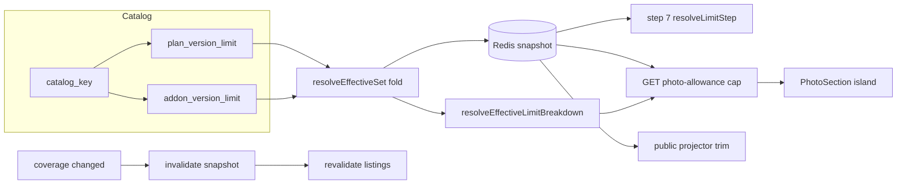

# One listing photo editor with the effective photo cap

> Smoke gate: this spec carries `status-needs-smoke-staging`. It adds two add-on
> products and changes what a published gallery shows after a plan or add-on
> change, so the staging part of `docs/billing/smoke-checklist.md` must be run
> (buy the new venue pack in the MercadoPago sandbox, see the cap move, let it
> expire or cancel it, see photos hide). No billing CORE flow changes
> (checkout, webhooks, crons, refunds stay as they are), so the production
> section is not required.

## Part 1: Functional Specification

### Overview & Goals

Accommodation, venue and experience owners manage their photos in two different
editors today, with two different caps:

- Accommodation (`apps/web/src/components/host/editor/PhotoSection.client.tsx`)
  reads the plan cap from the effective set (`useMyEntitlements(...).limit('max_photos_per_accommodation')`),
  supports reorder (buttons + drag), cover promotion, alt/caption/description/credit,
  and delete with confirm. The server enforces the cap through step 7 of
  `resolveListingAccess` (`apps/api/src/utils/listing-access/photo-limit.ts:4-15`).
- Venue and experience (`apps/web/src/components/listing/editor/MediaSection.client.tsx`,
  `use-listing-media.ts`, `use-listing-media-upload.ts`) show a flat literal cap
  (`getGalleryCap(vertical)` = 30, `apps/web/src/components/listing/editor/use-listing-media.ts:78`),
  have no reorder and no cover promotion in the UI, surface raw API messages via
  `visibleApiMessage` (`use-listing-media.ts:175,211,257`), and the server
  declares no photo limit at all (`apps/api/src/routes/venue/protected/addMedia.ts:43`,
  `apps/api/src/routes/experience/protected/addMedia.ts:43`).
- On top of the plan cap, every listing vertical is also cut by a literal ceiling
  (`ENTITY_GALLERY_CAPS`, `packages/schemas/src/common/media-upload.schema.ts:32-39`):
  accommodation 50, venue 30, experience 30. A Premium accommodation (50) with one
  `extra-photos-20` pack (effective 70) is refused at 51 by that literal.

This spec makes the three verticals handle photos exactly the same, in ONE shared
component, against ONE number: the listing owner's **effective** photo limit, as
`@repo/verticals` folds it (plan + every live add-on + courtesy/permanent grants,
`packages/verticals/src/effective-set/resolve-effective-set.ts:126-204`), enforced
server-side by step 7 and displayed with its breakdown.

- **Goal**: one photo editor for the three listing verticals; one cap per listing,
  the effective limit; photos over the cap hidden publicly, reversibly.
- **Motivation**: owner decision 2026-11-26. Absorbs HOS-2442 ("Cargando tu límite…"
  never ends without a plan; raw "Entitlement required" on delete) for venue and
  experience, and builds on the HOS-2489 visual layer already in staging
  (`git log`: `b36d774358 [HOS-2489] feat(web): mi cuenta phase 4 photos…`,
  plus `bedc5268d9` and `84bb50d2aa`, which already fixed the no-plan and
  failed-read states for accommodation only).
- **Success metrics**:
  - Zero listing-vertical gallery writes refused by a literal constant.
  - Zero raw English API messages rendered in any photo editor (AC-10).
  - The number shown in the editor equals the number step 7 enforces, for every
    vertical and every coverage state (AC-4, AC-5, AC-9).
- **Target users**: accommodation hosts, venue owners, experience owners.

### Definitions (normative)

- **Gallery photo**: a `*_media` row with `state = 'visible'`, `is_featured = false`,
  `deleted_at IS NULL`.
- **Cover**: the single row with `is_featured = true` (`state = 'visible'`).
- **Photo limit key** per vertical (new constant `LISTING_PHOTO_LIMIT_KEY_BY_VERTICAL`,
  `packages/schemas/src/catalog/listing-photo-limit.ts`):
  `accommodation → max_photos_per_accommodation`, `venue → max_photos_per_venue`,
  `experience → max_photos_per_experience`.
- **Effective cap (N)** of a listing: what step 7 reads for its key —
  `effective.limits.get({ key, userId: ownerId, vertical })`, falling back, only for
  a DRAFT of a pre-trial owner, to `resolvePreTrialDraftLimits`, and to `0` otherwise
  (`packages/verticals/src/authorization/limit-step.ts:35`,
  `resolve-listing-access.ts:296-320`). Never recomputed outside `@repo/verticals`.
- **Unlimited**: a limit value `>= UNLIMITED_LIMIT_VALUE` (2147483647,
  `packages/schemas/src/catalog/unlimited-limit.ts:10-23`). Note: the brief called
  this the "-1 sentinel"; `-1` exists only in the legacy, unused
  `AccommodationPhotoExcessSchema` (`packages/schemas/src/api/billing/downgrade-preview.schema.ts:135`)
  and in an outdated JSDoc. `plan_version_limit.value` has `CHECK (value >= 0)`,
  so `-1` can never come from the catalog. This spec uses `isUnlimitedLimit`.
- **Cover counting rule** (kept from accommodation, HOS-791): the cover NEVER counts
  toward N. N is the number of gallery photos allowed. Step 7 asks
  `requested = visibleNonFeatured + 1` for a gallery write
  (`photo-limit.ts:14`) and `requested = 1` for a cover write
  (`apps/api/src/routes/accommodation/protected/addFeaturedMedia.ts:79`), so adding a
  cover requires `N >= 1`, and a listing at cap N shows N gallery photos + 1 cover.
- **Within cap / over cap**: the public gallery is the composed `media.gallery`
  (approved, visible, non-featured, `sort_order ASC`; `packages/service-core/src/services/listing/listing-media-compose.ts:122-160`,
  `accommodation.media-compose.ts:117-160`). The first N items are *within cap*;
  the rest are *over cap*. The editor applies the same rule to the same set
  (approved, visible, non-featured rows in `sort_order`). Rows that are PENDING or
  REJECTED are never public and never marked over cap; they keep their moderation
  badge.

### User Stories & Acceptance Criteria

#### US-1: Upload up to my effective cap, in any vertical

**As an** owner of an accommodation, venue or experience, **I want** to upload photos
up to the number my plan, packs and grants give me, **so that** I use what I pay for
and nothing more is silently cut.

- **AC-1 (accommodation regression)** — **Given** a host whose effective
  `max_photos_per_accommodation` is 15 and whose listing has 14 gallery photos,
  **When** they upload one gallery photo, **Then** `POST /api/v1/protected/media/upload-entity`
  and `POST /api/v1/protected/accommodations/{id}/media` succeed; **and When** they
  try a 16th, **Then** the API answers 403 `LIMIT_REACHED` with
  `details: { limitKey: 'max_photos_per_accommodation', currentCount: 15, maxAllowed: 15 }`
  and the editor had already disabled the gallery dropzone and shows the localized
  cap-reached line (`host.properties.editor.photo.galleryCapReached`).
- **AC-2 (venue)** — **Given** a venue owner on `venue-basico` (effective
  `max_photos_per_venue` 15) with 14 gallery photos, **When** they upload one,
  **Then** it is stored; **When** they try a 16th through either
  `POST /api/v1/protected/media/upload-entity` (`entityType=venue`, `role=gallery`)
  or `POST /api/v1/protected/venues/{id}/media`, **Then** the API answers 403
  `LIMIT_REACHED` with `limitKey: 'max_photos_per_venue'`, `currentCount: 15`,
  `maxAllowed: 15`, and no Cloudinary asset is created for the refused upload.
- **AC-3 (experience)** — Same as AC-2 with `experience-basico`,
  `max_photos_per_experience`, `/api/v1/protected/experiences/{id}/media` and
  `entityType=experience`.
- **AC-4 (cap = plan + add-ons + grants)** — **Given** a venue owner on `venue-pro`
  (30) with one active `extra-photos-venue-20` add-on, **When** the editor loads,
  **Then** the cap shown is 50 and the 50th gallery photo is accepted while the 51st
  is refused (403 `LIMIT_REACHED`, `maxAllowed: 50`); **Given** two active packs,
  **Then** the cap is 70 (`SUM` fold, `packages/verticals/src/effective-set/fold.ts:310-315`);
  **Given** a permanent grant or a courtesy anchored to a plan that grants 30 and no
  subscription, **Then** the cap is 30 from that source; the same numbers hold for
  `experience` and for `accommodation` (`extra-photos-20`).
- **AC-5 (breakdown equals total)** — **Given** any owner and listing, **When**
  `GET /api/v1/protected/{accommodations|venues|experiences}/{id}/photo-allowance`
  answers with a non-null `breakdown`, **Then** the sum of its finite contribution
  values equals `cap` exactly (or, when any contribution is `unlimited`, `status` is
  `UNLIMITED`), and the editor renders the same contributions (e.g.
  "30 de tu plan + 20 de packs de fotos = 50"). **Given** the breakdown's fresh fold
  disagrees with the cap step 7 reads (cached snapshot), **Then** the endpoint returns
  `breakdown: null`, logs `warn` with `{ vertical, listingId, cap, breakdownTotal }`,
  and the editor shows the total alone, never a breakdown that does not add up.

#### US-2: Understand my cap when I have no plan, a trial, or a draft

**As an** owner without a plan, in a trial, or writing a draft before the trial,
**I want** the editor to tell me exactly what I can do, **so that** I am never stuck
on an endless loading line or a raw error.

- **AC-6 (no plan)** — **Given** an owner whose effective set carries no photo key
  for the vertical and whose listing is not a pre-trial DRAFT, **When** the editor
  loads, **Then** the allowance answers `status: 'NONE'`, `cap: 0`; the description
  shows the vertical's no-plan copy with a link to the vertical's pricing page
  (`PRICING_PAGE_PATH_BY_AUDIENCE.owner|venue|experience`,
  `apps/web/src/lib/pricing-plans.ts:42-47`); "Cargando tu límite de fotos…" is not
  in the DOM once the request settled; the upload controls are disabled; existing
  photos stay listed.
- **AC-7 (failed read)** — **Given** the allowance request fails (network or 5xx),
  **Then** the editor shows the neutral "No pudimos cargar tu límite de fotos…" line,
  never the no-plan copy, and the upload controls stay disabled.
- **AC-8 (trial)** — **Given** a venue owner in an active trial (no subscription),
  **When** the editor loads, **Then** the cap is the trial's value for
  `max_photos_per_venue` (15 today: the lowest-rank sellable version, per
  `resolveTrialValues`), and the breakdown names the trial as the only contribution;
  **Given** that owner subscribes to `venue-pro`, **Then** the trial stops
  contributing (`packages/verticals/src/effective-set/plegable.ts:420-438`) and the cap
  is 30.
- **AC-9 (pre-trial draft)** — **Given** a pre-trial venue owner (TRIAL source with
  `since = 'NOT_STARTED'`, no live title) with a DRAFT venue, **When** they upload a
  cover and gallery photos, **Then** step 7 accepts up to the trial's cap (15) through
  `PRE_TRIAL_DRAFT_LIMIT_KEYS_BY_VERTICAL` (now listing the venue and experience keys),
  the allowance answers `source: 'PRE_TRIAL_DRAFT'`, `cap: 15`, and the breakdown has
  one contribution of kind `PRE_TRIAL_DRAFT`; **Given** the same owner's listing is
  not a DRAFT, **Then** the cap is 0 (`status: 'NONE'`).
- **AC-10 (raw errors never shown)** — **Given** any media operation (upload, add,
  add cover, set cover, reorder, update metadata, delete) in any of the three
  verticals answers 403 `ENTITLEMENT_REQUIRED` (including `reason: 'NO_COVERAGE'`)
  or 403 `LIMIT_REACHED`, **When** the editor renders the failure, **Then** it shows
  the localized message from `translateApiError` (`apps/web/src/lib/api-errors.ts:52-66`)
  — `common.apiError.ENTITLEMENT_REQUIRED` / `LIMIT_REACHED` or the per-key
  `billing.limit.<key>.*` copy — and the strings `Entitlement required` and
  `Limit reached` never appear in the DOM.

#### US-3: Edit my photos the same way in every vertical

**As a** venue or experience owner, **I want** the same reorder, cover, metadata and
delete tools hosts have, **so that** I can present my listing well.

- **AC-11 (reorder)** — **Given** a venue or experience with ≥ 2 gallery photos,
  **When** the owner drags a photo or uses the move up / move down buttons,
  **Then** the editor calls `listingMediaApi.reorderMedia` with the featured id first
  (`buildReorderPayload`, `apps/web/src/components/host/editor/photo-section-helpers.ts:288-296`),
  the new order persists after reload, and a failed call rolls the UI back with a
  localized error. Reorder is never refused by the cap, also when over cap.
- **AC-12 (metadata and cover)** — **Given** a venue or experience photo, **When**
  the owner edits alt, caption, description or credit, **Then** `updateMedia`
  persists them with the same validation as accommodation
  (`validatePhotoMetadataFields`); **When** the owner promotes a gallery photo to
  cover, **Then** `setFeaturedMedia` runs (no re-upload). Neither is refused by the
  cap (EDIT declares no limit), also when over cap; the previous cover returns to the
  gallery and may then be over cap (it is marked, never refused).
- **AC-13 (delete with confirm)** — **Given** any photo in any vertical, **When** the
  owner clicks delete, **Then** the shared confirm dialog
  (`photoRemovalConfirmRequest`, `apps/web/src/lib/forms/confirm-photo-removal.ts`)
  opens; Cancel keeps the photo and makes no request; Confirm calls `removeMedia`
  once and removes the tile.

#### US-4: Over-cap photos are hidden, never lost

**As an** owner whose cap dropped (pack expired, downgrade, or day one of the new
venue/experience caps), **I want** my extra photos hidden instead of deleted, **so
that** they come back by themselves when my cap returns.

- **AC-14 (hidden publicly, marked in the editor)** — **Given** a published venue on
  `venue-basico` (cap 15) with a cover and 20 approved gallery photos, **When** a
  guest opens `GET /api/v1/public/venues/slug/{slug}` (and the web detail page),
  **Then** `media.featuredImage` is present and `media.gallery` holds exactly the
  first 15 by `sort_order`; **and** no `venue_media` row changed (`state`,
  `is_featured`, `sort_order`, `archived_at`, `deleted_at` identical before and
  after); **and** the editor shows the 5 remaining tiles with the badge
  "No se muestra: superás tu tope" and keeps their reorder, metadata, cover and
  delete controls enabled; **When** the owner moves a hidden photo into the first 15,
  **Then** after the purge it is public and the photo pushed to position 16 is hidden.
- **AC-15 (reappear when the cap returns)** — **Given** the listing of AC-14, **When**
  the owner buys `extra-photos-venue-20` (cap 35) and the coverage-changed notice
  fires, **Then** the public payload shows all 20 gallery photos and the editor marks
  none; **When** the pack expires (`expire-addon-instances.service.ts` emits the
  notice), **Then** 5 are hidden again. No row is written in either transition.
- **AC-16 (unlimited)** — **Given** an owner whose effective photo limit is
  unlimited, **When** the editor loads, **Then** the allowance answers
  `status: 'UNLIMITED'`, `cap: null`; the description reads "Sin límite"
  (`listingPhotos.unlimited`), no "máx. N" is rendered, the dropzone never reports
  "full", and the public gallery is not trimmed. `resolveEffectiveGalleryCap`
  no longer treats a huge or non-positive value as "unresolved".
- **AC-19 (cover rule)** — **Given** any listing, **Then** the public cover is always
  present when a cover row is approved, including when N = 0; the cover never counts
  toward N; adding or replacing a cover requires N ≥ 1 (403 `LIMIT_REACHED` with
  `requested: 1` otherwise), in all three verticals.

#### US-5: The platform stays consistent

- **AC-17 (literal ceiling removed for listings)** — **Given** an accommodation owner
  on `owner-premium` (50) with one `extra-photos-20` pack (70), **When** they upload
  gallery photos 51 to 70, **Then** every one succeeds through both
  `upload-entity` and `addMedia`; no listing-vertical path answers
  `GALLERY_LIMIT_EXCEEDED` (422) or service `QUOTA_EXCEEDED` for a gallery count;
  **and** destination (20), event (10) and post (15) galleries keep their literal
  caps exactly as today.
- **AC-18 (cache purge)** — **Given** a coverage-changed notice for
  `{ userId, vertical ∈ accommodation|venue|experience }`, **When** the new listener
  handles it, **Then** it first invalidates the user's effective-set snapshots
  (`invalidateEffectiveSetsForUser`), then calls
  `getListingPublicationPorts().afterCommit.revalidate({ vertical, listingIds })` with
  the ids of every non-deleted PUBLISHED listing of that owner in that vertical,
  which evicts the API memory cache prefixes and schedules the edge revalidation
  (`apps/api/src/utils/listing-publication/ports.ts:312-349`); a failure is logged
  and never thrown into the emitter.
- **AC-20 (one component)** — **Given** the two pages
  `apps/web/src/pages/[lang]/mi-cuenta/propiedades/[id]/editar/fotos.astro` and
  `.../mi-cuenta/comercio/[vertical]/[id]/editar/fotos.astro`, **Then** both render
  `PhotoSection` from `apps/web/src/components/host/editor/PhotoSection.client.tsx`
  with `{ vertical, listingId }`; `MediaSection.client.tsx`, `use-listing-media.ts`,
  `use-listing-media-upload.ts`, `listing-media-upload.ts` and
  `media-section-helpers.ts` no longer exist (a static test asserts no import of them
  remains).
- **AC-21 (catalog)** — **Given** migrations and seed data-migrations applied from an
  empty database and on a database at staging's current state, **Then**
  `catalog_key` holds `max_photos_per_venue` and `max_photos_per_experience`
  (`kind=limit`, `scope=vertical`, `SUM`, `ARCHIVE`, `COMMERCIAL`); every version of
  `venue-basico|pro|premium` and `experience-basico|pro|premium` holds the limit at
  15/30/50; the role plans (`trial`, `pre-trial`, `floor`) of venue and experience
  hold no photo limit (mirroring accommodation, `scripts/production-catalog/catalog.ts:1488-1560`);
  the add-ons `extra-photos-venue-20` and `extra-photos-experience-20` exist with
  `validity = WHILE_SUBSCRIPTION_ALIVE`, `scope_type = VERTICAL_SUBSCRIPTION`, one
  limit row `+20`, price `500000` ARS minor units, `charge_kind = PERIODICO`,
  `cycle = monthly`, `compatible_verticals = {venue}` / `{experience}`; and G3
  (`check-catalog-key-usage`) and G18 (`check-catalog-sql`) are green.
- **AC-22 (effective-set failure on a public read)** — **Given** the owner's
  effective-set lookup throws during a public read, **Then** the gallery is trimmed to
  0 (cover only, fail-closed like every paid field, `deniedSet`,
  `apps/api/src/utils/public-listing-projector.ts:164-209`) **and** the response
  carries `Cache-Control: no-store` in all three verticals (accommodation gains the
  `onEffectiveSetFailure` hook venue already uses,
  `apps/api/src/routes/venue/public/getBySlug.ts:137`).
- **AC-23 (admin)** — **Given** the admin galleries `GalleryManager.tsx`
  (`apps/admin/src/features/accommodations/components/GalleryManager.tsx:90`) and
  `ListingGalleryManager.tsx` (`apps/admin/src/features/listing/components/ListingGalleryManager.tsx:166`),
  **Then** they show the photo count without a "/N" literal and never block an upload
  client-side for a listing vertical; `ContentGalleryManager.tsx` keeps its literal
  caps for destination/event/post.
- **AC-24 (session-blind pages)** — **Given** `apps/web/test/pages/cacheable-pages-are-session-blind.guard.test.ts`,
  **Then** it stays green: neither `fotos.astro` page reads the allowance, the
  effective set or the session server-side; the cap is fetched by the client island.

### UX Considerations

- **User flows**
  1. Owner opens Fotos → island mounts → `GET …/media` (rows) and
     `GET …/photo-allowance` in parallel → description resolves to one of
     *loading / limited (with breakdown) / unlimited / none / failed*.
  2. Upload (file picker, drag & drop onto the cover slot or the grid) → batch
     checked up front against `remaining = cap - used` (unchanged
     `buildCapExceededOnSelectMessage`) → sequential uploads → allowance refetched
     after the batch settles.
  3. Reorder / cover / metadata / delete → optimistic, rollback on failure,
     allowance-derived marking recomputed client-side with `partitionGalleryByCap`
     after every reorder/delete/cover change; allowance refetched after delete and
     cover change (they change `used`).
- **States of the description line** (`PhotoSectionDescription.client.tsx`):
  | State | Condition | Copy (es) |
  |---|---|---|
  | Loading | allowance in flight | "Cargando tu límite de fotos…" |
  | Limited | `status: 'LIMITED'` | per vertical: "Subí hasta {{cap}} fotos de tu …" + breakdown line "{{plan}} de tu plan + {{addons}} de packs de fotos …" |
  | Unlimited | `status: 'UNLIMITED'` | "Sin límite de fotos" |
  | None | `status: 'NONE'` | per vertical no-plan copy + "Ver planes" link to that vertical's pricing page |
  | Failed | request failed | "No pudimos cargar tu límite de fotos. Probá recargar la página." |
- **Over-cap tile**: badge "No se muestra: superás tu tope" (es), "Not shown: over your limit" (en),
  "Não aparece: você passou do seu limite" (pt); tile dimmed via a CSS Module class,
  never `display:none`; screen readers read the badge through the tile's accessible
  description (`aria-describedby`).
- **Over-cap summary**: when `hiddenCount > 0`, an inline `Alert` (`@/components/account/ui`)
  above the grid: "{{count}} fotos no se muestran porque superás tu tope. Sumá un pack
  de fotos o reordená para elegir cuáles se ven." with the existing `capUpsell` link
  when present. Plural via `tPlural`.
- **Edge cases**: cap 0 with existing photos (all over cap, all editable); cap drop
  while the editor is open (next allowance refetch updates marking); a PENDING photo
  in the first N positions does not consume a public slot (the public list is
  approved-only) and is never marked over cap.
- **Error states**: every failure goes through `translateApiError`; `LIMIT_REACHED`
  on upload uses `billing.limit.<limitKey>.*` through `buildLimitReachedPayload*`
  (`apps/web/src/lib/billing-limit-error.ts`) where a toast is shown today.
- **Loading states**: upload disabled until the allowance settles (same as
  `PhotoSection.client.tsx:322,337` today).
- **Accessibility**: drag sensors keep keyboard support (`SortablePhotoGallery`);
  move buttons stay; the badge is text, not color alone; `aria-busy` on the
  description while loading.
- **Styling and i18n**: CSS Modules only (`PhotoSection.module.css`), no Tailwind in
  web; every string in es/en/pt.

### Out of Scope

- **HOS-2659**: the owner choosing WHICH photos are hidden (other than by reordering).
- **Videos**: `VideoSection` / `ListingVideoWidget` stay exactly as today.
- **Admin plan cap**: admin venue/experience media routes keep declaring no limit;
  admin accommodation routes keep the owner's step 7 as today (see "Admin facts").
- **Changing step 6 for EDIT**: a no-plan owner on a PUBLISHED or
  UNPUBLISHED_BY_BILLING listing still gets 403 `ENTITLEMENT_REQUIRED` on media
  writes (`OPERATION_STEP6_KEY.EDIT`, `packages/verticals/src/authorization/listing-operation.ts:124-131`).
  This spec only translates it (AC-10). See OQ-2.
- **Archiving rows**: the `ARCHIVE` enforcement strategy of the photo keys stays
  declarative; nothing writes `state = 'archived'` on a cap drop.
- **The legacy `AccommodationPhotoExcessSchema`** (no consumer): untouched.
- **The add-on purchase flow**: unchanged; multiple packs SUM through the existing fold.
- **The upload rate limit** (`PROTECTED_ENTITY_UPLOAD_RATE_LIMIT_MAX`): keeps its
  value 51/min (see OQ-5); it only stops deriving from the removed constants.

## Part 2: Technical Analysis

### Architecture

- **Pattern**: one resolver (`@repo/verticals`), one enforcement point (step 7 via
  the listing-access middleware), one read model (`photo-allowance`), one pure
  partition rule (`partitionGalleryByCap` in `@repo/schemas`) used by the public
  projector and the editor, one React component over a per-vertical media API adapter.

- **Components**

| Layer | New / modified | Path |
|---|---|---|
| schemas | new keys | `packages/schemas/src/catalog/limit-keys.ts` (ROWS), `key-enums.ts` (`LimitKeyEnum.MAX_PHOTOS_PER_VENUE`, `MAX_PHOTOS_PER_EXPERIENCE`) |
| schemas | new | `packages/schemas/src/catalog/listing-photo-limit.ts`: `LISTING_PHOTO_LIMIT_KEY_BY_VERTICAL`, `partitionGalleryByCap` |
| schemas | new | `packages/schemas/src/api/listing/listing-photo-allowance.schema.ts`: `ListingPhotoAllowanceSchema` |
| schemas | modified | `packages/schemas/src/common/media-upload.schema.ts`: `ENTITY_GALLERY_CAPS` keeps only `destination`, `event`, `post` |
| verticals | refactor | `resolve-effective-set.ts`: extract `collectFoldableSources` (no behaviour change) |
| verticals | new | `packages/verticals/src/effective-set/limit-breakdown.ts`: `resolveEffectiveLimitBreakdown` |
| verticals | modified | `authorization/pre-trial-draft-limit.ts:42-44`: add venue/experience keys |
| api | modified | `utils/listing-access/photo-limit.ts`: `listingGalleryPhotoLimit` + `listingCoverPhotoLimit` per vertical |
| api | new | `utils/listing-access/photo-allowance.ts`: `resolveListingPhotoAllowance` |
| api | new | `routes/{accommodation,venue,experience}/protected/getPhotoAllowance.ts` |
| api | modified | venue/experience protected `addMedia.ts`, `addFeaturedMedia.ts`; `routes/media/protected/upload-entity.ts`; `routes/media/admin/upload.ts`; `routes/media/admin/import-stock.ts` |
| api | modified | `utils/public-listing-projector.ts`, `utils/public-accommodation-projection.ts`, accommodation public routes (no-store hook) |
| api | new | `utils/listing-media/gallery-coverage-revalidation.ts` + wiring in `apps/api/src/index.ts:365-369` |
| service-core | modified | `accommodation.service.ts:3653-3688`, `venue/venue.media.ts:158-191`, `experience/experience.media.ts:~166-199`: drop the `getGalleryCap` gallery check |
| db/seed | new migration | `packages/db/src/migrations/0253_hos2495_listing_photo_keys_and_packs.sql` (next free number at spec time) |
| seed | new data-migration | `packages/seed/src/data-migrations/0194-hos-2495-listing-photo-limits-grant.ts` (next free number) + constant in `packages/seed/src/catalog/next-version-entitlements.ts` |
| scripts | modified | `scripts/production-catalog/commercial-catalog.ts` (`PRODUCTION_ADDON_CATALOG`), `scripts/production-catalog/catalog.ts` (re-export block) |
| web | new | `apps/web/src/lib/api/listing-photo-api.ts`: `createListingPhotoApi({ vertical })` |
| web | modified | `PhotoSection.client.tsx`, `use-photo-section.ts`, `use-photo-gallery-mutations.ts`, `SortablePhotoGallery.client.tsx`, `PhotoSectionDescription.client.tsx`, `photo-section-helpers.ts`, `PhotoSection.module.css` |
| web | modified | both `fotos.astro` pages |
| web | deleted | `components/listing/editor/{MediaSection.client.tsx,use-listing-media.ts,use-listing-media-upload.ts,listing-media-upload.ts,media-section-helpers.ts}` |
| admin | modified | `GalleryManager.tsx`, `ListingGalleryManager.tsx` |
| i18n | modified | `packages/i18n/src/locales/{es,en,pt}/{billing,account}.json` |

- **Integration points**
  - Step 7 through `listingAccess.limit` (the middleware passes `preTrialDraftLimits`
    and the cached `effectiveSet` port, `apps/api/src/utils/listing-access/ports.ts:76-93`).
  - The public projector already reads one effective set per owner
    (`readOwnerEffectiveSets`, `public-listing-projector.ts:180-209`); the gallery
    trim reuses that same map: no extra lookups.
  - The coverage-changed registry (`apps/api/src/utils/listing-access/coverage-notices.ts`),
    already used by `subscribeListingFeaturedSync` and the partner revalidation.

- **Data flow**



#### Admin facts (verified, stated for reviewers)

- `POST /api/v1/admin/accommodations/{id}/media` declares
  `limit: accommodationGalleryPhotoLimit` (`apps/api/src/routes/accommodation/admin/addMedia.ts:61-66`)
  and `admin/addFeaturedMedia.ts:58-63` declares `requested: 1`; with an admin actor
  the subject is the listing owner (`apps/api/src/middlewares/listing-access.ts:249-261`),
  so admin accommodation writes ARE capped by the owner's effective cap. The admin
  upload does the same for accommodation galleries
  (`apps/api/src/routes/media/admin/upload.ts:404-427`).
- `venue/admin/addMedia.ts:35`, `venue/admin/addFeaturedMedia.ts:58` and
  `experience/admin/addMedia.ts:35` declare no limit.
- This spec keeps both as they are (out of scope), removes only the literal
  `getGalleryCap` check for listing verticals on the admin upload
  (`upload.ts:441-467`) and stock import (`import-stock.ts:~150-170`), so staff are
  not cut at 50/30 either.

### Data Model Changes

No structural change (no table, column, index, enum or FK). Only reference rows.

| Table | Change | Carril | Description |
|---|---|---|---|
| `catalog_key` | 2 rows | versioned migration, generated (G18) | `max_photos_per_venue`, `max_photos_per_experience` |
| `addon`, `addon_version`, `addon_version_limit`, `addon_product` | 2 add-ons | versioned migration, generated (G18) | `extra-photos-venue-20`, `extra-photos-experience-20` |
| `plan_version_limit` | 1 row per version of 6 plans | seed data-migration, bounded additive-grant lane (`hospeda.catalog_additive_grant = 'HOS-2495'`, extras 041) | 15/30/50 on every version of the venue and experience sellable plans |

**Migrations needed**: yes, two artifacts.

1. `packages/db/src/migrations/0253_hos2495_listing_photo_keys_and_packs.sql`
   (number = next free at implementation; 0252 is the last today). Created as a
   custom drizzle migration (`pnpm --filter @repo/db db:generate -- --custom
   --name=hos2495_listing_photo_keys_and_packs`, which writes the journal entry and
   snapshot like 0251), then filled with ONLY the new rows printed by
   `pnpm gen:catalog-sql --load=catalog_key` and the five add-on loads
   (`--load=addon`, `addon_version`, `addon_version_limit`, `addon_product`;
   `addon_version_entitlement` has no new row). Order in the file: `catalog_key`
   first (FK of `addon_version_limit.key`), then `addon`, `addon_version`,
   `addon_version_limit`, `addon_product`, each a separate statement
   (`--> statement-breakpoint`), because extras 041 accepts an `addon_version_limit`
   only under an `addon_version` inserted by an EARLIER statement of the same
   transaction. G18 is cumulative, so the file carries only the delta.
   Header comment like 0251/0176: generated by `scripts/generate-catalog-sql.ts`,
   GUARD:G18.
2. `packages/seed/src/data-migrations/0194-hos-2495-listing-photo-limits-grant.ts`
   (number = next free; 0193 is the last today), modelled on
   `0191-hos-2589-promotion-keys-grant.ts`: `meta = { name, group: 'required',
   destructive: false, contentOnly: true }`; reads
   `PRODUCTION_PLAN_LISTING_PHOTO_LIMIT_GRANTS` (new, in
   `packages/seed/src/catalog/next-version-entitlements.ts`) shaped
   `readonly { vertical: 'venue'|'experience'; slug: string; limit: { key; value } }[]`
   = venue-basico 15, venue-pro 30, venue-premium 50, experience-basico 15,
   experience-pro 30, experience-premium 50; sets
   `set_config('hospeda.catalog_additive_grant', 'HOS-2495', true)`, inserts one
   `plan_version_limit` per `(plan_version of that plan, key)` that does not exist,
   resets the setting, returns counts. Why every version and a data-migration, not a
   new plan version: subscriptions, trials (their `floor.limitsVersionId`), courtesies
   and permanent grants anchor environment-specific version ids; a new version would
   leave every live owner without the key (cap 0 → every gallery hidden on day one).
   Same reasoning as 0191 (`packages/seed/src/data-migrations/0191-hos-2589-promotion-keys-grant.ts:1-15`).
   The constant is re-exported from the `export { … } from '../../packages/seed/src/catalog/next-version-entitlements.js'`
   block of `scripts/production-catalog/catalog.ts` (as HOS-2589 did) so the catalog
   source stays the one place to read the whole catalog.

**Seed dual-write**: no baseline fixture under `packages/seed/src/data/**` changes, so
`scripts/check-seed-dual-write.sh` has nothing to pair; `contentOnly: true` makes a
fresh database run the migration for real instead of baseline-stamping it.

**Prices (G7)**: the add-on price lives only in
`scripts/production-catalog/commercial-catalog.ts` (`limitPack({ …, monthlyPesos: 5_000 })`,
the same value as `extra-photos-20`, `commercial-catalog.ts:181-189`) and in the
generated SQL. No price constant enters `packages/payments/src` or
`packages/service-core/src/services/billing` (G7 roots,
`scripts/check-commercial-values-in-code.ts:9`).

**Run order on a live env**: `db:migrate` (keys + add-ons) → `db:apply-extras` →
`db:seed:migrate` (plan grants). The data-migration needs the keys (FK), which the
schema carril ADDS first, so the run order is correct (no HOS-433 split needed).

**Rollout order constraint**: the code that trims public galleries for venue and
experience must not reach an environment before 0194 ran there, or every venue and
experience gallery shows cover only. Both ship in the same PR and the same deploy;
the deploy runs `db:seed:migrate` before traffic (existing hops flow). R-1 covers it.

### API Design

#### GET /api/v1/protected/accommodations/{id}/photo-allowance (and `/venues/{id}/…`, `/experiences/{id}/…`)

- **Auth**: user session. `listingAccess: { vertical, operation: 'READ_OWN', idParam: 'id' }`
  (no step 5/6, so a no-plan owner gets an answer, not a 403), same shape as
  `apps/api/src/routes/accommodation/protected/sectionStates.ts:18-35`.
  `emailUnverifiedOperation: 'READ_OWN'`.
- **Request**: path `id` (`AccommodationIdSchema` / venue / experience id schema). No body.
- **Response** (`ListingPhotoAllowanceSchema`):

```ts
{
  limitKey: 'max_photos_per_accommodation' | 'max_photos_per_venue' | 'max_photos_per_experience';
  status: 'LIMITED' | 'UNLIMITED' | 'NONE';
  /** Gallery photos allowed. `null` when UNLIMITED; `0` when NONE. */
  cap: number | null;
  /** Where the cap came from: the effective set, or the pre-trial DRAFT fallback. */
  source: 'EFFECTIVE_SET' | 'PRE_TRIAL_DRAFT';
  /** Visible non-featured rows (any moderation state): what step 7 counts. */
  used: number;
  /** Approved visible non-featured rows beyond `cap`: what the public does not show. */
  hiddenCount: number;
  /** Whether a cover may be added or replaced (cap >= 1 or UNLIMITED). */
  coverAllowed: boolean;
  breakdown: {
    contributions: ReadonlyArray<{
      kind: 'PLAN' | 'TRIAL' | 'ADDON' | 'COURTESY' | 'PERMANENT_GRANT' | 'BASE' | 'PRE_TRIAL_DRAFT';
      /** Sum of this kind's sources, or 'unlimited'. */
      value: number | 'unlimited';
      /** How many sources of this kind contributed (e.g. 2 packs). */
      sources: number;
    }>;
  } | null;
}
```

  Kind mapping from `CoverageSource.type` (`packages/billing-verticals-contract/src/coverage.schema.ts:23-30`):
  `SUBSCRIPTION → PLAN`, `TRIAL → TRIAL` (a `NOT_STARTED` trial resolves its plan
  version like a BASE and maps to `BASE`), `ADDON → ADDON`, `COURTESY → COURTESY`,
  `GRANT → PERMANENT_GRANT`, `BASE → BASE`. Contributions with value 0 are omitted.
  Order: PLAN, TRIAL, COURTESY, PERMANENT_GRANT, ADDON, BASE, PRE_TRIAL_DRAFT.
- **Computation** (`resolveListingPhotoAllowance`, api util):
  1. `cap` = exactly what step 7 would use for a gallery write on this listing:
     `ports.effectiveSet(...)` → `limits.get(...)`; if absent and the listing is a
     DRAFT and `isPreTrialDraftLimitKey`, `ports.preTrialDraftLimits(...)`; else 0.
     Reuses `resolveLimitStep`'s inputs; does not re-fold.
  2. `used` = `count(visible, isFeatured=false, deletedAt=null)` via the vertical's
     media model (same as `listingGalleryPhotoLimit`).
  3. `hiddenCount` = `partitionGalleryByCap({ items: approvedVisibleGallery, cap }).hidden.length`.
  4. `breakdown` = `resolveEffectiveLimitBreakdown({ …ResolveEffectiveSetArgs, keys: [limitKey] })`
     when `source = 'EFFECTIVE_SET'`; one `PRE_TRIAL_DRAFT` contribution otherwise;
     `null` when its total differs from `cap` (AC-5) or it throws (logged `warn`,
     never a 500).
- **Errors**: 401 unauthenticated; 404 `NOT_FOUND` when the listing does not exist or
  belongs to someone else (never 403, `apps/api/docs/error-contract.md` ownership
  rule); 400 on a malformed id.

**Why a listing-scoped endpoint and not `GET /users/me/effective-set`**
(`apps/api/src/routes/user/protected/effective-set.ts:26-66`):
the cap step 7 enforces depends on the LISTING (DRAFT fallback, pre-trial), and the
editor also needs `used` and `hiddenCount`; the effective-set read is user+vertical,
browser-cached 60 s (`apps/web/src/lib/entitlements-cache.ts:9`) and consumed by every
gate on the site, so adding a fresh (uncached) breakdown fold to it would cost a
coverage resolve on every call for every consumer. The new endpoint is called only by
the photo editor.

#### Modified write routes (step 7 added)

| Route | `listingAccess.limit` |
|---|---|
| `POST /api/v1/protected/venues/{id}/media` | `listingGalleryPhotoLimit(VerticalEnum.VENUE)` → `{ key: 'max_photos_per_venue', requested: used + 1 }` |
| `POST /api/v1/protected/venues/{id}/media/featured` | `listingCoverPhotoLimit(VerticalEnum.VENUE)` → `{ key, requested: 1 }` |
| `POST /api/v1/protected/experiences/{id}/media` | idem with `max_photos_per_experience` |
| `POST /api/v1/protected/experiences/{id}/media/featured` | idem, `requested: 1` |
| `POST /api/v1/protected/media/upload-entity` | `UPLOAD_LISTING_ACCESS` gains `venueGallery`, `venueFeatured`, `experienceGallery`, `experienceFeatured` (`upload-entity.ts:157-181`), mirroring accommodation |

The listing-access config stays a literal object per branch (G2 scans the
`listingAccess:` shape; the vertical is literal per branch,
`upload-entity.ts:149-156`). Accommodation keeps `accommodationGalleryPhotoLimit`'s
behaviour through the generalized helper.

**Error contract** (`apps/api/docs/error-contract.md:59,96-102`): order unchanged
(401 → 403 permission → 400 → 404 → business). Step 7 refusal = 403
`LIMIT_REACHED` `{ limitKey, currentCount, maxAllowed }`
(`apps/api/src/middlewares/listing-access.ts:466-471`). Listing-vertical uploads no
longer return 422 `GALLERY_LIMIT_EXCEEDED`; content entities still do. Services no
longer return `QUOTA_EXCEEDED` for a listing gallery count.

#### Public reads (trim)

`projectPublicListings` (venue, experience) and `projectPublicAccommodationPage`
(accommodation) gain one step after `projectPublicListing`: when the projected record
has `media.gallery` (array), replace it with
`partitionGalleryByCap({ items: media.gallery, cap }).shown`, where
`cap = effective.limits.get({ key: LISTING_PHOTO_LIMIT_KEY_BY_VERTICAL[vertical], userId: ownerId, vertical }) ?? 0`
from the map `readOwnerEffectiveSets` already built (no new lookup, no DRAFT fallback:
public listings are published). `featuredImage` is never touched. Every public route
already calling those functions is covered (accommodation: `getById`, `getBySlug`,
`getByDestination`, `getTopRatedByDestination`, `similar`, user/feature/destination
accommodation lists; venue and experience: `getById`, `getBySlug`, `getByDestination`,
`list`; also the protected venue `brochure`). Accommodation routes pass
`onEffectiveSetFailure: () => ctx.header('Cache-Control', 'no-store')` like venue.

#### Cache purge

New `subscribeListingGalleryRevalidation()` in
`apps/api/src/utils/listing-media/gallery-coverage-revalidation.ts`, wired in
`apps/api/src/index.ts` next to `subscribeListingFeaturedSync()` (line 367) and
unsubscribed in the same shutdown path. On every `CoverageChangedEvent` whose
`vertical` is a listing vertical: `await invalidateEffectiveSetsForUser(userId)`
(so the purge cannot be refilled from a stale snapshot; the invalidation listener
`subscribeEffectiveSetCoverageInvalidation` is registered later, line 369, and
listener order is not a contract), then select `id` of the owner's listings in that
vertical with `publication_status = 'PUBLISHED'` and `deleted_at IS NULL`, then
`getListingPublicationPorts().afterCommit.revalidate({ vertical, listingIds })`.
Errors are logged (`apiLogger.error`), never rethrown. In-flight promises are tracked
like `featured-sync-listener.ts:9-22` so tests can drain them.

Triggers that reach it (all existing emitters of `emitCoverageChanged`): subscription
activation/changes/suspension/end, add-on instance creation and expiry
(`packages/service-core/src/services/billing/addon/addon-instance-a2.ts`, `a5`, `a6`,
`expire-addon-instances.service.ts`), courtesy and permanent grant
(`grant-temporary-courtesy.service.ts`, `permanent-grant-s13.ts`,
`permanent-grant-revoke.ts`), trial machine. Delivery is in-process with no durable
retry (DEC-ARCH-009, `coverage-notices.ts` header); the daily coverage reconciler and
the edge TTL are the backstop (R-3).

### Dependencies

**External packages:** none.

**Internal packages affected:**

- `@repo/schemas` — keys, enum, allowance schema, partition rule, `ENTITY_GALLERY_CAPS` shrink.
- `@repo/verticals` — breakdown function, pre-trial draft keys, refactor.
- `@repo/service-core` — remove three literal gallery checks.
- `@repo/db` — one versioned migration (journal + snapshot).
- `@repo/seed` — one data-migration + constant.
- `@repo/i18n` — billing + account strings, three locales.
- `apps/api`, `apps/web`, `apps/admin`.

### Shared web component design

- `createListingPhotoApi({ vertical })` (`apps/web/src/lib/api/listing-photo-api.ts`)
  returns one object with `listMedia`, `addMedia`, `addFeaturedMedia`, `removeMedia`,
  `setFeaturedMedia`, `reorderMedia`, `updateMedia`, `getAllowance`, delegating to
  `accommodationMediaApi` (`endpoints-protected.ts:4866`) or `listingMediaApi`
  (`endpoints-protected.ts:5465`) and normalizing rows to one `ListingPhotoRow`
  (the fields `photo-section-helpers.ts` reads: `id, url, publicId, caption,
  description, alt, attribution, isFeatured, moderationState, sortOrder`).
- `usePhotoSection` / `usePhotoGalleryMutations` take `{ api, vertical, listingId }`
  instead of `accommodationId`; every error path uses `translateApiError` (already
  true for accommodation, `use-photo-gallery-mutations.ts:102,148,201,293,378`).
- `PhotoSectionProps` changes `accommodationId` → `vertical` + `listingId`;
  `publishContext` stays optional (accommodation only).
- `resolveEffectiveGalleryCap` is replaced by `resolveGalleryCapView({ allowance,
  isLoading, failed })` → `{ kind: 'loading'|'limited'|'unlimited'|'none'|'failed', cap }`
  (pure, in `photo-section-helpers.ts`), removing the `> 0` heuristic
  (`photo-section-helpers.ts:113-128`) and the `GALLERY_CAP_PENDING_PLACEHOLDER`
  trick only where no longer needed (kept as the "unlimited/unknown" placeholder for
  `isGalleryFull`).
- `MAX_PHOTOS_LIMIT_KEY` (`photo-section-helpers.ts:66`) is removed; the key comes
  from the allowance (`limitKey`).
- Copy that names the vertical (`host.properties.editor.section.photosDescription*`
  says "de tu propiedad para atraer más huéspedes") moves to
  `account.listingPhotos.description.{accommodation,venue,experience}` (plural forms);
  the rest of `host.properties.editor.photo.*` is vertical-neutral and is reused.

### Testing Strategy

Every AC has at least one test; every new behaviour has a named mutation that a test
must kill (run by the implementer, reported with a non-zero test count).

| AC | Level | File (new or updated) | Mutation to kill |
|---|---|---|---|
| AC-1 | api route + web unit | `apps/api/test/routes/media/protected-upload-entity-listing-access.test.ts`, `apps/web/test/components/host/editor/PhotoSection.plan-cap.test.tsx` | `requested: used + 1` → `used` |
| AC-2/3 | api route | new `apps/api/test/routes/venue/protected/addMedia.photo-limit.test.ts`, `…/experience/protected/addMedia.photo-limit.test.ts`, upload-entity listing-access test | drop `limit` from venue `addMedia` |
| AC-4 | api integration (real DB) | new `apps/api/test/integration/listing-photos/effective-cap.integration.test.ts` (venue-pro + 1 and 2 packs, grant) | change `SUM` fold to `MAX` for the key |
| AC-5 | verticals unit + api unit | new `packages/verticals/test/effective-set/limit-breakdown.test.ts`, `apps/api/test/utils/listing-access/photo-allowance.test.ts` | skip `selectPlegableSources` in breakdown (complement with no title must not appear); return breakdown when totals differ |
| AC-6/7 | web unit | `PhotoSection.plan-cap.test.tsx` (venue + experience cases), `PhotoSectionDescription` test | map `NONE` to loading |
| AC-8 | verticals unit | `limit-breakdown.test.ts` (trial alone; trial + subscription) | keep trial when subscription present |
| AC-9 | verticals + api | `packages/verticals/test/authorization/pre-trial-draft-limit.test.ts`, `resolve-listing-access` tests, allowance test | remove venue from `PRE_TRIAL_DRAFT_LIMIT_KEYS_BY_VERTICAL` |
| AC-10 | web unit | `use-photo-gallery-mutations.entitlement-error.test.tsx` (extend to venue/experience), `apps/web/test/components/editors-upload-refusal.i18n.test.tsx` | swap `translateApiError` for `visibleApiMessage` |
| AC-11/12/13 | web unit | `PhotoSection.drag-reorder.test.tsx`, `PhotoSection.test.tsx`, `PhotoMetadataEditor.test.tsx` parametrized by vertical | adapter routes venue to accommodation API |
| AC-14/15 | api integration + schemas unit | new `apps/api/test/integration/listing-photos/over-cap-public.integration.test.ts`; `packages/schemas/test/catalog/listing-photo-limit.test.ts`; web `SortablePhotoGallery` marking test | `slice(0, cap)` → `slice(0, cap + 1)`; trim `featuredImage` |
| AC-16 | schemas + web unit | `listing-photo-limit.test.ts`, `photo-section-helpers.test.ts` | treat `UNLIMITED_LIMIT_VALUE` as finite |
| AC-17 | service-core + api | `packages/service-core/test/services/accommodation/addMedia.gallery-cap.test.ts`, `venue.media.test.ts`, `experience.media.test.ts`, `apps/api/test/routes/media/gallery-cap-enforcement.test.ts`, `import-stock.test.ts`, `upload-defensive-hardening.test.ts`; `packages/schemas/src/common/__tests__/media-upload.schema.test.ts` | reintroduce `getGalleryCap('venue')` |
| AC-18 | api unit | new `apps/api/test/utils/listing-media/gallery-coverage-revalidation.test.ts` | revalidate before invalidating; include DRAFT listings |
| AC-19 | api route | venue/experience `addFeaturedMedia` tests | `requested: 1` → `0` |
| AC-20 | web static test | new `apps/web/test/static-guards/no-legacy-listing-media-section.test.ts` | — (import of a deleted path) |
| AC-21 | scripts + seed + db integration | `scripts/__tests__/production-catalog-commercial.test.ts` (12 add-ons), `scripts/__tests__/check-catalog-sql.test.ts`, new `packages/seed/test/data-migrations/0194-hos-2495-listing-photo-limits-grant.test.ts` (idempotent, every version, no role plan), `packages/db/test/integration/vertical-catalog-from-empty.test.ts` | grant only the current version |
| AC-22 | api route | venue/experience/accommodation `getBySlug` tests with a throwing effective set | drop the no-store hook from accommodation |
| AC-23 | admin unit | `GalleryManager.test.tsx`, `ListingGalleryManager.test.tsx`, `ContentGalleryManager.test.tsx` (unchanged caps) | keep `/50` |
| AC-24 | web guard | `apps/web/test/pages/cacheable-pages-are-session-blind.guard.test.ts` (unchanged, must stay green) | — |

**Existing tests to update** (they assert literal caps, the old hook, or venue copy):
`apps/web/test/components/host/editor/{PhotoSection.test.tsx,PhotoSection.compression.test.tsx,PhotoSection.plan-cap.test.tsx,PhotoSection.upload-errors.test.tsx,PhotoSection.limit.test.tsx,photo-section-helpers.test.ts,use-photo-section.hydration.test.tsx,use-photo-gallery-mutations.test.tsx}`,
`apps/web/test/components/listing/editor/{MediaSection.test.tsx,MediaSection.compression.test.tsx,MediaSection.metadata.test.tsx,media-section-helpers.test.ts}` (migrated to `PhotoSection` venue/experience cases, then deleted),
`apps/web/test/components/account/editor/gallery-cap-interpolation.test.tsx`,
`apps/web/test/components/editors-upload-refusal.i18n.test.tsx`,
`apps/web/test/lib/media/upload-entity.test.ts`, `apps/web/test/lib/media/upload-entity-error.test.ts`,
`apps/web/test/lib/billing-limit-key-i18n-coverage.guard.test.ts` (new keys),
`apps/api/test/utils/listing-access/photo-limit.test.ts`,
`apps/api/test/routes/media/{protected-upload-entity.test.ts,protected-upload-entity-listing-access.test.ts,gallery-cap-enforcement.test.ts,upload-defensive-hardening.test.ts}`,
`apps/api/test/routes/media/admin/import-stock.test.ts`,
`packages/service-core/test/services/{accommodation/addMedia.gallery-cap.test.ts,accommodation/addFeaturedMedia.test.ts,venue/venue.media.test.ts,venue/venue.featured-media.test.ts,experience/experience.media.test.ts,experience/experience.featured-media.test.ts}`,
`packages/schemas/src/common/__tests__/media-upload.schema.test.ts`,
`packages/i18n/test/{media-error-keys.test.ts,translate-api-error.test.ts}`,
`apps/admin/src/features/{accommodations,listing}/components/__tests__/*GalleryManager.test.tsx`,
`scripts/__tests__/helpers/help-lock-fixture.ts` (only if the help lock enumerates limit keys),
any frozen count of limit keys or add-ons found by running the suites of
`@repo/schemas`, `@repo/verticals`, `@repo/db` (integration), `scripts` (memory:
a new enum value trips frozen guards in several packages).

**e2e** (`apps/e2e/tests`):
- `guest/guest-11-listing-detail-mobile.spec.ts:182-207` asserts more than one gallery
  slide on `paraiso-calido-country-house-colon`. Its seeded owner has no billing state
  (HOS-1416), so after this spec its public gallery is trimmed to 0. The test must
  give that owner coverage first (e.g. `fixtures/permanent-grant-flow.ts` or
  `fixtures/listing-owner-trial.ts`) or the fixture must assert the trimmed shape.
  Decided in T-031 by reading those fixtures; the assertion itself stays.
- New `apps/e2e/tests/verticals/listing-photos-cap.spec.ts`: a venue owner in trial
  uploads to the cap, sees the cap line, the 16th is refused with the localized
  message; reorder persists. Uses `fixtures/listing-editor-helpers.ts`.
- `accommodation/acc-01-publish-discover.spec.ts`, `resilience/res-03-cloudinary-timeout.spec.ts`
  read the cover only; they are re-run, not changed.

**Guards to run before the PR**: `pnpm check:guards` (includes G3 `check-catalog-key-usage`,
G18 `check-catalog-sql`, G7 `check:commercial-values`, G2 `check-vertical-context`,
`check-role-never-decides`, `check-step5-declared`), `scripts/check-seed-dual-write.sh`
against the committed diff, `pnpm env:check:registry` (no env change expected),
`pnpm typecheck` with `CI=true`, and the affected package suites one package at a
time (never the whole monorepo at once).

### Risks & Mitigations

| ID | Risk | Probability | Impact | Mitigation |
|---|---|---|---|---|
| R-1 | Trim code live before 0194 ran → every venue/experience gallery shows cover only | M | H | Same PR and deploy; `db:seed:migrate` runs before traffic; staging smoke checks a venue gallery right after deploy; the trim reads the key absent as 0 by design, so verify `db:seed:migrate:status` on the VPS (compiled `hops`, see memory) before promoting |
| R-2 | Seed/dev/e2e listings owned by billing-less users show cover only | H | M | Documented; guest-11 fixture fix (T-031); dev users can get a permanent grant through admin; no prod impact (published prod listings have coverage) |
| R-3 | Coverage notice lost (process restart) → public page stale until edge TTL / reconciler | L | M | Existing backstops; listener invalidates the snapshot before purging; no-store on lookup failure |
| R-4 | Breakdown fold (fresh) differs from cached step-7 snapshot | L | L | `breakdown: null` + warn (AC-5); cap always from the step-7 source |
| R-5 | Removing `ENTITY_GALLERY_CAPS` keys makes `getGalleryCap('venue')` silently return the fallback 50 somewhere missed | M | M | `getGalleryCap` narrowed to `'destination'|'event'|'post'` (type error on a listing vertical); rg gate in T-037 |
| R-6 | Upload burst 51/min refuses a 70-photo single pass | M | L | Known, OQ-5; error is localized (429 message already Spanish, `upload-entity.ts:~100`) |
| R-7 | Day-one hiding surprises venue owners with >15 photos | M | M | Over-cap summary Alert names the cause and links the pack; nothing is deleted |
| R-8 | Purge storm for an owner with many listings on each notice | L | L | Only PUBLISHED listings of one vertical; owners have few |

### Performance Considerations

- **Expected load**: allowance read once per editor mount + after each upload batch,
  delete or cover change (owner traffic only).
- **Bottlenecks**: the breakdown resolve is an uncached coverage + catalog read
  (same cost as one cold effective-set load). Not on public paths.
- **Public trim**: O(gallery) slice on data already loaded; no new query (reuses
  `readOwnerEffectiveSets`).
- **Optimization**: none needed; allowance not browser-cached (it must reflect `used`).
- **Monitoring**: `warn` log on breakdown mismatch; existing
  `Effective set lookup failed for public listing` warn; existing revalidation logs.

## Implementation Approach

Phases are pause points. Tasks are in `tasks/state.json`.

### Phase 1: Setup

1. [ ] Limit keys + enum + `LISTING_PHOTO_LIMIT_KEY_BY_VERTICAL` + `partitionGalleryByCap` + allowance schema (schemas).
2. [ ] Add-on catalog entries + generated migration 0253.
3. [ ] Plan grant constant + data-migration 0194.
4. [ ] i18n (billing + account, es/en/pt) and web key maps.

### Phase 2: Core

5. [ ] `collectFoldableSources` refactor, `resolveEffectiveLimitBreakdown`, pre-trial draft keys (verticals).
6. [ ] Generalized photo limit helpers; venue/experience write routes and upload-entity declare step 7.
7. [ ] Remove literal gallery checks (services, protected/admin upload, stock import).
8. [ ] Allowance util + three routes.
9. [ ] Public gallery trim + no-store hook; coverage-change revalidation listener.

### Phase 3: Integration

10. [ ] Web adapter + hooks + `PhotoSection` generalization + description/breakdown + over-cap marking.
11. [ ] Both `fotos.astro` pages on `PhotoSection`; admin galleries without literal.

### Phase 4: Testing

12. [ ] DB integration (effective cap, over-cap public, reappear), e2e (guest-11 fixture, new venue spec), mutations.

### Phase 5: Docs & Cleanup

13. [ ] Docs (error contract, route architecture, web CLAUDE.md, smoke checklist entry, comer-y-salir docblock).
14. [ ] Delete venue/experience legacy editor files; shrink `ENTITY_GALLERY_CAPS`; run every guard.

## Decision Log

| ID | Decision | Reason | Decided by |
|---|---|---|---|
| D-1 | A missing photo key reads as 0, except the pre-trial DRAFT fallback | That is step 7 today (`limit-step.ts:35`); a different default would make the editor disagree with the server | orchestrator |
| D-2 | Several purchases of a pack SUM; the purchase flow is unchanged | The catalog declares `SUM` for the key and the fold already applies it (`fold.ts:310-315`) | orchestrator |
| D-3 | Unlimited = `isUnlimitedLimit` (sentinel 2147483647), shown "Sin límite"; `resolveEffectiveGalleryCap`'s `> 0` heuristic is removed | The heuristic treated non-positive as "unresolved" and would print the sentinel as a number; the brief's "-1" does not exist in the catalog (CHECK value >= 0) | orchestrator; corrected premise by spec author |
| D-4 | Alt, reorder, delete and cover change are never blocked by the cap | EDIT declares no limit; only gallery/cover ADDS run step 7 | orchestrator |
| D-5 | `ENTITY_GALLERY_CAPS` / `getGalleryCap` lose `accommodation`, `venue`, `experience`; destination/event/post keep theirs | The literal cut a paid 70 at 50; content entities have no plan | orchestrator |
| D-6 | Breakdown = new `resolveEffectiveLimitBreakdown` in `@repo/verticals` over the same foldable set; exposed by a listing-scoped `photo-allowance` endpoint, not by `/me/effective-set` | The cap depends on the listing (DRAFT fallback) and the editor needs `used`/`hiddenCount`; keeps the hot, cached effective-set read cheap | orchestrator chose the function; endpoint shape chosen by spec author with that justification |
| D-7 | Admin galleries keep no plan cap for venue/experience and the owner's step 7 for accommodation; only the literal "/N" is dropped | Staff tool; changing admin authorization is out of scope | orchestrator |
| D-8 | Venue/experience map `ENTITLEMENT_REQUIRED` / `LIMIT_REACHED` through `translateApiError`, like accommodation | `visibleApiMessage` returns any 4xx message raw (`api-errors.ts:112-123`), which is the HOS-2442 bug | orchestrator |
| D-9 | One shared hook over a per-vertical media API adapter; one `PhotoSection` for both pages; legacy venue/experience files deleted; videos unchanged | Owner product model: the three verticals handle photos exactly the same | owner (26/11) + orchestrator |
| D-10 | New keys `max_photos_per_venue`, `max_photos_per_experience`: limit, vertical, SUM, ARCHIVE, COMMERCIAL; Basic 15 / Pro 30 / Premium 50; no value on role plans | Owner answer; mirrors accommodation | owner |
| D-11 | Plan values via a `contentOnly` seed data-migration on EVERY version (bounded additive-grant lane), not a new plan version | Live titles, trial floors, courtesies and grants anchor environment-specific versions; precedent 0191 | spec author (follows HOS-2589 precedent) |
| D-12 | Add-ons `extra-photos-venue-20`, `extra-photos-experience-20` via `commercial-catalog.ts` + generated migration, same price/lifecycle/scope as `extra-photos-20` | Owner answer; G18 requires add-ons to come from the code catalog | owner (values), spec author (slug naming, see OQ-4) |
| D-13 | Over cap = HIDE, reversible, computed at read time; cover never counts (HOS-791) and is always shown; cover add needs N ≥ 1 | Owner answer; keeps accommodation semantics (`photo-limit.ts:14`, `addFeaturedMedia.ts:79`) | owner + spec author (precise rule) |
| D-14 | The partition runs over APPROVED visible non-featured photos in `sort_order` (the composed public gallery), in both the projector and the editor | The composed `media.gallery` is already approved-only and carries no ids; trimming earlier would need raw rows in every public reader | spec author |
| D-15 | On a public effective-set failure the gallery fails closed (cover only) and the response is `no-store` | Same as every paid field (`deniedSet`); `no-store` keeps the damage to one request; accommodation gains the venue hook | spec author |
| D-16 | Purge = new coverage-changed listener that invalidates the snapshot first, then reuses the publication `revalidate` port for the owner's PUBLISHED listings | Reuses the only listing purge path that also evicts the API memory cache (`ports.ts:312-349`); the featured sync purges only changed rows | spec author |
| D-17 | The upload burst limit keeps 51/min as an explicit constant, decoupled from `ENTITY_GALLERY_CAPS` | Removing listing caps would otherwise change it silently (`max(...)` over a smaller set = 20); the value is a separate question (OQ-5) | spec author |

## Open Questions (non-blocking; defaults apply)

- **OQ-1 Abuse ceiling** — With the literal gone, a listing gallery has no hard
  ceiling other than the effective cap (unlimited plans have none). Default: none.
  Ask the owner whether a technical ceiling (e.g. 200) is wanted.
- **OQ-2 No-plan delete** — A no-plan owner on a PUBLISHED or UNPUBLISHED_BY_BILLING
  listing gets 403 on delete/reorder (step 6 `edit_*_info`). Default: unchanged, now
  localized. Should media DELETE skip step 6 like UNPUBLISH (HOS-2244)?
- **OQ-3 Admin alignment** — Admin accommodation media writes run the owner's step 7;
  admin venue/experience do not. Default: unchanged.
- **OQ-4 Add-on slugs** — `extra-photos-venue-20` / `extra-photos-experience-20`
  (pattern of `visibility-boost-venue-7d`). Default: these names.
- **OQ-5 Upload burst** — 51 uploads/min refuses part of a 70-photo single pass.
  Default: keep 51.
- **OQ-6 Dev seed** — Example listings of billing-less seed users show cover only.
  Default: accept; document the permanent-grant workaround.

## Internal Review Notes

**Pass 1 — completeness against the brief.** Checked every brief item: shared
component (AC-20, D-9), effective cap + breakdown (AC-4/5, D-6), new keys and values
(AC-21, D-10), trial/pre-trial mirror (AC-8/9), add-ons (AC-21, D-12), over-cap hide
+ editor marking + reappear (AC-14/15, D-13), cover rule stated (Definitions, AC-19),
decisions D-1…D-8 logged, literal removal (AC-17), admin facts verified, raw errors
(AC-10), CSS Modules / i18n / session-blind (AC-24), videos and HOS-2659 out of scope,
cache purge with triggers (AC-18). Added AC-22 (lookup failure) and AC-23 (admin),
which the brief implied but did not number.

**Pass 2 — correctness against the code.** Corrected two premises: (a) "-1 sentinel"
is `UNLIMITED_LIMIT_VALUE` 2147483647 (D-3); (b) HOS-2442's no-plan and failed-read
states are already fixed for accommodation in staging (`bedc5268d9`, `84bb50d2aa`),
so the remaining HOS-2442 surface is venue/experience. Found that admin accommodation
writes are capped by the owner's step 7 (`accommodation/admin/addMedia.ts:61-66`),
contrary to "admin has no plan cap"; recorded as fact, kept. Found that
`PROTECTED_ENTITY_UPLOAD_RATE_LIMIT_MAX` derives from `ENTITY_GALLERY_CAPS`
(`upload-entity.ts:111`) and would drop to 21 silently (D-17). Found that role plans
carry no photo limit for accommodation and the trial reads the lowest sellable
version, so "mirror" means no rows on role plans (AC-21). Confirmed `addon_version`
FK/trigger ordering constraint of extras 041 for the migration layout.

**Pass 3 — junior implementability.** Every new file has an exact path and an
exported name; the allowance schema is fully typed; the migration commands, numbers
("next free"), statement order and the data-migration template are named; the kind
mapping of the breakdown is a table; every AC maps to a test file and a mutation.
Remaining judgment calls are listed as OQ-1…OQ-6 with defaults.

**Pass 4 — risk and rollout.** The single high-impact failure mode is R-1 (trim before
grants); mitigation is ordering + a smoke step + `db:seed:migrate:status` on the VPS.
E2E fallout (guest-11) found and assigned. Cache coherence: snapshot invalidation is
explicitly ordered before the purge (D-16). No billing CORE flow is touched, so the
production smoke section is not required; the staging smoke covers buying and losing
the new pack.
