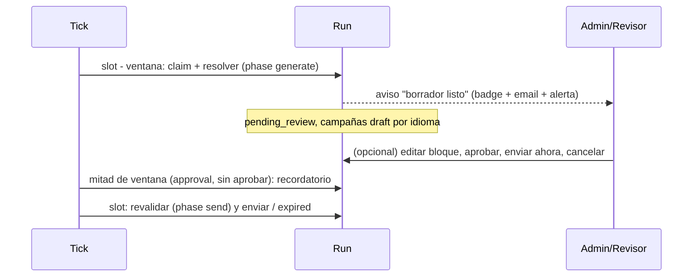

# F3. Ventana, aprobación, avisos y pausas (HOS-2638)

Paraguas: [spec.md](./spec.md). Decisiones aplicables: D-1, D-2 (al enviar), D-6
(borrador vencido), D-8, D-9 (rescheduled, regenerar), D-11, D-12, D-13.

## 1. Objetivo

Que una plantilla pueda generar el borrador antes del slot para que una persona lo
revise (`window`) o lo apruebe (`approval`), con avisos en el admin y por email, y que
el equipo pueda pausar, saltear, cancelar el borrador del día o terminar la plantilla.

## 2. Alcance

**Incluye**
- Habilitar `send_mode` `window` y `approval`; default de servicio pasa a `window`.
- `review_window_hours` con defaults diaria 2h, semanal 24h, mensual 48h, tope el intervalo.
- Generación del borrador en `slot - review_window_hours`, run `pending_review`.
- Revalidación al enviar con respeto de ediciones manuales (D-1) y `minItems` (D-2).
- Aprobar, enviar ahora, cancelar borrador, regenerar con versión nueva.
- Pausar (con decisión sobre el borrador pendiente), reanudar, `skipNextRun`, `skipUntil`, terminar, `endsAt`.
- `rescheduled` al cambiar la recurrencia.
- Revisores por plantilla, marcados si pierden `newsletter.campaign.send`.
- Avisos: badge en el admin, email a revisores, siempre también a `HOSPEDA_NEWSLETTER_ALERT_EMAIL`.
- Recordatorio a mitad de ventana y aviso de vencido en `approval`.

**No incluye**
- Baja por plantilla (F4). Acciones ejecutadas desde el email (prohibido por D-11).

## 3. Dependencias

- HOS-2637 (F2) mergeado.
- **El dueño setea `HOSPEDA_NEWSLETTER_ALERT_EMAIL` en Coolify antes del deploy** (R-10 del paraguas).

## 4. Diseño

### 4.1 Línea de tiempo de una corrida con revisión

- `next_action_at` = mínimo entre la generación, el recordatorio y el slot pendientes.
- `review_deadline_at` = slot. En `window` el borrador sale solo en el slot; en `approval` sale sólo si `approved_at` no es null, si no `expired` y aviso de vencido.

### 4.2 Ediciones manuales

- Al generar, `run.report.generated[blockKey] = itemIds` (ítems tal como salieron).
- Editar un borrador generado pasa por `PATCH /api/v1/admin/newsletter/campaigns/{id}`, que
  con `run_id` exige además `newsletter.campaign.send` (H-19).
- Al enviar, para cada bloque: si los ítems del borrador difieren de `generated[blockKey]`
  en cualquier idioma, el bloque es `manuallyEdited` y la fase `send` sólo quita inválidos;
  si no, quita y rellena. Los ítems se comparan a nivel run, así que una edición en un idioma
  se propaga al resto (D-7: mismos ítems para todos).
- Después de revalidar se aplica `minItems` / `ifBelowMin`; un `skip_run` deja el run
  `skipped_empty` con `status_reason = 'below_min_at_send'` y aviso.

### 4.3 Acciones sobre el borrador (todas con `newsletter.campaign.send`)

| Acción | Efecto | Errores |
|---|---|---|
| `approve` | `approved_at`, `approved_by`; en `window` es un no-op informativo | 409 si el run no está `pending_review` |
| `send-now` | revalida y envía ya; el slot queda consumido | 409 idem |
| `cancel` | run `cancelled`; campañas vía `cancel()` extendido para drafts con `run_id` (H-1); la recurrencia sigue | 409 idem |
| `regenerate` | re-resuelve con `current_version_id`, actualiza `version_id` del run y los drafts | 409 `MANUAL_EDITS_WOULD_BE_LOST` salvo `{ discardManualEdits: true }` |

Todas son compare-and-set sobre `status = 'pending_review'`. Si un tick envía en el mismo
instante, una de las dos operaciones recibe 409 y la otra gana.

**Carrera `cancel()` contra `send()` (H-1, H-2, verificado en staging).** Hoy los dos leen
el estado fuera de cualquier transacción y escriben con `WHERE id = :id` a secas: `send()`
en `newsletter-campaign.service.ts:700` / `:751-761`, `cancel()` en `:1044-1056` / `:1059-1065`.
Mientras `cancel()` sólo acepte `sending` y `send()` sólo `draft`, la carrera casi no
existe. Al extender `cancel()` a drafts con `run_id` aparece: los dos leen `draft`, y gana
el último que escribe. Si gana `send()`, la campaña queda `sending` con el run `cancelled`.
Si gana `cancel()`, quedan entregas insertadas y quizá encoladas. Regla:
- `send()` ya pasa a `UPDATE ... WHERE status = 'draft' RETURNING` en F2 (T-F2-11) y aborta
  la transacción, con las entregas, si devuelve 0 filas.
- `cancel()` de un draft con `run_id` hace `UPDATE ... WHERE status = 'draft' RETURNING`
  en la misma transacción que el compare-and-set del run. Si devuelve 0 filas, responde
  409 `CAMPAIGN_NOT_CANCELLABLE` y no toca el run.
- El camino de `sending` de `cancel()` no cambia (fuera de alcance).

### 4.4 Controles de plantilla (con `newsletter.schedule.manage`)

- **Pausar** `{ pendingDraft?: 'cancel' | 'keep' }`. Con borrador pendiente y sin
  `pendingDraft` → 409 `PENDING_DRAFT_DECISION_REQUIRED` (la UI pregunta).
  `cancel` → run `cancelled` con `status_reason = 'paused_cancel'`. `keep` → ese borrador
  sigue su curso. Desde ahí, cada slot que pase queda `skipped_paused`.
- **Reanudar**: `next_slot_at` = próximo slot futuro; slots pasados sin run quedan
  `skipped_paused`. La tolerancia de recuperación no aplica a la pausa.
- **skip-next**: aplica al próximo slot sin run; si ya hay borrador para ese slot → 409
  `USE_CANCEL_FOR_PENDING_DRAFT`. **skip-until** `{ until: ISO | null }`.
- **Terminar**: estado `ended`, `ended_reason = 'manual'`, borrador pendiente `cancelled`
  con `status_reason = 'ended'`. Irreversible; `duplicate` crea una plantilla nueva `paused`
  con la versión vigente copiada como versión 1. `endsAt` se evalúa en cada tick.
- **Cambiar recurrencia** con borrador pendiente cuyo slot ya no está en la recurrencia
  nueva → run `cancelled`, `status_reason = 'rescheduled'`, aviso.

### 4.5 Borrador vencido por caída

Si el tick encuentra un `pending_review` con slot pasado: dentro de
`catch_up_window_hours` revalida y envía tarde (`is_late = true`; en `approval` sólo si
está aprobado, si no `expired`); fuera, `missed`.

### 4.6 Revisores

- Tabla `newsletter_schedule_reviewers`. Al crear la plantilla se inserta el creador.
- `PUT /reviewers { userIds }` reemplaza la lista; cada usuario debe tener
  `newsletter.campaign.send` resuelto con el mismo resolver de permisos del actor
  (incluye el bypass de `SUPER_ADMIN` de `apps/api/src/middlewares/actor.ts`) → si no,
  422 `REVIEWER_LACKS_PERMISSION`. Un usuario inexistente responde también 422 en la
  misma lista (no 404: es input de body, y el mensaje no distingue).
- `GET /reviewers` devuelve cada revisor con `hasSendPermission`; el admin marca los que lo perdieron.

### 4.7 Avisos

- **Badge**: `GET /schedules/pending-review` (H-9) devuelve runs `pending_review` con
  asunto, idioma, slot, modo, `isReviewer` y preview corto. No hay notificaciones in-app
  del lado servidor: el "Mi inbox (beta)" del admin (`/notifications`) guarda en
  `localStorage` (`apps/admin/src/routes/_authed/notifications.tsx:24`). El precedente que
  sí sirve es el contador de conversaciones: `Sidebar.tsx:48-61` consulta
  `useUnreadCount` y le inyecta el número al ítem `conversations-inbox` por su id, y
  `SidebarItem` lo pinta con la prop `unreadCount` (`SidebarItem.tsx:25`). F3 hace lo
  mismo con un hook `usePendingReviewCount` (TanStack Query, polling, como
  `features/conversations/hooks/useUnreadCount.ts`) y el ítem de plantillas. El campo `badge` del schema de IA (`apps/admin/src/config/ia/schema.ts:138-139`)
  está declarado pero nada lo consume; no se usa.
- **Email**: `NotificationType` nuevo `ADMIN_NEWSLETTER_REVIEW` con variantes
  `draft_ready`, `approval_reminder`, `approval_expired`, `skipped_at_send`, `rescheduled`,
  `run_failed`, `run_missed`, template en `packages/notifications/src/templates/newsletter/`
  sobre `EmailLayout` con `variant="staff"` y `Button` de `@repo/email` (HOS-2565,
  `packages/email/src/templates/staff-layout.tsx`).
  Destinatarios: revisores (sólo los que hoy tienen el permiso) ∪
  `HOSPEDA_NEWSLETTER_ALERT_EMAIL`. Fallas y `missed` van sólo a la alerta.
- Links: `${HOSPEDA_ADMIN_URL}/newsletter/schedules/{id}/runs/{runId}`. Sin token, sin
  acción: la sesión del admin decide (D-11).
- Idempotencia: cada aviso se emite en la transición que lo causa (compare-and-set); el
  recordatorio usa `UPDATE ... SET reminder_sent_at = now() WHERE reminder_sent_at IS NULL RETURNING`.

### 4.8 `HOSPEDA_NEWSLETTER_ALERT_EMAIL`

Flujo obligatorio del root `CLAUDE.md`:
1. Registro en `packages/config/src/env-registry.hospeda.ts` (junto a las otras
   `HOSPEDA_NEWSLETTER_*`, `:705-811`), `type: 'string'`, `required: false`,
   `requiredScope: 'production'`, `secret: false`, lista separada por comas. Ojo: `required`
   significa "en todo entorno" (`env-registry-types.ts:50-55`); lo que la hace obligatoria
   sólo en producción es `requiredScope` (`:67`).
2. Zod en `apps/api/src/utils/env.ts`: lista de emails válidos, no vacía cuando
   `NODE_ENV=production`; el boot falla si no.
3. `apps/api/.env.example` con un placeholder.
4. `docs/guides/environment-variables.md`: diferencia con `HOSPEDA_ADMIN_NOTIFICATION_EMAILS` (`env-registry.hospeda.ts:684`, H-10).
5. **Coolify**: el dueño la setea en `hospeda-api-staging` y `hospeda-api-prod`
   (`hops env-set api HOSPEDA_NEWSLETTER_ALERT_EMAIL ...` o la UI). El redeploy lo decide
   el dueño. El agente avisa y frena en ese punto.

## 5. Archivos a tocar

| Archivo | Cambio |
|---|---|
| `packages/db/src/schemas/newsletter/newsletter_schedule_reviewers.dbschema.ts` | nuevo + `db:generate` |
| `packages/schemas/src/entities/newsletter/newsletter-schedule*.schema.ts` | acciones, reviewers, pending-review |
| `packages/service-core/src/services/newsletter/schedule/schedule-tick.service.ts` | generación anticipada, recordatorio, vencimiento, envío al slot, borrador vencido |
| `packages/service-core/src/services/newsletter/schedule/schedule-run.engine.ts` | fase `send` con `manuallyEdited` |
| `packages/service-core/src/services/newsletter/schedule/newsletter-schedule.service.ts` | pausar, reanudar, saltear, terminar, rescheduled, reviewers |
| `packages/service-core/src/services/newsletter/schedule/schedule-run-actions.service.ts` | nuevo: approve, send-now, cancel, regenerate |
| `packages/service-core/src/services/newsletter/newsletter-campaign.service.ts` | `cancel()` (`:1005-1083`) acepta draft con `run_id`, con compare-and-set; `update()` (`:475`) exige `campaign.send` con `run_id` |
| `packages/notifications/src/types/notification.types.ts`, `constants/` | `ADMIN_NEWSLETTER_REVIEW` |
| `packages/notifications/src/templates/newsletter/newsletter-review-notice.tsx` | nuevo |
| `packages/config/src/env-registry.hospeda.ts` | variable nueva |
| `apps/api/src/utils/env.ts`, `apps/api/.env.example` | Zod + placeholder |
| `docs/guides/environment-variables.md` | documentación |
| `apps/api/src/cron/jobs/newsletter-schedule-tick.job.ts` | inyecta notificador (`sendNotification`, como `newsletter-close-campaigns.job.ts`) |
| `apps/api/src/routes/newsletter/admin/schedule-controls.ts`, `schedule-run-actions.ts`, `schedule-reviewers.ts` | nuevos |
| `apps/admin/src/routes/_authed/newsletter/schedules/$scheduleId.tsx` + `-components/` | controles, diálogo de pausa, revisores |
| `apps/admin/src/routes/_authed/newsletter/schedules/$scheduleId_.runs.$runId.tsx` | nuevo: revisión del borrador |
| `apps/admin/src/components/layout/sidebar/Sidebar.tsx`, `apps/admin/src/features/newsletter-schedules/hooks/usePendingReviewCount.ts` (nuevo) | badge "borradores por revisar", mismo patrón que `features/conversations/hooks/useUnreadCount.ts` |
| `packages/i18n/src/locales/{es,en,pt}/` | textos |

## 6. Criterios de aceptación

- **AC-F3-1 Default window.** Dado un payload sin `sendMode`, cuando se crea, entonces la versión queda `window` con `review_window_hours = 24` si es semanal.
- **AC-F3-2 Tope de ventana.** Dada una diaria con `reviewWindowHours: 30`, cuando se guarda, entonces 422 `REVIEW_WINDOW_EXCEEDS_INTERVAL`.
- **AC-F3-3 Generación anticipada.** Dada una semanal `window` del lunes 09:00 con ventana 24h, cuando corre el tick del domingo 09:00, entonces el run queda `pending_review`, hay una campaña `draft` por idioma con cuerpo, y se envía un único aviso `draft_ready` a revisores y a `HOSPEDA_NEWSLETTER_ALERT_EMAIL`.
- **AC-F3-4 Window sale sola.** Dado ese borrador sin tocar, cuando llega el slot, entonces se revalida, se envía y el run queda `sent`.
- **AC-F3-5 Revalidación respeta edición manual.** Dado un bloque generado `[A, B, C]` que el revisor cambió a `[C, A]`, y A despublicada antes del slot, cuando se envía, entonces sale `[C]` (sin relleno), y si `minItems: 2` con `hide_block`, el bloque no aparece.
- **AC-F3-6 Revalidación sin edición rellena.** Dado `[A, B, C]` sin tocar y A despublicada, cuando se envía, entonces sale `[B, C, D]`.
- **AC-F3-7 Revalidación deja bajo el mínimo con skip_run.** Dado el único bloque con `minItems: 3` y dos ítems invalidados sin reemplazo, cuando llega el slot, entonces el run queda `skipped_empty` con `below_min_at_send`, las campañas `cancelled` y se envía el aviso `skipped_at_send`.
- **AC-F3-8 Approval sin aprobar.** Dada una `approval`, cuando pasa la mitad de la ventana sin aprobación, entonces se envía UN recordatorio; cuando llega el slot, el run queda `expired`, no hay entregas y se envía `approval_expired`.
- **AC-F3-9 Approval aprobada.** Dado el borrador aprobado, cuando llega el slot, entonces se revalida y se envía.
- **AC-F3-10 Pausa con borrador, cancelar.** Dado un `pending_review`, cuando se pausa con `pendingDraft: 'cancel'`, entonces el run queda `cancelled` (`paused_cancel`), las campañas `cancelled` y la plantilla `paused`.
- **AC-F3-11 Pausa con borrador, desde el próximo.** Con `pendingDraft: 'keep'`, entonces ese borrador sale en su slot y el slot siguiente queda `skipped_paused`.
- **AC-F3-12 Pausa sin decidir.** Con borrador pendiente y sin `pendingDraft`, entonces 409 `PENDING_DRAFT_DECISION_REQUIRED` y nada cambia.
- **AC-F3-13 Reanudar no recupera.** Dada una diaria pausada 3 días, cuando se reanuda dentro de las 3h siguientes a un slot, entonces los 3 slots quedan `skipped_paused` (ninguno corre tarde) y `next_slot_at` es el próximo futuro.
- **AC-F3-14 skipNextRun.** Dado `skip-next`, cuando llega el próximo slot, entonces el run queda `skipped_manual`, `skip_next_run` vuelve a `false` y el slot siguiente corre normal; con dos contenedores, un solo run.
- **AC-F3-15 skipUntil.** Dado `skip-until` hasta el día 10, entonces los slots anteriores quedan `skipped_manual` y el del día 10 o posterior corre.
- **AC-F3-16 Cancelar sólo el borrador.** Dado un `pending_review`, cuando se cancela, entonces el run queda `cancelled` y el siguiente slot genera su borrador normalmente.
- **AC-F3-17 Terminar.** Dada una plantilla activa con borrador, cuando se termina, entonces queda `ended`, el borrador `cancelled` (`ended`), `POST /resume` responde 409 `SCHEDULE_ENDED` y `duplicate` crea una plantilla `paused` nueva.
- **AC-F3-18 Rescheduled.** Dado un borrador para el lunes, cuando la recurrencia pasa a jueves, entonces el run del lunes queda `cancelled` (`rescheduled`) y `next_slot_at` es el jueves.
- **AC-F3-19 Regenerar con ediciones.** Dado un borrador editado a mano y una versión nueva, cuando se pide `regenerate` sin `discardManualEdits`, entonces 409 `MANUAL_EDITS_WOULD_BE_LOST`; con `true`, el run toma la versión nueva.
- **AC-F3-20 Carrera tick contra acción.** Dado un `send-now` y el tick del slot simultáneos, cuando ambos terminan, entonces hay una sola tanda de entregas y la acción perdedora recibe 409.
- **AC-F3-21 Borrador vencido dentro de tolerancia.** Dado un `pending_review` y el API caído durante el slot, cuando vuelve dentro de `catch_up_window_hours`, entonces se revalida y sale con `is_late = true`; fuera, `missed` y aviso `run_missed` a la alerta.
- **AC-F3-22 Revisores.** Dado `PUT /reviewers` con un usuario sin `newsletter.campaign.send`, entonces 422 `REVIEWER_LACKS_PERMISSION`; dado un revisor que perdió el permiso después, `GET /reviewers` lo devuelve con `hasSendPermission: false` y no recibe emails.
- **AC-F3-23 Permisos de acciones.** Dado un usuario con `newsletter.schedule.manage` sin `newsletter.campaign.send`, cuando aprueba, entonces 403; cuando pausa, 200.
- **AC-F3-24 Editar borrador.** Dado un usuario con `newsletter.campaign.write` sin `.send`, cuando hace `PATCH` a una campaña con `run_id`, entonces 403; a una manual, 200.
- **AC-F3-25 Ningún link ejecuta.** Dado el email `draft_ready`, cuando se inspeccionan sus links, entonces todos apuntan a `HOSPEDA_ADMIN_URL` sin query de token.
- **AC-F3-27 Carrera cancel contra send.** Dado un draft con `run_id`, cuando `cancel()` y `send()` corren a la vez sobre Postgres real, entonces o la campaña queda `cancelled` con cero entregas y `send()` devuelve `CAMPAIGN_NOT_SENDABLE`, o queda `sending` con sus entregas y `cancel()` devuelve 409 `CAMPAIGN_NOT_CANCELLABLE`; nunca `sending` con el run `cancelled`.
- **AC-F3-26 Env var en prod.** Dado `NODE_ENV=production` y `HOSPEDA_NEWSLETTER_ALERT_EMAIL` vacía o con un email inválido, cuando arranca el API, entonces falla la validación de env; en `development`, arranca.

## 7. Plan de tests

| Nivel | Suite | Qué |
|---|---|---|
| Unit | `packages/service-core/test/services/newsletter/schedule/schedule-tick.service.test.ts` | AC-F3-3, 4, 8, 13..15, 21 con `@repo/test-clock` |
| Unit | `.../schedule/schedule-run.engine.test.ts` | AC-F3-5..7 |
| Unit | `.../schedule/schedule-run-actions.service.test.ts` (nuevo) | AC-F3-16, 19 |
| Unit | `.../schedule/newsletter-schedule.service.test.ts` | AC-F3-1, 2, 10..12, 17, 18, 22 |
| Unit | `packages/service-core/test/services/newsletter/newsletter-campaign.service.test.ts` | `cancel()` de draft con `run_id`; AC-F3-24 |
| Unit | `packages/notifications/test/templates/` | template del aviso, AC-F3-25 |
| Integración | `packages/service-core/test/integration/services/newsletter-schedule-review.integration.test.ts` (nuevo) | AC-F3-20, AC-F3-27 y recordatorio único con Postgres real |
| API | `apps/api/test/routes/newsletter/admin-schedule-controls.test.ts`, `admin-schedule-run-actions.test.ts` (nuevos) | AC-F3-12, 23; asertar `mock.calls` |
| Env | `apps/api/test/utils/env-registry-cross-validation.test.ts`, `pnpm env:check:registry` | AC-F3-26 |
| Admin | componentes de controles y revisión | diálogo de pausa, badge |
| E2E | `apps/e2e/tests/newsletter/schedule-review-flow.spec.ts` (nuevo) | generar, editar, aprobar, enviar |

## 8. Guards

- `apps/api/test/cron/email-outbox-template-registry.guard.test.ts` y cualquier inventario de `NotificationType` (buscar `rg "ADMIN_LEAD_RECEIVED" packages/*/test apps/*/test` para encontrar los conteos congelados).
- `pnpm env:check:registry` y el cross-validation de env.
- `apps/api/test/cron/schedules-manifest.test.ts` (sin cambio de nombre, sólo del handler).
- Contrato de errores: 409 para conflictos de estado, nunca `INTERNAL_ERROR` en 4xx.

## 9. Smoke (staging)

Label `status-needs-smoke-staging`. Se necesita staging porque intervienen emails reales,
la sesión del admin al abrir el link y el tiempo real del cron:

1. Plantilla `window` diaria con ventana 1h: llega el aviso a un revisor y a la alerta; el link abre el borrador con sesión.
2. Editar un bloque, despublicar un ítem, esperar el slot: sale sin relleno.
3. Plantilla `approval`: recordatorio a mitad de ventana, `expired` al slot sin aprobar.
4. Pausar con borrador ("cancelar el de hoy"), reanudar al día siguiente: slots en `skipped_paused`.
5. Verificar en producción que la env var está seteada antes de promover (`hops env-list api`).

## 10. Tareas (orden de implementación)

1. **T-F3-01** Env var: registro, Zod, `.env.example`, docs + tests AC-F3-26. Frenar y avisar al dueño para Coolify. (1.5h)
2. **T-F3-02** Tabla `newsletter_schedule_reviewers` + `db:generate` + alta del creador. (1h)
3. **T-F3-03** Habilitar `window`/`approval`, `review_window_hours`, defaults y tope + tests AC-F3-1, 2. (1.5h)
4. **T-F3-04** Tick: generación anticipada y `pending_review` + test AC-F3-3. (2h)
5. **T-F3-05** Fase `send` con `manuallyEdited` y `minItems` + tests AC-F3-5..7. (2h)
6. **T-F3-06** Tick: envío al slot, `approval` vencida, recordatorio único + tests AC-F3-4, 8, 9. (2h)
7. **T-F3-07** Borrador vencido por caída + test AC-F3-21. (1h)
8. **T-F3-08** `cancel()` (compare-and-set) y `update()` de campañas con `run_id` + tests H-1, AC-F3-24, integración AC-F3-27. (2h)
9. **T-F3-09** Acciones approve, send-now, cancel, regenerate + tests AC-F3-16, 19, 20. (2h)
10. **T-F3-10** Pausar, reanudar, skip-next, skip-until, terminar, duplicar + tests AC-F3-10..15, 17. (2h)
11. **T-F3-11** `rescheduled` en cambio de recurrencia + test AC-F3-18. (1h)
12. **T-F3-12** Revisores con chequeo de permiso + test AC-F3-22. (1.5h)
13. **T-F3-13** `ADMIN_NEWSLETTER_REVIEW` + template + destinatarios + test AC-F3-25. (2h)
14. **T-F3-14** Rutas de controles, acciones, revisores, pending-review + tests AC-F3-12, 23. (2h)
15. **T-F3-15** Admin: pantalla de revisión del borrador y diálogo de pausa. (2h)
16. **T-F3-16** Admin: revisores, badge del sidebar, i18n + e2e `schedule-review-flow.spec.ts`. (2h)
