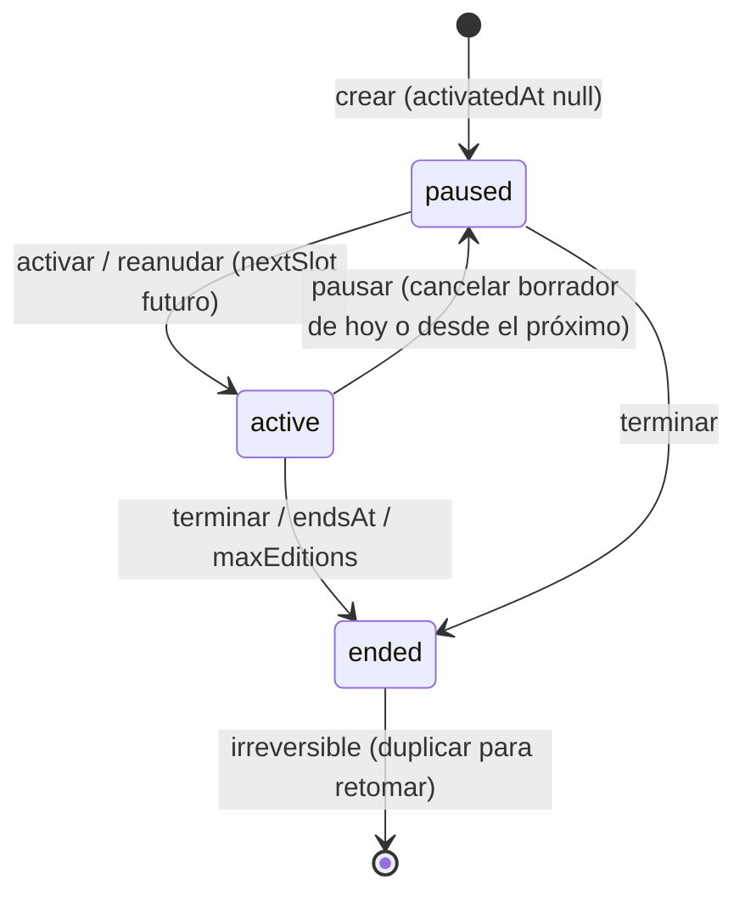
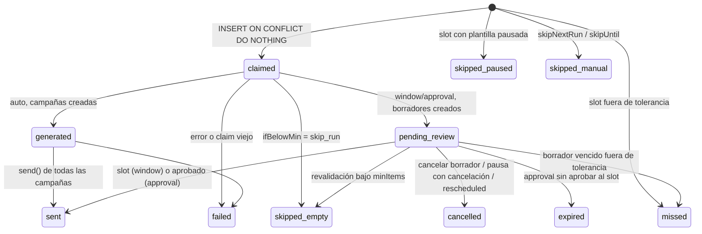

# Newsletters recurrentes, plantillas con contenido dinámico que salen solas

> **Verificación**: todas las rutas, números de línea y hallazgos de esta spec y de sus
> cuatro fases se verificaron contra **`origin/staging` en `942edece66`** (checkout de sólo
> lectura), no contra el working tree del clone principal. Antes de implementar cada fase,
> re-chequear las líneas citadas si staging avanzó.

## 1. Summary

Hoy (SPEC-101) un admin escribe cada campaña a mano. Esta spec agrega **plantillas
recurrentes**: un cuerpo TipTap por idioma con **bloques dinámicos** que se resuelven
contra los datos del momento **en cada corrida**, una recurrencia (diaria, semanal,
mensual), un modo de envío (`auto | approval | window`), versiones inmutables,
historial de corridas, deduplicación entre ediciones y baja por plantilla.

Se entrega en una sola spec con cuatro PRs por fase (ver §15). El contenido de una
corrida nunca se precongela para corridas futuras: lo único que se guarda es lo que
**efectivamente salió** en cada edición, como registro.

## 2. Problem

- Armar a mano un resumen semanal de "lo más visto" o "lo nuevo" cuesta tiempo cada
  semana y queda desactualizado si se escribe con anticipación.
- La columna `newsletter_campaigns.scheduled_for` existe y nada la consume
  (`packages/db/src/schemas/newsletter/newsletter_campaigns.dbschema.ts:79`).
- No hay forma de que un suscriptor deje de recibir un resumen puntual sin darse de
  baja de todo el newsletter.

## 3. Goals

- G-1: bloques dinámicos en el editor, resueltos al enviar, usables también en campañas manuales.
- G-2: plantillas con recurrencia, versiones, cuerpo por idioma y corridas idempotentes.
- G-3: control humano opcional (ventana de revisión o aprobación), pausas, saltos, fin.
- G-4: baja por plantilla para el suscriptor, reversible desde el perfil.
- G-5: simulación idéntica a la corrida real, verificada por test.

## 4. Non-goals

- NG-1: nuevo `contentType` `digest` (diferido explícitamente, D-10).
- NG-2: fuente `featured` operativa (declarada y deshabilitada hasta HOS-1357, D-3).
- NG-3: tests A/B de asunto o contenido.
- NG-4: hora de envío por suscriptor.
- NG-5: cambiar la baja global o su header one-click (HOS-2617, ya en staging).

## 5. Glosario

| Término | Significado |
|---|---|
| **Plantilla** (`newsletter_schedules`) | Definición recurrente: nombre interno, recurrencia, estado y puntero a la versión vigente. |
| **Versión** (`newsletter_schedule_versions`) | Foto inmutable del contenido y la configuración operativa (modo, soft-cap, tolerancias, bloques, idiomas). |
| **Cuerpo** (`newsletter_schedule_bodies`) | Asunto, nombre público y documento TipTap de una versión para un idioma. |
| **Bloque dinámico** | Nodo TipTap `dynamicBlock` con `blockKey` estable cuya lista de ítems sale de una fuente (`most_viewed`, `newest`, `top_rated`). |
| **Slot** | Instante teórico de envío calculado por la recurrencia, en hora de mercado (`America/Argentina/Buenos_Aires`). |
| **Corrida / run** (`newsletter_schedule_runs`) | Lo que pasó con un slot: una fila por `(scheduleId, slotAt)`, con estado propio. |
| **Edición** | Una corrida que terminó `sent`. Es la unidad que cuentan `maxEditions` y la deduplicación. |
| **Borrador** | Campaña `draft` generada por una corrida en modo `window` o `approval`, a la espera del slot. |

## 6. Decisiones del owner (finales, no se reabren)

1. **D-1 Modo de envío** por plantilla `auto | approval | window`, default `window`. Al enviar se revalida cada ítem (despublicado, ya no elegible, borrado) y se rellena con el siguiente candidato; si el revisor editó a mano ese bloque, se respeta y sólo se quitan los inválidos. *Razón: nunca mandar una ficha caída sin pisar el criterio humano.*
2. **D-2 Mínimo por bloque** `minItems` (default 1) e `ifBelowMin: skip_run | hide_block | send_anyway`; default `skip_run` si es el único bloque dinámico, si no `hide_block`. Misma regla al generar y al enviar. *Razón: un resumen vacío es peor que no mandar.*
3. **D-3 Fuentes** enum cerrado, un resolver por valor: `most_viewed` (de `entity_views`, ventana N días), `newest`, `top_rated` (mínimo de reseñas) y `featured` declarada pero deshabilitada hasta HOS-1357. Fuente y parámetros por bloque. *Razón: catálogo chico y testeable.*
4. **D-4 Soft-cap** por plantilla `respect | ignore` (default `respect`). Con `respect`, las entregas de ediciones de la MISMA plantilla no cuentan contra ella (`campaign.scheduleId`, `excludeScheduleId`). El admin avisa si el intervalo es menor que los días del soft-cap. *Razón: un resumen semanal no debe bloquearse a sí mismo.*
5. **D-5 Dedup** por bloque `excludeRecentEditions: N` y `fillWithRepeats`. Defaults: newest 0; most_viewed 2/true; top_rated 3/true. Tabla `newsletter_schedule_run_items` con lo que salió realmente. *Razón: variedad sin dejar bloques vacíos en destinos chicos.*
6. **D-6 Corridas perdidas**: si el slot vencido más reciente está dentro de `catchUpWindowHours` (diaria 3h, semanal 12h, mensual 24h) corre UNA vez tarde; los demás quedan `missed`. Misma tolerancia para un borrador vencido (revalidando). Idempotencia con único `(scheduleId, slotAt)` y fila `claimed` insertada antes de trabajar. *Razón: Coolify deja dos contenedores vivos en un rollout.*
7. **D-7 Idiomas**: una plantilla multilenguaje con cuerpos por idioma, idiomas habilitados opcionales. Una campaña por idioma por corrida; bloques resueltos una vez por corrida y renderizados con las columnas i18n de la entidad con fallback a `es`. Idioma habilitado sin cuerpo no se genera y deja warning. *Razón: mismo contenido para todos, sin traducir a mano lo que la ficha ya tiene.*
8. **D-8 Controles**: estados `active | paused | ended`. Pausar con borrador pendiente pregunta "pausar y cancelar el de hoy, o pausar desde el próximo". Reanudar arranca en el próximo slot futuro; slots en pausa quedan `skipped_paused`. `skipNextRun` y `skipUntil` dejan `skipped_manual`. Cancelar sólo el borrador (`cancelled`). Fin irreversible, `endsAt` / `maxEditions` opcionales. *Razón: control fino sin perder historial.*
9. **D-9 Versionado**: cambios de contenido y operativos crean versión inmutable; `runs.versionId`; plantilla apunta a `currentVersionId`. La recurrencia vive en la plantilla; cambiarla recalcula `nextRunAt` y cancela un borrador cuyo slot ya no existe (`rescheduled`). Regenerar borrador con versión nueva avisa si se pierden ediciones manuales. `blockKey` estable. *Razón: auditar qué versión mandó cada edición.*
10. **D-10 Audiencia**: `contentType` OBLIGATORIO por plantilla. Cada mail generado lleva, además de la baja global, "no recibir más este resumen" que da de baja sólo esa plantilla (`newsletter_schedule_optouts`). Token reutiliza `newsletter-token.helpers.ts` con scope nuevo. El perfil muestra y revierte. `digest` diferido. *Razón: baja granular evita bajas totales.*
11. **D-11 Avisos de borrador**: notificación en admin (badge "borradores por revisar") + email a la lista de revisores por plantilla (default el creador; deben tener `newsletter.campaign.send`). Ventanas default diaria 2h, semanal 24h, mensual 48h, tope el intervalo. En `approval`: recordatorio a mitad de ventana y aviso de vencido. Los links del mail abren el admin con sesión; NUNCA se ejecuta una acción por token de email. *Razón: revisión real sin superficie de ataque.*
12. **D-12** Los avisos van SIEMPRE además a `HOSPEDA_NEWSLETTER_ALERT_EMAIL` (una o más direcciones), obligatoria en producción. No se resuelve por rol. *Razón: alguien de ops siempre se entera.*
13. **D-13 Permisos** nuevos `newsletter.schedule.view`, `.write`, `.manage`. Aprobar, editar, cancelar o "enviar ahora" un borrador sigue pidiendo `newsletter.campaign.send`. Inicialmente para `super_admin` y `admin`. *Razón: separar quién diseña de quién dispara.*
14. **D-14 Simulación**: "Simular ahora" aplica TODAS las reglas con datos actuales y muestra salida por idioma más reporte. "Enviarme la simulación" usa `testSend`. Mismo resolver con escrituras apagadas. Calendario de los próximos N slots desde la misma función que calcula `nextRunAt`. Criterio: test que compara simulación y corrida real sobre datos idénticos. *Razón: lo que ves es lo que sale.*
15. **D-15 Entrega** en una spec con PRs por fase F1-F4; F2-F4 llevan `status-needs-smoke-staging`. *Razón: cada fase es mergeable y verificable sola.*

## 7. Hallazgos de la verificación (origin/staging 942edece66)

Rutas relativas a `packages/service-core/src/services/newsletter/` salvo que se indique otra.

- **H-1 `cancel()` no acepta borradores.** Sólo acepta `sending` o `'scheduled'`
  (`newsletter-campaign.service.ts:1044-1056`); un `draft` da `CAMPAIGN_NOT_CANCELLABLE`.
  D-8 dice "reutilizar `cancel()`". Adaptación (F3): extenderlo a un `draft` **con
  `run_id`**, con compare-and-set. Los drafts manuales siguen yendo por `softDelete`.
- **H-2 `send()` y `cancel()` escriben sin condición de estado.** `send()` lee el estado
  fuera de la transacción (`:700`) y dentro inserta con `onConflictDoNothing` (`:742-746`)
  y pisa `status`, `totalRecipients` con `WHERE id` a secas (`:751-761`). `cancel()` hace
  lo mismo (`:1059-1065`). Dos `send()` simultáneos dejan `totalRecipients = 0`; con H-1
  aparece además la carrera `cancel()` contra `send()` sobre el mismo draft. Con dos
  contenedores (D-6) es real. F2 vuelve condicional el UPDATE de `send()` y F3 el de
  `cancel()` (F3 §4.3, AC-F3-27).
- **H-3 El bypass del soft-cap ya está arreglado (HOS-2613).** `resolveEligibleForCampaign`
  omite la ventana cuando `ignoreSoftCap` (`newsletter-campaign.service.ts:811`) y
  `getEligibleForCampaign` usa `TRUE` en ese caso (`newsletter-subscriber.service.ts:1795-1803`).
  F2 ya no depende de nada para `softCapPolicy: 'ignore'`. *Antes decía que estaba
  invertido: era el working tree viejo.*
- **H-4 El soft-cap sólo mira `delivered_at`.** `d.delivered_at >= NOW() - N days`
  (`newsletter-subscriber.service.ts:1802`). Las entregas `pending` no cuentan. Con el
  tick procesando varias plantillas del mismo slot una tras otra, la segunda se despacha
  segundos después de la primera y no ve sus entregas: les llegan las dos. Resuelto por OQ-2 (decidida).
- **H-5 El borde del soft-cap es inclusivo** (`>=`): una entrega hecha hace exactamente
  7 días todavía excluye.
- **H-6 El worker renderiza el cuerpo por lote.** `processBatch` llama
  `renderTiptapEmailFn({ content: campaign.bodyJson })` en cada lote
  (`newsletter-delivery.service.ts:657`). Diseño: resolver una sola vez en `send()` y
  guardar `newsletter_campaigns.resolved_body_json`.
- **H-7 El renderer compartido no sirve tal cual para tarjetas.** `renderTiptapContent`
  renderiza un nodo desconocido como sus hijos (`packages/utils/src/tiptap-renderer.ts:166-168`),
  así que un `dynamicBlock` sin resolver sale vacío en silencio. `sanitizeEmailHtml`
  (`packages/notifications/src/utils/tiptap-email-renderer.ts:120`, allowlist `:64-86`) no
  admite `table`, `div` ni `style`. `TiptapNode.attrs` es `Record<string, string | number>`
  (`tiptap-renderer.ts:34`). Diseño en F1 §4.5.
- **H-8 HOS-2565 ya está en staging.** `@repo/email` exporta `Button`, `Callout`,
  `EmailTitle`, `OptionCard`, `SectionBar`, `EmailLayout` (`user` / `staff`) y
  `emailPalette` (`packages/email/src/index.ts:12-105`). `NewsletterCampaign` ya usa
  `EmailLayout` y `Callout`. En `packages/notifications/src/templates/components/` quedan
  sólo `heading` e `info-row`. No hay componente de tarjeta de ficha: F1 lo arma sobre
  esas piezas. *Antes decía que HOS-2565 no tenía código.*
- **H-9 No hay notificaciones in-app de admin del lado servidor.** El "Mi inbox (beta)"
  (`apps/admin/src/routes/_authed/notifications.tsx:24`) vive en `localStorage`. Lo que sí
  existe es el patrón de contador del sidebar (`apps/admin/src/components/layout/sidebar/Sidebar.tsx:48-61`,
  `useUnreadCount`). El badge de D-11 sale de una consulta con ese patrón (F3 §4.7).
- **H-10 Ya existe `HOSPEDA_ADMIN_NOTIFICATION_EMAILS`** (opcional, alertas operativas,
  `packages/config/src/env-registry.hospeda.ts:684`; la usa `newsletter-close-campaigns.job.ts:60-77`).
  D-12 pide una variable nueva, obligatoria en producción: `requiredScope: 'production'`
  (`env-registry-types.ts:67`). No pude verificar si staging corre con `NODE_ENV=production`;
  si es así, también hay que setearla en staging.
- **H-11 `PermissionEnum` es un enum de Postgres.** Los newsletter están en
  `packages/schemas/src/enums/permission.enum.ts:740-744` y las categorías en `:48-49`.
  Agregar valores exige migración estructural antes del data-migration de grants (patrón
  `packages/seed/src/data-migrations/0089-hos-981-qr-code-permissions.ts`; el último es
  `0192`). Grants actuales en `rolePermissions.seed.ts`: `SUPER_ADMIN` `:236-239`, `ADMIN`
  `:707-710`, `EDITOR` `:1063-1065` (sin `send`).
- **H-12 La baja global funciona (HOS-2617).** Página `apps/web/src/pages/[lang]/newsletter/unsubscribe.astro`
  con isla que hace POST, `GET /unsubscribe` que sólo redirige y `POST /unsubscribe`
  (`apps/api/src/routes/newsletter/public/index.ts:136-141`, `unsubscribe-post.ts`).
  Fuente única de URLs: `packages/utils/src/newsletter-links.ts`. Cada mail lleva
  `List-Unsubscribe` one-click RFC 8058 (`newsletter-delivery.service.ts:690-700`).
  F4 copia este patrón. *Antes decía que la página no existía.*
- **H-13 `verifyUnsubscribeToken` acepta payloads con campos extra.** Sólo exige `sid` y
  `ch` strings (`newsletter-token.helpers.ts:309-310`). Un token con scope verificaría como
  baja global, también por el one-click. F4 hace que el global rechace `scp`.
- **H-14 `entity_views`** guarda `ACCOMMODATION | POST | EVENT`, índice
  `idx_entity_views_entity_time` (`entity_view.dbschema.ts:59-62`). Retención: 120 días
  desde HOS-2256 (`apps/api/src/cron/jobs/entity-views-purge.job.ts:4-14`). Ventana máxima
  de `most_viewed`: 90 días, la misma que los paneles.
- **H-15 Alojamientos**: visibilidad pública `publication_status = 'PUBLISHED'` y
  `deleted_at IS NULL` (`listing-publication-columns.ts:28`); `reviews_count` y
  `average_rating` denormalizados (`accommodation.dbschema.ts:160-162`); sin `published_at`,
  `newest` ordena por `created_at`; `name_i18n`/`summary_i18n` jsonb (`:70-71`); portada
  `accommodation_media.is_featured` (`accommodation_media.dbschema.ts:117`).
  `featured_by_entitlement` (`:114`) no tiene escritor.
- **H-16 No hay helper canónico de "clave duplicada"** y Drizzle envuelve el error sin
  copiar `code` (`packages/db/CLAUDE.md`). El claim usa `INSERT ... ON CONFLICT DO NOTHING
  RETURNING` y no depende de detectar 23505.
- **H-17 Los crons corren in-process en cada contenedor** (`apps/api/src/cron/bootstrap.ts`).
  `CRON_SCHEDULE_OPTIONS = { timezone: MARKET_TIMEZONE, noOverlap: true }` (`:30`):
  `noOverlap` evita solapamiento dentro de un proceso, no entre contenedores. Confirma D-6.
- **H-18 `testSend` exige una campaña existente** (`newsletter-campaign.service.ts:924-978`,
  delega en `sendTestEmail`, `newsletter-delivery.service.ts:959`). La simulación no escribe
  filas (D-14): F1 agrega `sendTestEmailFromContent` y `testSend` lo usa por dentro.
- **H-19 Editar una campaña pide `newsletter.campaign.write`**
  (`apps/api/src/routes/newsletter/admin/campaigns.ts:457`; servicio `update()` `:475`). D-13
  pide `campaign.send` para un borrador generado: `update()` lo exige cuando hay `run_id`.
- **H-20 El estado de campaña** es `draft | sending | sent | cancelled`
  (`packages/schemas/src/enums/newsletter-campaign-status.enum.ts:15-18`); el `'scheduled'`
  de `cancel()` es reserva. El de entrega es `pending | delivered | failed | skipped`.
- **H-21 Atribución y audiencia ya resueltas para lo nuevo.** `send()` escribe
  `attribution_slug` (HOS-2359, `:720-723`) y `delivery-factory.ts:59` aplica UTMs a todo el
  HTML renderizado: las tarjetas los heredan. `getAudienceEstimate` comparte
  `resolveEligibleForCampaign` con `send()` (`:802-829`): `excludeScheduleId` entra ahí y
  el estimado coincide con el envío (F2 §4.4).

## 8. Preguntas abiertas para el owner

Cerradas por la re-verificación: **OQ-1** (HOS-2565 existe, H-8) y **OQ-6** (la baja
global funciona, H-12). Los números no se reusan.

- **OQ-2 Las entregas `pending` no cuentan para el soft-cap (H-4). DECIDIDA (2026-11-25).**
  Se cuentan también las `pending` de las últimas 24 h, en todas las campañas, con un
  índice nuevo `(subscriber_id, status, created_at)` (hoy sólo hay
  `(subscriber_id, delivered_at)`, `newsletter_campaign_deliveries.dbschema.ts:88-90`).
  Detalle en F2 §4 (T-F2-10).
- **OQ-3 ¿Qué permiso cambia la recurrencia? DECIDIDA (2026-11-25).**
  `newsletter.schedule.manage`. Criterio: `write` toca qué dice la plantilla y `manage`
  toca cuándo y si sale. La recurrencia inicial entra con `write` al crear la plantilla,
  porque todavía no hay borradores que romper. Cambiarla después (`PATCH
  /schedules/{id}/recurrence`) pide `manage`. En el admin, el bloque de recurrencia es de
  sólo lectura para quien tiene `write` sin `manage`.
- **OQ-4 Tipos de entidad de las fuentes. DECIDIDA (2026-11-25).** Se sale sólo con
  `ACCOMMODATION`, pero F1 deja preparados `VENUE` (comer y salir), `POST` (notas),
  `EVENT`, `EXPERIENCE` y `PARTNER`: enum propio, registros por tipo y UI con
  "Próximamente" (F1 §4.6). Implementarlos va en HOS-2642.
- **OQ-5 Suscriptores de un idioma no habilitado. DECIDIDA (2026-11-25).** Se acepta
  como está en D-7: una plantilla sin el idioma del suscriptor no le llega, y nunca se le
  manda otro idioma. El editor y la simulación muestran cuántos quedan afuera, por idioma
  ("no llega a 42 suscriptores: en 30, pt 12"). Un toggle por plantilla para mandar en
  `es` queda como extensión aditiva futura, fuera de alcance.
- **OQ-7 El botón "Desuscribirse" del cliente de correo en un mail de plantilla. DECIDIDA
  (2026-11-25).** `List-Unsubscribe` one-click sigue apuntando a la baja **global** (H-12)
  también en las ediciones de plantilla; la baja por plantilla vive sólo en el footer.
  Razón: es lo que espera quien toca el botón ("no me manden más") y protege la
  reputación de entrega. Ofrecer "sólo este resumen" en la página de baja del footer
  queda como extensión aditiva futura, fuera de alcance.

Todas las preguntas abiertas quedan cerradas.

## 9. Data model

Detalle de columnas en [F2 §4.8](./F2-motor-recurrencia.md). Migraciones por carril
(root `CLAUDE.md` "Three migration carriles"):

| Pieza | Carril | Fase |
|---|---|---|
| Columnas `resolved_body_json` (jsonb null), `resolved_at` (timestamptz null) en campañas | 1 (`db:generate`) | F1 |
| Tablas `newsletter_schedules`, `_versions`, `_bodies`, `_runs`, `_run_items`; columnas `schedule_id`, `run_id` en campañas; pg enums | 1 | F2 |
| Valores nuevos de `permission_enum` | 1 (se regenera el tipo) | F2 |
| CHECKs (recurrencia, locales, rangos, `run_id ⇒ schedule_id y content_type`), único parcial `(run_id, locale_filter)` | 2 (`migrations/extras/0NN-newsletter-schedules.*.sql`, idempotente) | F2 |
| Grants de rol de los 3 permisos | 3 (`packages/seed/src/data-migrations/` + baseline `rolePermissions.seed.ts`) | F2 |
| `newsletter_schedule_reviewers`: PK `(schedule_id, user_id)`, FKs `cascade`, `created_by`, `created_at` | 1 | F3 |
| `newsletter_schedule_optouts`: PK `(subscriber_id, schedule_id)`, FKs `cascade`, `created_at`, índice `(schedule_id)` | 1 | F4 |

Enums (Zod en `packages/schemas/src/enums/`, pg en `packages/db/src/schemas/enums.dbschema.ts`):

| Enum | Valores | pg enum |
|---|---|---|
| `NewsletterScheduleStateEnum` | `active`, `paused`, `ended` | sí |
| `NewsletterScheduleRunStatusEnum` | `claimed`, `generated`, `pending_review`, `sent`, `skipped_empty`, `skipped_manual`, `skipped_paused`, `missed`, `cancelled`, `expired`, `failed` | sí (completo desde F2) |
| `NewsletterScheduleFrequencyEnum` | `daily`, `weekly`, `monthly` | sí |
| `NewsletterScheduleSendModeEnum` | `auto`, `approval`, `window` | sí (completo desde F2) |
| `NewsletterSoftCapPolicyEnum` | `respect`, `ignore` | sí |
| `NewsletterDynamicSourceEnum` | `most_viewed`, `newest`, `top_rated`, `featured` | no (vive en jsonb) |
| `NewsletterIfBelowMinEnum` | `skip_run`, `hide_block`, `send_anyway` | no |

Los enums pg se crean completos en F2 para no pagar un `ALTER TYPE` en F3. La plantilla
nace en `paused` (`activated_at IS NULL`); "Activar" es la primera reanudación.

## 10. Contratos

- **Bloque y resolver**: `DynamicBlockConfigSchema`, `DynamicSourcePort`, `resolveBlocks()`
  y render por segmentos en [F1 §4.5](./F1-bloques-dinamicos.md).
- **Dry vs real**: `resolveRun()` llama a `resolveBlocks()` y arma el `RunPlan` (campañas
  por idioma, warnings). `simulateRun()` devuelve el plan. `executeRun()` llama exactamente
  a `resolveRun()` y después a `commitRun()`, que es lo único que escribe. Simular no toca
  `skip_next_run` ni inserta runs (D-14). Detalle en F2 §4.3 y §4.6.
- **Recurrencia**: `computeSlots({ recurrence, from, count })`, pura, en
  `packages/service-core/src/services/newsletter/schedule/recurrence.ts`, sobre
  `getUtcInstantForLocalMidnight` de `packages/utils/src/local-day.ts` más minutos. La usan
  `nextSlotAt`, el tick, el calendario y el aviso de soft-cap. Nada más calcula slots.

## 11. Máquinas de estado

Toda transición posterior al claim es compare-and-set:
`UPDATE ... SET status = :to WHERE id = :id AND status = :from RETURNING id`; si devuelve
0 filas, otro contenedor ya la hizo y este no hace nada. Lo mismo vale para los UPDATE
de estado de campaña que hace el motor (H-2).

## 12. Cron `newsletter-schedule-tick`

- Manifest `apps/api/src/cron/schedules.manifest.ts` (junto a `newsletter-close-campaigns`,
  `:427`): `name: 'newsletter-schedule-tick'`, `displayName: 'Corridas de newsletters recurrentes'`,
  `category: 'notifications'`, `schedule: '*/5 * * * *'`. Job en
  `apps/api/src/cron/jobs/newsletter-schedule-tick.job.ts`, registrado en `registry.ts`
  (`apps/api/test/cron/schedules-manifest.test.ts` exige ambos).
- Algoritmo por tick:
  1. `SELECT` de plantillas `deleted_at IS NULL AND state IN ('active','paused') AND next_action_at <= now()` ordenadas, tope 50.
  2. Por plantilla, `computeSlots()` desde el último slot con run hasta `now`.
  3. Slots vencidos que no son el más reciente: run `missed` (`ON CONFLICT DO NOTHING`).
  4. Slot actual: pausada → `skipped_paused`; `skip_next_run` → `skipped_manual` y se limpia el flag sólo si el insert ganó; `slot < skip_until` → `skipped_manual`; vencido fuera de `catchUpWindowHours` → `missed`.
  5. Si toca trabajar: **claim** `INSERT INTO newsletter_schedule_runs (...) VALUES (..., 'claimed', :tickRunId) ON CONFLICT (schedule_id, slot_at) DO NOTHING RETURNING id`. Sin fila devuelta, otro contenedor la tiene: `continue`.
  6. Trabajo de la fase (F2: generar y enviar; F3: generar borrador, recordar, vencer, enviar al slot).
  7. Recalcular `next_slot_at`, `next_action_at`; aplicar `endsAt` / `maxEditions`.
- Claim viejo: run `claimed` con más de 15 minutos. Si todas sus campañas ya están
  `sending`/`sent`, se reconcilia a `sent`; si no, `failed` + alerta. Nunca se reenvía solo.
- `send()` de campañas generadas usa `createSystemActor` con `NEWSLETTER_CAMPAIGN_SEND`.

## 13. API

Orden de rechazo de `apps/api/docs/error-contract.md` (401 → 403 → 400 → 404 → 409/422).
Admin con `page` + `pageSize`. Un recurso ajeno o inexistente responde 404.

| Método y ruta (`/api/v1/admin/newsletter`) | Permiso | Fase |
|---|---|---|
| `GET /dynamic-sources` | `newsletter.campaign.write` | F1 |
| `POST /campaigns/{id}/resolve-preview` | `newsletter.campaign.view` | F1 |
| `GET /schedules`, `GET /schedules/{id}` | `newsletter.schedule.view` | F2 |
| `POST /schedules` (plantilla + versión 1), `PATCH /schedules/{id}` (nombre) | `newsletter.schedule.write` | F2 |
| `PATCH /schedules/{id}/recurrence` | `newsletter.schedule.manage` (OQ-3) | F2 |
| `POST /schedules/{id}/versions` | `newsletter.schedule.write` (+ `.manage` si cambia `send_mode`) | F2 |
| `GET /schedules/{id}/versions`, `GET /schedules/{id}/versions/{versionId}` | `newsletter.schedule.view` | F2 |
| `POST /schedules/{id}/activate`, `/resume` | `newsletter.schedule.manage` | F2 |
| `POST /schedules/{id}/duplicate` | `newsletter.schedule.write` | F2 |
| `GET /schedules/{id}/runs`, `GET /schedules/{id}/runs/{runId}` | `newsletter.schedule.view` | F2 |
| `POST /schedules/{id}/simulate`, `GET /schedules/{id}/calendar?count=N` | `newsletter.schedule.view` | F2 |
| `POST /schedules/{id}/simulate/test-send` | `newsletter.campaign.send` | F2 |
| `POST /schedules/{id}/pause` (`{ pendingDraft: 'cancel' \| 'keep' }`), `/skip-next`, `/skip-until`, `/end` | `newsletter.schedule.manage` | F3 |
| `GET /schedules/{id}/reviewers`, `PUT /schedules/{id}/reviewers` | view / manage | F3 |
| `GET /schedules/pending-review` (badge + preview) | `newsletter.schedule.view` | F3 |
| `POST /schedules/{id}/runs/{runId}/approve`, `/send-now`, `/cancel`, `/regenerate` | `newsletter.campaign.send` | F3 |

Público y protegido (F4, detalle en F4 §4.3):

| Ruta | Tier | Auth |
|---|---|---|
| `POST /api/v1/public/newsletter/schedule-optout` `{ token }` | public | token HMAC con scope |
| `GET /api/v1/protected/newsletter/schedule-optouts` | protected | sesión; sólo las del propio suscriptor |
| `DELETE /api/v1/protected/newsletter/schedule-optouts/{scheduleId}` | protected | sesión; ajeno o inexistente → 404 |

La baja por plantilla usa una página `/{lang}/newsletter/baja-resumen/` con botón que hace
`POST`, igual que la baja global de HOS-2617: los escáneres de links prefetchean los `GET`.

## 14. Riesgos

- **R-1 Doble envío en rollout.** Mitigado por unique + claim + compare-and-set y el arreglo de H-2.
- **R-2 Contenido distinto entre lotes.** Mitigado por `resolved_body_json` (H-6).
- **R-3 Bloque vacío en silencio** (H-7). Mitigado: `send()` rechaza con 422 `DYNAMIC_BLOCK_UNRESOLVED` un documento con nodo sin resolver, y un guard estático sobre el renderer.
- **R-4 Carrera `cancel()` contra `send()`** sobre un borrador generado (H-1, H-2). Mitigado en F2 y F3 con compare-and-set en los dos, test de integración AC-F3-27.
- **R-5 Saturación** con varias plantillas en el mismo slot (H-4). Mitigado por OQ-2: las pendientes de las últimas 24 h cuentan para el soft-cap.
- **R-6 Destinos chicos** agotan la dedup. Mitigado por `fillWithRepeats` y el reporte de repeticiones.
- **R-7 Token con scope verificado como baja global** (H-13), también por el one-click. Mitigado en F4 con test de ambos sentidos.
- **R-8 Escáneres de links** (§13). Mitigado con página + POST.
- **R-9 Guards congelados** al sumar permisos, enums pg y un `NotificationType` (cada fase lista los suyos).
- **R-10 `HOSPEDA_NEWSLETTER_ALERT_EMAIL` sin setear** hace fallar el boot en producción. El dueño la setea en Coolify ANTES del deploy de F3.

## 15. Fases

| Fase | Issue | Doc | Bloqueada por | Smoke |
|---|---|---|---|---|
| F1 Bloques dinámicos y resolver | HOS-2636 | [F1-bloques-dinamicos.md](./F1-bloques-dinamicos.md) | nada | no |
| F2 Plantillas y motor de recurrencia | HOS-2637 | [F2-motor-recurrencia.md](./F2-motor-recurrencia.md) | HOS-2636 | staging |
| F3 Ventana, aprobación, avisos, pausas | HOS-2638 | [F3-control-revision.md](./F3-control-revision.md) | HOS-2637 | staging |
| F4 Baja por plantilla | HOS-2639 | [F4-baja-por-plantilla.md](./F4-baja-por-plantilla.md) | HOS-2637; coordinar HOS-2567 | staging |

Sólo el PR de F4 lleva `Closes HOS-2635` en la descripción; los de F1-F3 llevan
`Closes HOS-263N` de su propia fase y nunca el del paraguas.

## 16. Dependencias entre specs

- **HOS-2613** (mergeado): bypass del soft-cap correcto. F2 agrega parámetros a la misma consulta sobre la forma ya arreglada.
- **HOS-2617** (mergeado): baja global con página + POST + one-click y `newsletter-links.ts`. F4 sigue el mismo patrón.
- **HOS-2565** (mergeado): bloques compartidos de `@repo/email`. F1 arma la tarjeta y F3 el aviso sobre ellos.
- **HOS-2359** (mergeado): atribución de campañas. Lo generado la hereda sin cambios.
- **HOS-2567**: página de preferencias de email, sin código en staging. `EMAIL_PREFERENCES_URL` ya apunta a `/es/mi-cuenta/preferencias/` (`packages/email/src/email-assets.ts:22`), que no existe. F4 coordina dónde va "Resúmenes que no recibís".
- **HOS-1357** (V3): única forma de habilitar `featured`. Hasta entonces el schema lo rechaza.

## 17. Acceptance criteria (paraguas)

- AC-1: los criterios BDD de las cuatro fases pasan.
- AC-2: existe un test que corre simulación y corrida real sobre los mismos datos y compara el contenido resuelto por idioma, ítem por ítem (F2).
- AC-3: ninguna ruta nueva ejecuta una acción a partir de un token de email salvo la baja por plantilla (F4).
- AC-4: `pnpm check:guards`, `pnpm env:check:registry`, typecheck, lint y tests verdes en cada PR.

## 18. Linear

Canonical tracking: HOS-2635 (fases HOS-2636, HOS-2637, HOS-2638, HOS-2639).
