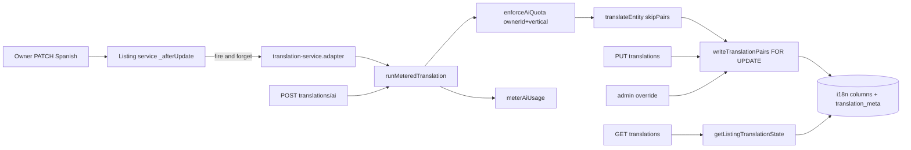

# One translation model for accommodation, venue and experience listings

> Absorbs [HOS-583](../HOS-583-host-editable-translations/spec.md) (host-editable
> accommodation translations). What HOS-583 got right is reused here and cited by
> section. What changed since it was written is listed in §2.3.

## Part 1: Functional Specification

### 1. Overview & Goals

Today the three listing verticals translate in three different ways:

| Vertical | Spanish save | Owner edit of en/pt | AI button | Manual is protected |
|---|---|---|---|---|
| Accommodation | AI on save, **unmetered, ungated** (`translation-service.adapter.ts:29-77`) | **Impossible**: panel is read-only (HOS-797) and the PATCH HTTP schema has no `*I18n` keys | "Generar traducciones faltantes", `onlyMissing: true`, gated + metered | Yes (`persistTranslations` skips `autoTranslated: false`) but only staff can create a manual pair |
| Venue | Nothing | Free text, sent as WHOLE `*I18n` JSONB objects in the PATCH | None | No metadata column at all |
| Experience | Nothing | Same as venue | None | No metadata column at all |

This spec replaces the three with **one model**, decided by the owner on 2026-11-26:

1. When a Spanish translatable field is saved, AI generates or regenerates its `en` and `pt`.
2. The owner can edit any translation by hand. That `(field, locale)` pair becomes **MANUAL**.
3. A manual pair is never overwritten by AI, even when the Spanish text changes.
4. "Traducir con IA" on a pair returns it to **AUTOMATIC** and regenerates it.
5. When the Spanish text changes under a manual pair, the editor shows
   "El texto en español cambió, esta traducción puede estar desactualizada" plus a
   "Traducir con IA" button. Nothing is overwritten.

- **Goal**: one translation behaviour, one persistence path, one editor section and one
  metering rule for the main text fields of the three listing verticals.
- **Motivation**: AI publishes text under the owner's commercial name in languages the
  owner often does not speak. Accommodation owners cannot fix it; venue and experience
  owners get no translation at all unless they write it, and their corrections are
  not protected because nothing records them. Accommodation on-save translation is
  also an unmetered AI cost today.
- **Success metrics**:
  - 100% of AI translation calls made for a listing (on save or on click) are gated by
    `ai_translate` and produce at most one `ai_usage` row per request (verifiable in
    `ai_usage` by `feature = 'translate'`).
  - 0 manual pairs overwritten by AI (asserted by tests AC-6/AC-7 and by the
    `translationMeta` audit query in §11.4).
  - Venue and experience owners on a paid plan get `en`/`pt` without typing them.
- **Target users**: accommodation hosts, venue owners, experience owners, and staff
  correcting listings from the admin.

### 2. Current baseline (verified against `origin/staging`, 2026-11-26)

#### 2.1 Facts with file:line

- **Metadata shape.** `TranslationMeta` / `TranslationMetaSchema`,
  `packages/schemas/src/common/i18n.schema.ts:123-153`: per field, per locale,
  `{ autoTranslated, translatedAt, provider?, model? }`. `ListingIdentityFields`
  spreads `translationMeta: TranslationMetaSchema.nullish()`
  (`packages/schemas/src/common/listing-identity.schema.ts:102`), so `VenueSchema`
  (`venue.schema.ts:87`) and `ExperienceSchema` (`experience.schema.ts:157`) already
  carry the key in Zod.
- **No column on venue/experience.** `translation_meta` exists on `accommodations`
  (`accommodation.dbschema.ts:74`) and on destinations, events, posts, POIs, but not
  on `venues` (`venue.dbschema.ts:68-93`) nor `experiences`
  (`experiences.dbschema.ts:48-61`). The owner-create schemas say so explicitly
  (`venue.crud.schema.ts:342-352`, `experience.crud.schema.ts:460-477`).
- **The single writer of `translationMeta`** is `apps/api/src/services/ai-translate.service.ts`:
  - `persistTranslations` (`:711-834`) merges per pair and skips any pair whose
    stored meta is `autoTranslated: false` (`:785`). It refreshes the source locale
    from the field values it was given (`:774`).
  - `applyManualOverride` (`:965-1031`) writes one pair as
    `{ autoTranslated: false, translatedAt }`.
  - Both read-modify-write the whole JSONB column **without a row lock**.
  - `translateEntity` (`:602-669`) does NOT know about manual pairs: it calls the
    provider for them and `persistTranslations` throws the result away. Paid calls
    for nothing.
  - `TranslatableEntityType` (`:31-36`) has no `venue` / `experience`.
- **On-save hook.** `AccommodationService._afterCreate`
  (`accommodation.service.ts:1104-1120`) and `_afterUpdate` (`:1450-1471`) call
  `getTranslationService().translate(...)` fire-and-forget with the changed fields
  (`diffTranslatableFields`, `packages/service-core/src/translation/diff-translatable-fields.ts:31-48`).
  `TranslationInput` (`translation-init.ts:20-27`) carries no owner and no vertical,
  so the adapter cannot meter. The adapter accepts only
  `accommodation|destination|event|post` (`translation-service.adapter.ts:18-23`),
  never gates and swallows every error (`:64-76`).
- **The protected button route.** `POST /api/v1/protected/ai/translate`
  (`apps/api/src/routes/ai/protected/translate.ts`):
  - ownership gate since HOS-584 (`:139-158`, policy in `translate.authorization.ts`,
    which has no `venue`/`experience` rule, `:33-38`),
  - quota with `vertical: VerticalEnum.ACCOMMODATION` hard-coded (`:181-187`),
  - always `onlyMissing: true` (`:196`),
  - **defect**: `enforceAiQuota` throws `ServiceError(ENTITLEMENT_REQUIRED|LIMIT_REACHED)`
    inside the `try`, and the `catch` (`:344-389`) turns it into
    `500 TRANSLATION_FAILED`. A host out of quota sees a provider failure.
- **Quota primitives.** `evaluateAiQuota` / `enforceAiQuota`
  (`apps/api/src/utils/listing-access/ai-quota-gate.ts:32-100`, `:103-176`).
  The monthly count is keyed by `(userId, feature)`, not by vertical
  (`getMonthlyCallCount`, `:75-80`); the limit is resolved per vertical.
  Keys: `ai_translate` (`packages/schemas/src/catalog/entitlement-keys.ts:68`),
  `max_ai_translate_per_month` (`limit-keys.ts:33`); feature map
  `apps/api/src/utils/listing-access/ai-quota-catalog.ts:3-27`.
  Metering: `meterAiUsage` (`apps/api/src/utils/ai-usage-metering.ts:139`).
- **Catalog grants.** Accommodation plans carry `ai_translate` with
  `(plan_quota, trial_quota)` = Basic `(200, 200)`, Pro `(1000, 200)`, Premium
  `(5000, 200)` and `max_ai_translate_per_month` = 200 / 1000 / 5000
  (`packages/db/src/migrations/0144_production_plan_catalog.sql:84,114,147,333,347,361`;
  source `scripts/production-catalog/catalog.ts:122,186,303,367,493,557`).
  No venue or experience plan carries either key.
- **Venue/experience persistence.** The owner PATCH schemas pick the four `*I18n`
  keys (`VenueOwnerUpdateInputSchema`, `venue.crud.schema.ts:199-230`;
  `ExperienceOwnerUpdateInputSchema`, `experience.crud.schema.ts:318-368`). The web
  sends each changed `*I18n` object whole
  (`apps/web/src/components/listing/editor/listing-patch-payload.ts:186-199`) and the
  model REPLACES the column (not merged; see the HOS-902 note in
  `ListingTranslationPanel.client.tsx:111-133`). `entryNoteI18n` has no plain column:
  its Spanish lives in `entryNoteI18n.es` (`venue.dbschema.ts:93`, max 200 per locale,
  `venue.schema.ts:53-57`) and it is sent whole by the nightInfo section
  (`listing-patch-payload.ts:350-353`).
- **`translationMeta` is writable through domain update schemas.**
  `AccommodationUpdateInputSchema` (`accommodation.crud.schema.ts:143`) does not omit
  it (HOS-583 R-3 still open). `VenueUpdateInputSchema` (`venue.crud.schema.ts:430`)
  and `ExperienceUpdateInputSchema` (`experience.crud.schema.ts:544`) do not omit it
  either; it is inert only because the column does not exist yet.
- **Web.** Venue/experience: `ListingTranslationPanel.client.tsx` (editable, no AI, no
  provenance), rendered by `section-renderers.tsx:415-427`. Accommodation:
  `TranslationPanel.client.tsx` + `TranslationFieldRow.client.tsx` +
  `translation-status.ts` (read-only, bulk generate button), page
  `apps/web/src/pages/[lang]/mi-cuenta/propiedades/[id]/editar/traducciones.astro`.
  Both build on the shared presentation `apps/web/src/components/account/editor/TranslationEditor.tsx`
  (HOS-2624).
- **Admin.** `apps/admin/src/features/content/components/TranslationSection.tsx`
  handles `accommodation|destination|event|post|pointOfInterest` (`:26`, `:35-41`),
  calling `POST /api/v1/admin/ai/translate` and `PUT /api/v1/admin/ai/translate/override`
  (`apps/api/src/routes/ai/admin/translate.ts:36-56`, permission `AI_SETTINGS_MANAGE`).
  It is mounted on the admin accommodation edit page but not on
  `apps/admin/src/routes/_authed/venues/$id_.edit.tsx` nor `experiences/$id_.edit.tsx`.
- **Public read fallback.** `resolveI18nText` / `resolveI18nTextWithLegacyFallback`
  (`apps/web/src/lib/resolve-i18n-text.ts:58-160`): requested locale, then es → en → pt,
  then the legacy plain column. An empty `en` therefore renders the Spanish text.
  **Unchanged by this spec.**

#### 2.2 What HOS-583 decided that this spec keeps

- D-1 source fingerprint for staleness (HOS-583 §6.5) — kept, made concrete in §8.3.
- D-2 provenance is a computed projection, never the raw column (HOS-583 §11) — kept;
  the projection lives in a dedicated GET (§9.1), not on the protected entity GET.
- One writer of `translationMeta` (HOS-583 §6.3, R-1) — kept: `writeTranslationPairs` (§8.4).
- Omit `translationMeta` from update inputs (HOS-583 R-3) — kept, extended to the
  three verticals (§10.1).
- `richDescription` and its i18n twin are one premium gate (HOS-583 §6.4) — kept, via the
  existing section trait `richDescription` (`packages/schemas/src/catalog/listing-sections.ts:326-330`).
- Field labels carry the locale, `Descripción (EN)` (HOS-371, HOS-583 §6.1) — kept.
- Clearing a locale to empty is a legitimate manual edit and freezes it (HOS-583 §6.3) — kept.

#### 2.3 What changed since HOS-583

- HOS-583 OQ-1 (the ungated translate route) is **resolved**: HOS-584 shipped the
  ownership gate.
- HOS-583 NG-3 ("no automatic re-translation on a Spanish edit") is **reversed** by the
  owner: on-save AI is rule 1 of the model.
- HOS-583 persisted translations through the accommodation PATCH. This spec uses a
  dedicated per-pair endpoint instead (decision DL-4), so the accommodation PATCH HTTP
  schema does NOT gain `*I18n` keys and venue/experience PATCH loses them.

### 3. In-scope fields

| Field id | Accommodation | Venue | Experience | Spanish source | i18n column | Max chars per locale |
|---|---|---|---|---|---|---|
| `name` | yes | yes | yes | plain `name` | `nameI18n` | 100 |
| `summary` | yes | yes | yes | plain `summary` | `summaryI18n` | 300 |
| `description` | yes | yes | yes | plain `description` | `descriptionI18n` | 2000 |
| `richDescription` | yes (premium) | yes (premium) | yes (premium) | plain `richDescription` | `richDescriptionI18n` | 5000 |
| `entryNote` | no | yes | no | `entryNoteI18n.es` (no plain column) | `entryNoteI18n` | 200 |

Target locales: `en`, `pt`. Spanish is always the source and is never a "translation".

### 4. User Stories & Acceptance Criteria

Terms. A **pair** is one `(field, locale)` with locale in `en|pt`. **Source** is the
Spanish text of the field (§3). **Billed owner** is the listing's `ownerId` (DL-3).
**Entitled** means `evaluateAiQuota` for the billed owner and the listing's vertical
returns `allowed` for `ai_translate` + `max_ai_translate_per_month`.

#### US-1: AI translates when I save Spanish

**As an** owner on a plan with AI translation, **I want** my Spanish text translated
when I save it, **so that** my listing reads well in English and Portuguese without
extra work.

- **AC-1** — **Given** a venue owned by an entitled owner with empty `en`/`pt`, **When**
  the owner saves a new Spanish `description`, **Then** the PATCH answers 200 before any
  AI call completes, and within the async run `descriptionI18n.en` and `.pt` are
  written, `translationMeta.description.en|pt` = `{ autoTranslated: true, sourceHash:
  sha256(normalized source), translatedAt, provider, model }`, and exactly ONE
  `ai_usage` row with `feature = 'translate'`, `status = 'success'`,
  `user_id = venue.ownerId` is recorded. Same for accommodation and experience, and for
  `_afterCreate` (a listing created with Spanish text).
- **AC-2** — **Given** an accommodation whose owner has an AUTOMATIC `name.en`, **When**
  the owner saves a different Spanish `name`, **Then** `name.en` and `name.pt` are
  regenerated and their `sourceHash` equals the hash of the new name. Fields whose
  Spanish did not change in that save are not sent to the provider (existing
  `diffTranslatableFields` behaviour).
- **AC-3** — **Given** an owner who has used all of `max_ai_translate_per_month` for
  that vertical, **When** they save a changed Spanish `summary`, **Then** the PATCH
  answers 200 and the Spanish persists, no provider call is made, one `ai_usage` row
  with `status = 'quota_exceeded'` is recorded (the `enforceAiQuota` behaviour), the
  stored `en`/`pt` values are unchanged, and `GET .../translations` reports
  `summary.en.state = 'noQuota'` and `summary.pt.state = 'noQuota'`.
- **AC-4** — **Given** a venue on a plan WITHOUT `ai_translate`, **When** the owner saves
  a changed Spanish `name`, **Then** the PATCH answers 200, no provider call and no
  `ai_usage` row are made, and the GET reports `name.en|pt.state = 'noEntitlement'`
  (when the stored value is empty or its `sourceHash` no longer matches).
- **AC-5** — **Given** an entitled owner, **When** the provider fails for every call of an
  on-save run, **Then** the PATCH has already answered 200, nothing is written to the
  i18n column nor to `translationMeta`, no `success` `ai_usage` row is recorded, a
  `warn` log `listing-translation: on-save run failed` is emitted with
  `{ entityType, entityId, outcome }`, and the GET reports the affected pairs as
  `state = 'pending'`.

#### US-2: My manual translation is never overwritten

**As an** owner, **I want** to correct a translation by hand and have it stay, **so
that** AI never undoes my work.

- **AC-6** — **Given** any owner with EDIT access (no `ai_translate` needed), **When**
  they `PUT .../translations` with `{ field: 'description', locale: 'en', value: 'Fixed' }`,
  **Then** `descriptionI18n.en = 'Fixed'`, `descriptionI18n.es` and `.pt` are untouched,
  `translationMeta.description.en = { autoTranslated: false, translatedAt, sourceHash:
  hash(current Spanish description) }`, and no `ai_usage` row is written.
- **AC-7** — **Given** `description.en` is MANUAL, **When** the owner saves a changed
  Spanish `description` while entitled, **Then** only `description.pt` is sent to the
  provider (the manual pair is skipped BEFORE the provider call, not after), `en` keeps
  its value and meta byte-for-byte, and one `ai_usage` row is recorded for the `pt` call.
- **AC-8** — **Given** both `description.en` and `description.pt` are MANUAL, **When** the
  owner saves a changed Spanish `description`, **Then** zero provider calls are made and
  zero `ai_usage` rows are written (not even `quota_exceeded`).
- **AC-9** — **Given** an owner, **When** they `PUT` `{ field: 'summary', locale: 'pt',
  value: '' }`, **Then** `summaryI18n.pt = ''` and `translationMeta.summary.pt.autoTranslated
  = false`; a later on-save run for `summary` does not refill `pt`; the GET reports
  `summary.pt = { value: '', state: 'manual' }`; the public ficha in `/pt/` shows the
  Spanish summary (unchanged fallback, `resolve-i18n-text.ts`).
- **AC-10** — **Given** an owner, **When** the manual value exceeds the field's max (§3), or
  `field` is not in the vertical's field list (e.g. `entryNote` on an accommodation), or
  `locale = 'es'`, **Then** the API answers 400 `VALIDATION_ERROR` and nothing is written.

#### US-3: I know when my manual translation may be outdated

**As an** owner, **I want** to be warned when the Spanish text changed under my manual
translation, **so that** I can review it.

- **AC-11** — **Given** `name.en` is MANUAL with `sourceHash = hash('Casa Sol')`, **When**
  the Spanish name becomes `'Casa del Sol'`, **Then** the GET reports
  `name.en.state = 'stale'` and the web row shows the alert text
  `"El texto en español cambió, esta traducción puede estar desactualizada"` and a
  "Traducir con IA" button (button disabled with a reason when AI is not available, §6).
- **AC-12** — **Given** a stale manual pair, **When** the owner saves it with `PUT` (with
  the same or a different value), **Then** its `sourceHash` becomes the hash of the
  current Spanish and the GET reports `state = 'manual'` (warning gone).
- **AC-13** — **Given** a stale manual pair, **When** the Spanish text is edited back to the
  exact text it had when the pair was written (after normalization, §8.3), **Then** the
  GET reports `state = 'manual'` (warning gone).
- **AC-14** — **Given** a MANUAL pair written before this spec (accommodation, no
  `sourceHash`), **When** the Spanish changes, **Then** the GET reports `state = 'manual'`
  (unknown baseline never produces a false warning) and the pair is still never
  overwritten by AI.
- **AC-15** — **Given** a change to a non-translatable field (price, phone), **Then** no
  pair changes state.

#### US-4: "Traducir con IA" returns a pair to automatic

**As an** owner, **I want** one click to get a fresh AI translation of a field, **so
that** I can undo my manual edit or refresh a stale one.

- **AC-16** — **Given** `description.en` MANUAL and an entitled owner, **When** they `POST
  .../translations/ai` with `{ field: 'description', locales: ['en'] }`, **Then** `en` is
  regenerated from the current Spanish, its meta becomes `{ autoTranslated: true,
  sourceHash: hash(current), provider, model, translatedAt }`, `description.pt` and every
  other pair are untouched (including other MANUAL pairs), one `success` `ai_usage` row
  with `user_id = ownerId` is recorded, and the response is the updated GET payload.
- **AC-17** — **Given** an owner without `ai_translate` for the listing's vertical, **When**
  they call the AI endpoint, **Then** 403 `ENTITLEMENT_REQUIRED` with
  `details.entitlementKey = 'ai_translate'`, nothing written, no provider call.
- **AC-18** — **Given** an owner at the monthly limit, **When** they call the AI endpoint,
  **Then** 403 `LIMIT_REACHED` with `details = { limitKey: 'max_ai_translate_per_month',
  currentCount, maxAllowed }`, one `quota_exceeded` row, nothing else written.
- **AC-19** — **Given** an entitled owner, **When** every provider call of the AI endpoint
  fails, **Then** 502 `PROVIDER_ERROR`, the pair's value and meta are unchanged (a MANUAL
  pair stays MANUAL), and any paid spend is metered as `status = 'error'` (same rule as
  `translate.ts:353-370`).
- **AC-20** — **Given** a field whose Spanish source is empty, **When** the AI endpoint is
  called for it, **Then** 400 `VALIDATION_ERROR` with `details.reason = 'NO_SOURCE_TEXT'`.

#### US-5: One translations section in the three editors

**As an** owner, **I want** the same translations screen for my accommodation, venue or
experience, **so that** I learn it once.

- **AC-21** — **Given** the editor of any of the three verticals, **When** the
  translations section loads, **Then** it renders tabs `ES | EN | PT`; ES shows each
  field's Spanish source read-only with a hint pointing to the section where it is
  edited; EN and PT show one labelled textarea per field (label carries the locale,
  e.g. `Descripción (EN)`), a state pill (§6), a "Guardar" button and a "Traducir con IA"
  button. The venue editor also shows `entryNote` ("Nota de entrada"); the other two do not.
- **AC-22** — **Given** the venue or experience editor, **When** the owner edits any other
  section and saves, **Then** the PATCH body contains none of `nameI18n`,
  `summaryI18n`, `descriptionI18n`, `richDescriptionI18n` (the translations section no
  longer participates in the PATCH diff). A PATCH that still sends them has those keys
  stripped by Zod and they are not written.
- **AC-23** — **Given** an owner whose plan lacks `can_use_rich_description`, **Then** the
  GET omits `richDescription` from `fields`, the section does not render that row, and
  `PUT`/`POST ai` with `field = 'richDescription'` answer 403 `ENTITLEMENT_REQUIRED`
  (section trait `richDescription`). **Given** an entitled owner, the row renders and
  both writes succeed.
- **AC-24** — **Given** a foreign listing id (another owner's), **When** any of the three
  endpoints is called, **Then** 404 `NOT_FOUND` (never 403). **Given** a non-UUID id,
  400 `VALIDATION_ERROR`. **Given** no session, 401.
- **AC-25** — **Given** the venue nightInfo section saves `entryNoteI18n = { es: 'Gratis
  hasta la 1', en: 'stale', pt: 'stale' }`, **When** the stored pairs are `en` MANUAL and
  `pt` AUTOMATIC, **Then** the service persists `es` from the body and keeps the STORED
  `en` and `pt` (the body's `en`/`pt` are ignored); then the on-save run regenerates only
  `pt`.

#### US-6: Existing venue and experience translations become automatic

- **AC-26** — **Given** a venue or experience row with non-empty `en`/`pt` values and no
  `translation_meta` (pre-migration), **When** `pnpm db:migrate` + `pnpm db:seed:migrate`
  run, **Then** every non-empty pair gets `{ autoTranslated: true, translatedAt:
  <run time>, sourceHash: hash(current Spanish source) }`, empty pairs get no entry, the
  data-migration is idempotent (a second run changes 0 rows) and an accommodation row is
  never touched.
- **AC-27** — **Given** a migrated venue pair, **When** the owner next saves a changed
  Spanish for that field while entitled, **Then** the pair is regenerated by AI (it is
  AUTOMATIC, per owner decision 2026-11-26).

#### US-7: Venue and experience plans include AI translation

- **AC-28** — **Given** the catalog after `pnpm db:seed:migrate`, **Then** every version of
  `venue-basico`, `venue-pro`, `venue-premium`, `experience-basico`, `experience-pro`,
  `experience-premium` has `plan_version_entitlement(key='ai_translate')` with
  `(plan_quota, trial_quota)` = `(200, 200)`, `(1000, 200)`, `(5000, 200)` and
  `plan_version_limit(key='max_ai_translate_per_month')` = 200 / 1000 / 5000, versions
  that already held the key are untouched, and no accommodation row changes.
- **AC-29** — **Given** a venue owner in trial, **Then** `evaluateAiQuota({ vertical: VENUE,
  feature: 'translate', ... })` allows up to 200 calls per month (trial resolution takes
  the Basic limit row, `next-version-entitlements.ts:30-36` note).

#### US-8: Staff corrections follow the same model

- **AC-30** — **Given** staff with `AI_SETTINGS_MANAGE`, **When** they `PUT
  /api/v1/admin/ai/translate/override` for any of `accommodation|venue|experience`,
  **Then** the pair is written MANUAL with `sourceHash = hash(current Spanish)` through
  the same primitive as AC-6, and the admin venue and experience edit pages render
  `TranslationSection` with the vertical's field list (venue includes `entryNote`).
- **AC-31** — **Given** staff run `POST /api/v1/admin/ai/translate` on a venue, **Then**
  results are persisted AUTOMATIC with `sourceHash`, manual pairs are skipped, and no
  quota is consumed (admin route stays unmetered, as today).

#### US-9: The legacy button route stops lying about quota

- **AC-32** — **Given** `POST /api/v1/protected/ai/translate` for an accommodation whose
  owner is out of quota, **Then** it answers 403 `LIMIT_REACHED` (not 500
  `TRANSLATION_FAILED`); without the entitlement, 403 `ENTITLEMENT_REQUIRED`; and its
  quota vertical comes from `TRANSLATE_QUOTA_VERTICAL` (§9.4), not a literal.

### 5. Owner-facing copy (es; en/pt translated in the same PR)

All keys under `account.editorTranslations.*` in `packages/i18n/src/locales/{es,en,pt}/account.json`.

| Key | es |
|---|---|
| `title` | Traducciones |
| `description` | Cuando guardás un texto en español, lo traducimos al inglés y al portugués. Podés corregir cualquier traducción: la tuya no se pisa. |
| `sourceHint` | Este texto se edita en la sección «{{section}}». |
| `field.name` / `.summary` / `.description` / `.richDescription` / `.entryNote` | Nombre / Resumen / Descripción / Descripción ampliada / Nota de entrada |
| `state.auto` | Traducción automática |
| `state.manual` | Corregida por vos |
| `state.manualEmpty` | Sin traducción: se muestra el español |
| `state.stale` | El texto en español cambió, esta traducción puede estar desactualizada |
| `state.pending` | Traducción pendiente |
| `state.noQuota` | Sin traducción automática: llegaste al cupo del mes |
| `state.noEntitlement` | Sin traducción automática: tu plan no la incluye |
| `state.noSource` | Todavía no hay texto en español |
| `action.save` | Guardar |
| `action.translateAi` | Traducir con IA |
| `action.translateAiDisabled.noQuota` | Llegaste al cupo de traducciones de este mes |
| `action.translateAiDisabled.noEntitlement` | Tu plan no incluye traducción con IA |
| `action.translateAiDisabled.noSource` | Escribí primero el texto en español |
| `toast.saved` | Traducción guardada |
| `toast.aiDone` | Traducción generada |
| `toast.aiFailed` | No pudimos traducir ahora. Probá de nuevo en un rato. |
| `toast.loadFailed` | No pudimos cargar las traducciones |
| `manualHint` | Si la editás, queda como tuya y la IA no la vuelve a cambiar. |

### 6. UX Considerations

#### 6.1 Pair states (computed server-side, §8.5)

| `state` | When | Pill tone | Textarea | "Guardar" | "Traducir con IA" |
|---|---|---|---|---|---|
| `auto` | AUTOMATIC, value non-empty, hash matches or no hash | `success` | editable | enabled when dirty | enabled if AI available |
| `manual` | MANUAL, hash matches or no hash; value may be `''` (pill `manualEmpty`) | `info` | editable | enabled when dirty | enabled if AI available |
| `stale` | MANUAL, `sourceHash` present and ≠ current hash | `warning` + inline Alert with `state.stale` | editable | **enabled even if not dirty** (confirms review) | enabled if AI available |
| `pending` | AUTOMATIC (or no meta), source non-empty, value empty OR hash mismatch, AI available | `neutral` | editable | enabled when dirty | enabled |
| `noQuota` | like `pending` but AI status `quota` | `warning` | editable | enabled when dirty | disabled + `translateAiDisabled.noQuota` as description |
| `noEntitlement` | like `pending` but AI status `entitlement` | `neutral` | editable | enabled when dirty | disabled + `translateAiDisabled.noEntitlement` |
| `noSource` | Spanish source empty | `neutral` | read-only, empty | hidden | disabled + `translateAiDisabled.noSource` |

"AI available" is the response's `ai.status === 'available'` (§9.1).

#### 6.2 Flows

- **Edit and save one pair**: type in `Descripción (EN)` → "Guardar" → `PUT` → section
  replaces its state with the response → toast `saved` → pill becomes `manual`.
- **Translate with AI**: click → button shows busy state, row `aria-busy` → `POST ai` →
  state replaced → toast `aiDone`. A 403 response shows `visibleApiMessage` and reloads
  the state (GET) so the pill reflects the gate.
- **After a Spanish save in another section**: the run is async. The section reloads its
  state on mount and when the owner presses a "Actualizar" link shown under the tabs
  while any pair is `pending` (no polling, no auto reload; same principle as
  `TranslationPanel.client.tsx:22-27`).
- **Unsaved edits**: each row tracks its own draft; switching tabs keeps drafts in
  component state. Leaving the page loses unsaved drafts (no new beforeunload guard; out
  of scope, same as today).

#### 6.3 Edge, error, loading, a11y

- **Loading**: skeleton rows inside the Section while the GET is in flight; GET failure
  renders an `Alert tone="error"` with `toast.loadFailed` and a retry button.
- **Error on PUT**: inline field error under the textarea (validation) or toast with
  `visibleApiMessage` (others); the draft is kept.
- **A11y**: labels carry the locale (HOS-371). The stale Alert is linked to the
  textarea via `aria-describedby`. Disabled "Traducir con IA" is `aria-disabled` with
  the reason as visible text (not a tooltip only). Busy rows set `aria-busy="true"`; the
  section keeps the existing `aria-live="polite"` region of `TranslationEditor`.
- Styling: CSS Modules only (`apps/web` rule). Every string via `@repo/i18n`.

### 7. Out of Scope

- Venue menu sections and items, FAQs, venue events, daily specials, promotions:
  their translations stay as they are. Follow-up issue to be filed by the orchestrator
  (owner decision 2026-11-26).
- Destination, event, post, POI translation behaviour (they keep the unmetered on-save
  run and their admin tooling). Only the shared primitive changes underneath them.
- Changing the public locale fallback (`resolve-i18n-text.ts`).
- Removing the legacy `POST /api/v1/protected/ai/translate` route (kept; only AC-32 fixes).
- Per-vertical quota counters (`getMonthlyCallCount` stays keyed by `(userId, feature)`; see OQ-2).
- Rich-text editing of `richDescription` translations (plain textarea of Markdown, HOS-583 NG-1).
- Clearing translations when a Spanish field is cleared (e.g. `richDescription` set to
  null keeps its `*I18n` en/pt; existing behaviour).
- A `beforeunload` guard for unsaved translation drafts.
- Admin batch translate for venue/experience (`POST /admin/ai/translate/batch` enum unchanged).

## Part 2: Technical Analysis

### 7.5 Architecture

- **Pattern**: ports and adapters already in place. `@repo/service-core` services fire
  `TranslationService.translate` (port, `translation-init.ts`); `apps/api` implements it
  (`translation-service.adapter.ts`). All `translationMeta` writes go through ONE new
  primitive `writeTranslationPairs`. All AI calls for listings go through ONE new
  runner `runMeteredTranslation`. Per-vertical HTTP routes are built by one factory
  (precedent: `apps/api/src/routes/listing-location/owner-location-routes.ts`).
- **Data flow, on save**:
  1. Owner PATCH → `*Service.update` → `_beforeUpdate` captures
     `hookState.previousTranslatableFields` (source text per field).
  2. `_afterUpdate` computes changed fields with `diffTranslatableFields` and calls
     `translationService.translate({ entityType, entityId, fields, billing: { vertical,
     ownerId } })` fire-and-forget (`void ... .catch(() => {})`).
  3. Adapter → `runMeteredTranslation({ trigger: 'on-save', ... })`:
     load meta → drop MANUAL pairs → if no pair left return `nothing-to-do` →
     `enforceAiQuota` (billed owner, vertical) → `translateEntity` with the remaining
     pairs → `writeTranslationPairs` (row lock) → `meterAiUsage` success/error.
     ServiceError ENTITLEMENT_REQUIRED/LIMIT_REACHED is caught by the adapter and logged
     at `info`; anything else at `warn`. Never thrown back.
- **Data flow, manual**: web `PUT` → `createProtectedRoute` listingAccess EDIT
  (ownership 404, coverage, `edit_*_info`, trait `richDescription`) →
  `writeManualTranslation` → `writeTranslationPairs([{ origin: 'manual', ... }])` →
  `getListingTranslationState` → response.
- **Data flow, AI click**: web `POST ai` → same listingAccess →
  `runMeteredTranslation({ trigger: 'button', overrideManual: true, pairs })` (throws
  ServiceError on gate; maps all-failed to `PROVIDER_ERROR`) → state → response.
- **Read**: `GET` → listingAccess READ_OWN → `getListingTranslationState` (reads row,
  `evaluateAiQuota` non-throwing, rich-description entitlement) → response.



### 8. Data Model Changes

| Table / schema | Change | Carril |
|---|---|---|
| `venues.translation_meta` | NEW `jsonb DEFAULT '{}'::jsonb` (nullable, like accommodations) | structural: `pnpm db:generate` |
| `experiences.translation_meta` | NEW, same | structural: `pnpm db:generate` |
| `TranslationMetaSchema` / `TranslationMeta` | + optional `sourceHash: string` (64 hex chars) | schemas (additive) |
| venue/experience existing en/pt | backfill meta AUTOMATIC with `sourceHash` | seed data-migration `0197-hos-2658-venue-experience-translation-meta` |
| `plan_version_entitlement` / `plan_version_limit` for 6 venue/experience plans | grant `ai_translate` + `max_ai_translate_per_month` | seed data-migration `0195-hos-2658-ai-translate-venue-experience-grant` (bounded additive-grant lane) |

Migration numbers are the next free ones on 2026-11-26 (`0252_*` and data-migration
`0193-*` are the last). Renumber at implementation time if staging moved.

#### 8.1 Structural migration

- `packages/db/src/schemas/venue/venue.dbschema.ts`: add after `richDescriptionI18n`
  (`:81`): `translationMeta: jsonb('translation_meta').$type<TranslationMeta>().default({}),`
  importing `TranslationMeta` from `@repo/schemas` (same as `accommodation.dbschema.ts:74`).
- `packages/db/src/schemas/experience/experiences.dbschema.ts`: same after `:61`.
- Run `pnpm db:generate` → `packages/db/src/migrations/0255_hos2658_venue_experience_translation_meta.sql` (generated as 0253, re-chained to 0255 on top of staging 0254 after the 2026-11-26 merge) containing
  exactly two `ALTER TABLE ... ADD COLUMN "translation_meta" jsonb DEFAULT '{}'::jsonb;`.
  Commit the SQL + `meta/` snapshot. No extras, no index (the column is read by primary key only).

#### 8.2 Schemas

- `packages/schemas/src/common/i18n.schema.ts`: add to the interface and to the Zod
  object `sourceHash: z.string().regex(/^[0-9a-f]{64}$/).optional()` with JSDoc
  "sha256 hex of the normalized Spanish source this translation was written for (HOS-2658)".
- Omit `translationMeta: true` from `AccommodationCreateInputSchema`
  (`accommodation.crud.schema.ts:51`), `AccommodationUpdateInputSchema` (`:143`),
  `VenueAdminCreateInputSchema` (`venue.crud.schema.ts:39`), `VenueUpdateInputSchema`
  (`:430`), `ExperienceAdminCreateInputSchema` (`experience.crud.schema.ts:155`),
  `ExperienceUpdateInputSchema` (`:544`), each with a one-line comment
  "written only by writeTranslationPairs (HOS-2658)".
- Remove `nameI18n`, `summaryI18n`, `descriptionI18n`, `richDescriptionI18n` from the
  `.pick` of `VenueOwnerUpdateInputSchema` (`venue.crud.schema.ts:221-224`) and
  `ExperienceOwnerUpdateInputSchema` (`experience.crud.schema.ts` around `:368`), and
  update their docblocks (`:176-179`). `entryNoteI18n` stays (it carries the Spanish
  source of `entryNote`; §8.6).
- New file `packages/schemas/src/entities/listing-translation/listing-translation.schema.ts`
  (exported from the entities barrel):

```ts
export const LISTING_TRANSLATION_TARGET_LOCALES = ['en', 'pt'] as const;
export const ListingTranslationLocaleSchema = z.enum(LISTING_TRANSLATION_TARGET_LOCALES);

export const LISTING_TRANSLATION_FIELDS = {
    accommodation: ['name', 'summary', 'description', 'richDescription'],
    venue: ['name', 'summary', 'description', 'richDescription', 'entryNote'],
    experience: ['name', 'summary', 'description', 'richDescription']
} as const satisfies Record<'accommodation' | 'venue' | 'experience', readonly string[]>;

export type ListingTranslationVertical = keyof typeof LISTING_TRANSLATION_FIELDS;
export type ListingTranslationField =
    (typeof LISTING_TRANSLATION_FIELDS)[ListingTranslationVertical][number];

export const LISTING_TRANSLATION_MAX_LENGTH = {
    name: 100, summary: 300, description: 2000, richDescription: 5000, entryNote: 200
} as const satisfies Record<ListingTranslationField, number>;

export const ListingTranslationPairStateSchema = z.enum([
    'auto', 'manual', 'stale', 'pending', 'noQuota', 'noEntitlement', 'noSource'
]);

export const ListingTranslationAiStatusSchema = z.enum(['available', 'quota', 'entitlement']);

/** Builds the per-vertical body schema; superRefine enforces the field's max length. */
export function buildListingTranslationManualWriteSchema(
    { vertical }: { readonly vertical: ListingTranslationVertical }
) { /* z.object({ field: z.enum(LISTING_TRANSLATION_FIELDS[vertical]),
        locale: ListingTranslationLocaleSchema, value: z.string() }).strict()
        .superRefine(value.length <= LISTING_TRANSLATION_MAX_LENGTH[field],
                     message 'zodError.listingTranslation.value.max') */ }

export function buildListingTranslationAiInputSchema(
    { vertical }: { readonly vertical: ListingTranslationVertical }
) { /* z.object({ field: z.enum(LISTING_TRANSLATION_FIELDS[vertical]),
        locales: z.array(ListingTranslationLocaleSchema).min(1).max(2).optional() }).strict() */ }

export const ListingTranslationPairSchema = z.object({
    value: z.string(),
    state: ListingTranslationPairStateSchema,
    translatedAt: z.string().nullable()
});

export const ListingTranslationsResponseSchema = z.object({
    listingId: z.string().uuid(),
    vertical: z.enum(['accommodation', 'venue', 'experience']),
    ai: z.object({ status: ListingTranslationAiStatusSchema }),
    fields: z.array(z.object({
        field: z.enum(['name', 'summary', 'description', 'richDescription', 'entryNote']),
        source: z.string(),
        locales: z.object({ en: ListingTranslationPairSchema, pt: ListingTranslationPairSchema })
    }))
});
```

  Add `zodError.listingTranslation.value.max` to the zod-error i18n files (es/en/pt).

#### 8.3 Source hash (one helper)

New file `packages/service-core/src/translation/translation-source-hash.ts`, exported
from `packages/service-core/src/index.ts` next to `translation-init`:

```ts
/** Normalizes a Spanish source before hashing: NFC, CRLF/CR -> LF, trim both ends. */
export function normalizeTranslationSource({ text }: { readonly text: string }): { readonly normalized: string };
/** sha256 hex (lowercase, 64 chars) of the normalized text, via node:crypto. */
export function computeTranslationSourceHash({ text }: { readonly text: string }): { readonly hash: string };
```

Internal whitespace is NOT collapsed (Markdown line breaks in `richDescription` are
meaningful). The helper is the only place the hash is computed; `apps/api` and
`packages/seed` import it from `@repo/service-core` (both already depend on it).

#### 8.4 The single writer: `writeTranslationPairs`

New file `apps/api/src/services/translation/translation-pair-writer.ts`:

```ts
export interface TranslationPairWrite {
    readonly field: string;              // service field id, e.g. 'description'
    readonly locale: 'en' | 'pt';
    readonly value: string;
    readonly origin: 'ai' | 'manual';
    readonly sourceHash: string;
    readonly provider?: string;          // ai only
    readonly model?: string;             // ai only
    readonly overrideManual?: boolean;   // ai only; true = write even onto a MANUAL pair
}

export async function writeTranslationPairs(input: {
    readonly entityType: TranslatableEntityType;
    readonly entityId: string;
    readonly writes: readonly TranslationPairWrite[];
    /** Optional Spanish mirror per field written into `<col>.es` (AI path, keeps today's behaviour). */
    readonly sourceMirror?: Readonly<Record<string, string>>;
}): Promise<{
    readonly written: readonly { field: string; locale: 'en' | 'pt' }[];
    readonly skippedManual: readonly { field: string; locale: 'en' | 'pt' }[];
    readonly found: boolean;
}>;
```

Rules:

- Runs inside `getDb().transaction(...)`; reads the i18n columns + `translation_meta`
  with `.for('update')` (precedent `apps/api/src/utils/trial/trial-machine-ports.ts:108`).
- An `ai` write onto a pair whose stored meta is `autoTranslated: false` is SKIPPED
  unless `overrideManual === true`.
- `ai` meta: `{ autoTranslated: true, translatedAt: now, provider, model, sourceHash }`.
  `manual` meta: `{ autoTranslated: false, translatedAt: now, sourceHash }`.
- Missing i18n column value starts from `{ es: '', en: '', pt: '' }`; `es` is taken from
  `sourceMirror[field]` when given, otherwise kept.
- Zod gate before the write, exactly as today: each column through the column's schema
  (`I18nTextSchema`; `entryNoteI18n` through `VenueNightNoteSchema`-equivalent max 200,
  exported as `VenueEntryNoteI18nSchema` from `venue.schema.ts`) and meta through
  `TranslationMetaSchema`. A failure throws.
- `found: false` when no row matches (soft-deleted rows ARE matched, same as today).

Refactor, no behaviour change except locking and `sourceHash`:

- `persistTranslations` (`ai-translate.service.ts:711`) builds `ai` writes (computing
  `sourceHash` from `fieldValues[field]`) and delegates; signature unchanged + optional
  last param `overrideManualPairs?: ReadonlySet<string>` (`"field:locale"`).
- `applyManualOverride` (`:965`) loads the current source via `readSourceText` and
  delegates one `manual` write; `ManualOverrideResult` unchanged.

#### 8.5 State projection: `getListingTranslationState`

New file `apps/api/src/services/translation/listing-translation-state.ts`:

```ts
export function derivePairState(input: {
    readonly source: string;
    readonly value: string;
    readonly meta: TranslationMeta[string][string] | undefined;
    readonly currentHash: string;
    readonly aiStatus: 'available' | 'quota' | 'entitlement';
}): { readonly state: ListingTranslationPairState };

export async function getListingTranslationState(input: {
    readonly vertical: ListingTranslationVertical;
    readonly listingId: string;
}): Promise<ListingTranslationsResponse>;
```

`derivePairState` decision table (first match wins):

1. `source.trim() === ''` → `noSource`
2. `meta?.autoTranslated === false` → `meta.sourceHash && meta.sourceHash !== currentHash` ? `stale` : `manual`
3. `value.trim() !== '' && (!meta?.sourceHash || meta.sourceHash === currentHash)` → `auto`
4. otherwise (behind): `aiStatus === 'quota'` → `noQuota`; `'entitlement'` → `noEntitlement`; else `pending`

`getListingTranslationState`:

- loads the row (`readSourceText` + i18n columns + meta) — `NOT_FOUND` ServiceError if absent;
- `aiStatus` from `evaluateAiQuota({ userId: row.ownerId, vertical, feature: 'translate',
  entitlementKey: 'ai_translate', limitKey: 'max_ai_translate_per_month' })` mapped
  `allowed → available`, `reason`; an exception → `available` + `warn` log (fail open
  for DISPLAY only; the write paths still enforce);
- drops `richDescription` from `fields` when the owner's effective set lacks
  `can_use_rich_description` (same lookup as `apps/api/src/routes/accommodation/protected/getById.ts:113-126`,
  extracted to `apps/api/src/utils/listing-access/owner-has-entitlement.ts`
  `ownerHasEntitlement({ ownerId, vertical, key })` and reused by both);
- `translatedAt` = `meta?.translatedAt ?? null`.

#### 8.6 Service-core changes

- `translation-init.ts`: extend `TranslationInput` with
  `readonly billing?: { readonly vertical: 'accommodation' | 'venue' | 'experience'; readonly ownerId: string }`.
  JSDoc: present ⇒ metered + gated listing run; absent ⇒ legacy unmetered run
  (destination/event/post).
- `AccommodationService._afterCreate` (`:1104-1120`) and `_afterUpdate` (`:1450-1471`):
  pass `billing: { vertical: 'accommodation', ownerId: entity.ownerId }`.
- `BaseListingService` (`packages/service-core/src/services/listing/base-listing.service.ts`):
  - new protected getter `_translationSourceFields: readonly string[]` (default
    `['name', 'summary', 'description', 'richDescription']`), overridden in `VenueService`
    to add `'entryNote'`;
  - new protected helper `_readTranslationSources(entity): Record<string, string | undefined>`
    (plain column; `entryNote` from `entryNoteI18n?.es`);
  - `_beforeUpdate` (`:842`): after `current` is loaded (`:870-873`), set
    `typedCtx.hookState.previousTranslatableFields = this._readTranslationSources(current)`;
    add `previousTranslatableFields?: Readonly<Record<string, string | undefined>>` to
    `ListingHookState` (`listing.types.ts`);
  - `_afterCreate` (`:764`) and `_afterUpdate` (`:996`): after the existing work, call
    `getTranslationService()?.translate({ entityType: this._revalidationEntityType,
    entityId, fields, billing: { vertical: this._revalidationEntityType, ownerId } })`
    fire-and-forget, `fields` = all non-empty sources on create, the
    `diffTranslatableFields` result on update.
- `VenueService._beforeUpdate` (`venue.service.ts:732`): when `data.entryNoteI18n` is an
  object, rewrite it to `{ es: data.entryNoteI18n.es, en: stored?.en ?? '', pt: stored?.pt ?? '' }`
  using the row loaded by the base hook (AC-25). `null` stays `null`.

#### 8.7 Data-migration 0197 (renumbered from 0194 after HOS-2180 took it): backfill venue/experience meta

File `packages/seed/src/data-migrations/0197-hos-2658-venue-experience-translation-meta.ts`
(scaffold with `pnpm db:seed:make hos-2658-venue-experience-translation-meta`):

- `meta = { name, group: 'required', destructive: false, contentOnly: true,
  requiresColumns: [{ table: 'venues', column: 'translation_meta' }, { table: 'experiences', column: 'translation_meta' }] }`.
  `contentOnly` because no fixture writes `translation_meta`, so a fresh DB must run it
  for real (seed CLAUDE.md "contentOnly" exception).
- `up`: for each table, select `id, name, summary, description, rich_description,
  *_i18n, translation_meta` where `deleted_at IS NULL OR deleted_at IS NOT NULL` (all
  rows), in TS compute per non-empty `en`/`pt` pair missing from meta:
  `{ autoTranslated: true, translatedAt: runStartIso, sourceHash:
  computeTranslationSourceHash({ text: source }).hash }`; skip pairs whose source is
  empty; write `UPDATE ... SET translation_meta = $1 WHERE id = $2` only when the meta
  changed. Validate with `TranslationMetaSchema` before each write.
- Returns `counts: { venuesUpdated, experiencesUpdated, pairsWritten }`.
- Idempotent: an existing pair entry is never changed (AC-26).
- Not subject to the dual-write guard: no file under `packages/seed/src/data/**` changes.

#### 8.8 Data-migration 0195: catalog grants (bounded additive-grant lane)

Catalog VALUES are DB rows; the V2.4b baseline (`0144`, `0176`) is immutable and G18
(`scripts/check-catalog-sql.ts`) compares it with the code catalog, so
`PRODUCTION_PLAN_CATALOG` (`scripts/production-catalog/catalog.ts`) is NOT edited.
Both keys already exist in `catalog_key` (`0129_gorgeous_storm.sql:38,102`), so no
versioned SQL migration is needed and G3 (`check-catalog-key-usage`) is unaffected.
Precedent: HOS-2589 (`0191-hos-2589-promotion-keys-grant.ts`) and HOS-2105 (`0168`).

- `packages/seed/src/catalog/next-version-entitlements.ts`: add

```ts
/** HOS-2658 (owner decision, 2026-11-26): AI translation on venue and experience plans,
 *  same values as accommodation. Read by data-migration 0195. */
export const PRODUCTION_PLAN_AI_TRANSLATE_GRANTS = [
    { vertical: 'venue', slug: 'venue-basico', entitlement: { key: 'ai_translate', planQuota: 200, trialQuota: 200 }, limit: { key: 'max_ai_translate_per_month', value: 200 } },
    { vertical: 'venue', slug: 'venue-pro', entitlement: { key: 'ai_translate', planQuota: 1000, trialQuota: 200 }, limit: { key: 'max_ai_translate_per_month', value: 1000 } },
    { vertical: 'venue', slug: 'venue-premium', entitlement: { key: 'ai_translate', planQuota: 5000, trialQuota: 200 }, limit: { key: 'max_ai_translate_per_month', value: 5000 } },
    { vertical: 'experience', slug: 'experience-basico', entitlement: { key: 'ai_translate', planQuota: 200, trialQuota: 200 }, limit: { key: 'max_ai_translate_per_month', value: 200 } },
    { vertical: 'experience', slug: 'experience-pro', entitlement: { key: 'ai_translate', planQuota: 1000, trialQuota: 200 }, limit: { key: 'max_ai_translate_per_month', value: 1000 } },
    { vertical: 'experience', slug: 'experience-premium', entitlement: { key: 'ai_translate', planQuota: 5000, trialQuota: 200 }, limit: { key: 'max_ai_translate_per_month', value: 5000 } }
] as const;
```

  and re-export it from `scripts/production-catalog/catalog.ts:1883-1892`.

- `packages/seed/src/data-migrations/0195-hos-2658-ai-translate-venue-experience-grant.ts`:
  `meta = { name, group: 'required', destructive: false, contentOnly: true }`; `up`
  sets `hospeda.catalog_additive_grant = 'HOS-2658'`, inserts with `gen_random_uuid()`
  one entitlement row and one limit row into EVERY version of each listed plan
  (`plan_version pv JOIN plan p ON p.id = pv.plan_id AND p.vertical = pv.vertical`),
  each guarded by `NOT EXISTS` on `(plan_version_id, key)`, clears the setting, and
  returns `{ entitlementsInserted, limitsInserted }`. Same SQL shape as `0191:46-81`.
- Plan UIs read the catalog (owner rule HOS-1967), so the venue/experience plans pages
  show the new rows with the existing labels `billing.json` `ai_translate` /
  `max_ai_translate_per_month`. No UI code change.

### 9. API Design

All routes below use `createProtectedRoute` and answer in the standard envelope
(`ResponseFactory`). Errors follow `apps/api/docs/error-contract.md` (order: 401 → 400 →
404 → business 403/400/502).

New folder `apps/api/src/routes/listing-translations/`:

- `listing-translation-routes.ts` — `listingTranslationRouteOptions({ vertical, tag })`
  returning the three route option objects WITHOUT `listingAccess`; then exported
  `ownerAccommodationTranslationRoutes`, `ownerVenueTranslationRoutes`,
  `ownerExperienceTranslationRoutes`, each `{ get, putManual, postAi }` built with
  `createProtectedRoute({ ...options, listingAccess: { vertical: VerticalEnum.<LITERAL>, ... } })`
  (the G2 one-vertical guard wants the literal at each call site, see
  `owner-location-routes.ts:38-40`).
- `index.ts` — barrel.
- Mounted in `apps/api/src/routes/accommodation/protected/index.ts` (next to `:75`),
  `apps/api/src/routes/venue/protected/index.ts` (next to `:201`) and
  `apps/api/src/routes/experience/protected/index.ts`.

Path prefixes: `/api/v1/protected/accommodations`, `/api/v1/protected/venues`,
`/api/v1/protected/experiences`.

#### 9.1 GET `/{id}/translations`

- **Auth**: session; `listingAccess: { operation: 'READ_OWN', idParam: 'id' }`.
- **Response 200** `ListingTranslationsResponseSchema`, e.g.

```json
{ "success": true, "data": {
  "listingId": "0c9f…", "vertical": "venue", "ai": { "status": "quota" },
  "fields": [
    { "field": "name", "source": "La Parrilla del Puerto",
      "locales": {
        "en": { "value": "The Port Grill", "state": "auto", "translatedAt": "2026-11-20T10:00:00.000Z" },
        "pt": { "value": "", "state": "noQuota", "translatedAt": null } } }
  ] } }
```

- **Errors**: 401 `UNAUTHORIZED`; 400 `VALIDATION_ERROR` (non-UUID); 404 `NOT_FOUND`
  (missing or foreign).

#### 9.2 PUT `/{id}/translations`

- **Auth**: session; `listingAccess: { operation: 'EDIT', idParam: 'id',
  sectionTraits: ({ body }) => body.field === 'richDescription' ? ['richDescription'] : [] }`
  (no `ai_translate`; DL-5).
- **Request**: `buildListingTranslationManualWriteSchema({ vertical })` —
  `{ "field": "description", "locale": "en", "value": "…" }`.
- **Handler**: `writeManualTranslation({ vertical, listingId, field, locale, value })`
  in `apps/api/src/services/translation/listing-translation.service.ts`: reads the
  source, `writeTranslationPairs` one `manual` write with `sourceHash` of the current
  source, then returns `getListingTranslationState(...)`.
- **Response 200**: `ListingTranslationsResponseSchema`.
- **Errors**: 401; 400 `VALIDATION_ERROR` (shape, unknown field for the vertical,
  `locale = 'es'`, over max length); 404; 403 `ENTITLEMENT_REQUIRED` (no coverage /
  no `edit_*_info` / no `can_use_rich_description` for `richDescription`).

#### 9.3 POST `/{id}/translations/ai`

- **Auth**: as PUT (EDIT + trait), plus the AI gate inside the handler.
- **Request**: `buildListingTranslationAiInputSchema({ vertical })` —
  `{ "field": "description", "locales": ["en"] }` (default both).
- **Handler**: `translateListingFieldWithAi(...)` → `runMeteredTranslation({ trigger:
  'button', entityType: vertical, entityId, vertical, billedUserId: row.ownerId,
  fields: { [field]: source }, targetLocales, overrideManual: true })`.
- **Response 200**: `ListingTranslationsResponseSchema` (after the write).
- **Errors**: 401; 400 `VALIDATION_ERROR` (shape; `details.reason = 'NO_SOURCE_TEXT'`
  when the source is empty); 404; 403 `ENTITLEMENT_REQUIRED`
  (`details.entitlementKey = 'ai_translate'` or the listing-access gates); 403
  `LIMIT_REACHED` (`details: { limitKey, currentCount, maxAllowed }`); 502
  `PROVIDER_ERROR` when every provider call failed (AC-19).

#### 9.4 Shared runner `runMeteredTranslation`

New file `apps/api/src/services/translation/metered-translation.ts`:

```ts
export type MeteredTranslationOutcome =
    | { readonly outcome: 'translated'; readonly written: number; readonly failed: number }
    | { readonly outcome: 'nothing-to-do' }
    | { readonly outcome: 'all-failed' };

export async function runMeteredTranslation(input: {
    readonly trigger: 'on-save' | 'button';
    readonly entityType: TranslatableEntityType;
    readonly entityId: string;
    readonly vertical: VerticalEnum;
    readonly billedUserId: string;
    readonly fields: Readonly<Record<string, string>>;  // field -> Spanish source
    readonly targetLocales?: readonly ('en' | 'pt')[];   // default ['en','pt']
    readonly overrideManual?: boolean;                   // button only
}): Promise<MeteredTranslationOutcome>;  // throws ServiceError from enforceAiQuota
```

Steps: (1) load meta; build `skipPairs` = MANUAL pairs unless `overrideManual`;
(2) if every requested pair is skipped → `nothing-to-do` (no gate call, AC-8);
(3) `enforceAiQuota({ userId: billedUserId, vertical, feature: 'translate',
entitlementKey: 'ai_translate', limitKey: 'max_ai_translate_per_month' })`;
(4) `translateEntity({ ..., skipPairs })` — new optional `skipPairs?: ReadonlySet<string>`
on `TranslateEntityInput` (`ai-translate.service.ts:159`), checked before
`translateFieldWithRetry` (`:637`); (5) `writeTranslationPairs` with `sourceMirror =
fields` and `overrideManual` for the requested pairs; (6) meter exactly as
`translate.ts:250-370` (success after persistence, error on persistence throw, none
when nothing delivered), with `logContext: { entityType, entityId, trigger }`;
(7) `all-failed` when ≥1 call attempted and 0 succeeded.

Also in that file: `TRANSLATE_QUOTA_VERTICAL: Record<ProtectedTranslatableEntityType,
VerticalEnum>` = `{ accommodation: ACCOMMODATION, destination: ACCOMMODATION, event:
ACCOMMODATION, post: ACCOMMODATION }` with a comment that the three editorial types have
no vertical of their own and keep today's behaviour (OQ-3). The legacy route
(`translate.ts:181-187`) reads it, and its `catch` rethrows `ServiceError` before the
`TRANSLATION_FAILED` mapping (AC-32).

#### 9.5 Adapter

`apps/api/src/services/translation-service.adapter.ts`: when `input.billing` is present
→ `runMeteredTranslation({ trigger: 'on-save', vertical: VerticalEnum from
billing.vertical, billedUserId: billing.ownerId, ... })`; ServiceError
`ENTITLEMENT_REQUIRED`/`LIMIT_REACHED` → `apiLogger.info(... 'listing-translation:
on-save skipped by gate')`; other errors and `all-failed` → `warn`
`'listing-translation: on-save run failed'` (AC-5). Without `billing` → today's
unmetered path (now through `writeTranslationPairs`). `VALID_ENTITY_TYPES` gains
`venue`, `experience`.

#### 9.6 `ai-translate.service.ts` maps

Add `venue` and `experience` to `TranslatableEntityType`, `ENTITY_FIELDS` (venue +
`entryNote`), `getEntityTable` (`venues`, `experiences` from `@repo/db/schemas`) and
`I18N_COLUMN_MAP` (`entryNote: 'entryNoteI18n'`). Extract `readSourceText({ entityType,
row, field })` (plain column, falling back to `<i18nCol>.es` when the plain column is
`undefined`, as `loadTranslatableFields` does at `:864-876`) and use it in
`loadTranslatableFields`, `batchTranslate` (`:1096-1101`) and the new services. The
file is 1185 lines; new code goes to `apps/api/src/services/translation/*`, not here.

#### 9.7 Admin

- `apps/api/src/routes/ai/admin/translate.ts:42,53`: add `'venue', 'experience'` to the
  translate and override `entityType` enums (batch enum `:36` unchanged).
- `TranslationSection.tsx`: widen `entityType` (`:26`); `TRANSLATABLE_FIELDS` gains
  `venue: [...4, 'entryNote']`, `experience: [...4]`; read `entryNote` source from
  `entity.entryNoteI18n?.es`.
- Mount `TranslationSection` in `apps/admin/src/routes/_authed/venues/$id_.edit.tsx` and
  `experiences/$id_.edit.tsx` the way `accommodations/$id_.edit.tsx:166` does. Admin
  venue/experience GET must return `translationMeta`: `VenueAdminSchema`
  (`venue.access.schema.ts:519`) and `ExperienceAdminSchema`
  (`experience.access.schema.ts:476`) extend the full entity schema, which already
  carries the key through `ListingIdentityFields`; add an assertion to their access
  schema tests that it survives parsing.

### 10. Web changes

- New `apps/web/src/lib/api/endpoints-protected-translations.ts`:
  `listingTranslationsApi.get({ vertical, id })` (`apiClient.getProtected`),
  `.saveManual({ vertical, id, field, locale, value })` (`apiClient.put`),
  `.translateWithAi({ vertical, id, field, locales })` (`apiClient.postProtected`).
  Path segment map `{ accommodation: 'accommodations', venue: 'venues', experience: 'experiences' }`.
  Types from `@repo/schemas` with `import type`.
- New island `apps/web/src/components/account/editor/ListingTranslationsSection.client.tsx`
  (+ `ListingTranslationsSection.module.css`, + pure helpers in
  `listing-translations-section.helpers.ts`: `pillToneFor`, `pillLabelKeyFor`,
  `aiButtonStateFor`, `isSaveEnabled`). Props:
  `{ locale: SupportedLocale; vertical: 'accommodation' | 'venue' | 'experience'; listingId: string; sourceSectionLabels: Readonly<Partial<Record<ListingTranslationField, string>>> }`.
  Built on `TranslationEditor` / `TranslationEditorRow` / `TranslationTextControl`,
  fetches state on mount (client-side: no new session read in any `src/pages` frontmatter,
  so the session-blind guard is unaffected), behaviour per §6. Under 500 lines; split
  the row into `ListingTranslationRow.client.tsx` if needed.
- Accommodation: `traducciones.astro` renders `<ListingTranslationsSection vertical="accommodation" … client:load />`
  instead of `TranslationPanel`; the page keeps its `resolveEditorPage` call and its
  redirect (nav visibility unchanged). Delete `TranslationPanel.client.tsx`,
  `TranslationFieldRow.client.tsx`, `translation-status.ts` and their tests once nothing
  imports them; drop `transformAccommodationTranslations` /
  `AccommodationTranslationData` only if the page no longer needs them for the redirect
  (keep otherwise).
- Venue/experience: `section-renderers.tsx:415-427` renders
  `<ListingTranslationsSection vertical={context.vertical} listingId={context.listingId} … />`.
  Remove `i18nValues` from `listing-edit-data.ts:217`, `listing-initial-data.ts`, the
  `onI18nChange` path in `use-listing-edit-state.ts:150` and the four `*I18n` branches of
  `listing-patch-payload.ts:186-199`. Delete `ListingTranslationPanel.client.tsx` and its
  test. `entryNoteI18n` handling in `listing-patch-payload.ts:350-353` stays.
- i18n keys §5 in `packages/i18n/src/locales/{es,en,pt}/account.json`; remove keys only
  used by deleted components (`listing.owner.editor.translationPanel.*`,
  `host.properties.editor.translation.*`) after a repo-wide `rg`.

### 11. Testing Strategy

Run only changed test files locally; CI runs full suites (memory: never run full
package suites locally).

#### 11.1 Unit

| Test file | Covers | Mutation that must turn it red |
|---|---|---|
| `packages/service-core/test/translation/translation-source-hash.test.ts` | NFC, CRLF, trim, internal whitespace kept, 64 lowercase hex, known vector for `'Casa del Sol'` | drop `.trim()`; drop NFC |
| `packages/schemas/src/entities/listing-translation/__tests__/listing-translation.schema.test.ts` | per-vertical field enum (entryNote only venue), `es` rejected, max lengths, `.strict()`, response schema | widen accommodation enum to include entryNote |
| `packages/schemas/src/common/__tests__/i18n.schema.test.ts` (extend) | `sourceHash` optional, regex | remove regex |
| `apps/api/src/services/translation/__tests__/listing-translation-state.test.ts` | `derivePairState` full table (AC-3/4/5/9/11-14) | swap rule 2 and 3 order; treat missing hash as stale |
| `apps/api/src/services/translation/__tests__/translation-pair-writer.test.ts` | skip MANUAL on ai, override flag, manual meta shape, es mirror, Zod gate throws, lock query issued (AC-6/7/16) | remove the `autoTranslated === false` check |
| `apps/api/src/services/translation/__tests__/metered-translation.test.ts` | skipPairs before provider (AC-7/8), nothing-to-do skips gate, gate throws propagate, meter once success / error / none, all-failed (AC-1/3/5/18/19) | call `enforceAiQuota` before computing skipPairs |
| `apps/api/src/services/__tests__/ai-translate.service.test.ts` (extend) | `translateEntity` honours `skipPairs`; venue `entryNote` source fallback | ignore skipPairs |
| `apps/api/src/services/__tests__/translation-service.adapter.test.ts` (new) | billing ⇒ metered runner; no billing ⇒ legacy; gate errors logged not thrown | always use legacy path |
| `packages/service-core/test/services/venue/translation-on-save.test.ts`, `.../experience/translation-on-save.test.ts` (new, mirror `accommodation/translation-ac5.test.ts`) | create/update fire with `billing`, only changed fields, entryNote from `.es` | drop diff (send all fields) |
| `packages/service-core/test/services/accommodation/translation-ac5.test.ts` (update) | `billing` present | — |
| `packages/service-core/test/services/venue/venue-entry-note-source.test.ts` | AC-25 rewrite keeps stored en/pt | use body en/pt |
| `apps/web/test/components/account/editor/listing-translations-section.helpers.test.ts` | pill/button/save rules §6.1 | stale save not enabled when clean |
| `apps/web/test/components/account/editor/ListingTranslationsSection.test.tsx` | renders tabs, ES read-only, labels with locale, entryNote only venue, PUT/POST wiring, disabled reasons, load error | — |
| `apps/web/test/components/listing/editor/listing-patch-payload.test.ts` (update) | AC-22 no `*I18n` keys | re-add a branch |
| `apps/admin/src/features/content/components/__tests__/TranslationSection.api.test.ts` (extend) | venue/experience entityType + entryNote | — |

#### 11.2 Integration (real DB, `apps/api/test/integration/...`, `packages/seed/test/...`)

- `apps/api/test/integration/listing-translations/listing-translations.routes.test.ts`:
  AC-6, AC-9, AC-10, AC-12, AC-16-AC-20, AC-23, AC-24 for venue AND accommodation, with
  the AI stub; asserts `ai_usage` rows and `translation_meta` JSON.
- `apps/api/test/integration/listing-translations/on-save.test.ts`: AC-1-AC-5, AC-7,
  AC-8 through the real owner PATCH routes with the stubbed provider; waits for the
  fire-and-forget promise via the adapter's returned promise (inject a test
  `TranslationService` that records and awaits).
- `apps/api/test/integration/ai/translate.test.ts` (extend): AC-32 (403 instead of 500).
- `apps/api/test/routes/ai/admin/translate.test.ts` (extend): AC-30, AC-31 venue/experience.
- `packages/db/test/integration/venue-experience-translation-meta-column.test.ts`: column
  exists with default `{}` after migrate.
- `packages/seed/test/data-migrations/0197-hos-2658-venue-experience-translation-meta.test.ts`:
  AC-26 (non-empty pairs only, hash correct, accommodation untouched, idempotent).
- `packages/seed/test/data-migrations/0195-hos-2658-ai-translate-venue-experience-grant.test.ts`:
  AC-28 values, every version, existing key untouched, list equals
  `PRODUCTION_PLAN_AI_TRANSLATE_GRANTS` (pattern `0191-...test.ts:57-65`).
- `apps/api/test/integration/listing-translations/trial-quota.test.ts`: AC-29.

Every DB integration test must report a non-zero executed count (memory:
`isDbAvailable()` skip trap).

#### 11.3 E2E

- Update `apps/e2e/tests/listing-owner/listing-owner-03-owner-edits-type-i18n.spec.ts`
  test 2 (`:246`): the ES tab is now read-only, so the test edits `Nombre (EN)` in the
  new section, clicks "Guardar", reloads the editor and asserts the value plus the
  `Corregida por vos` pill; it asserts the PATCH of the save bar no longer carries
  `nameI18n` (AC-22).
- New `apps/e2e/tests/listing-owner/listing-owner-translations-manual-stale.spec.ts`
  (@p1): venue owner edits `Descripción (EN)`, saves; changes Spanish description in
  basic info and saves; returns to translations, sees the stale alert (AC-11); saves the
  pair again, alert gone (AC-12). The test never clicks "Traducir con IA": the E2E
  environment has no deterministic AI provider stub (see the note in
  `apps/e2e/tests/guest/guest-04-ai-conversational-search.spec.ts:27-32`), and the flow
  above needs none, because the MANUAL pair is skipped before any provider call (AC-7).
  The AI paths are covered by the API integration suites with the stubbed provider.

#### 11.4 Post-deploy audit query (staging smoke)

```sql
select count(*) from venues
where translation_meta is null
   or (name_i18n->>'en' <> '' and translation_meta->'name'->'en' is null);
-- expected 0 after 0197
```

### 12. Dependencies

**External packages**: none (`node:crypto` is built in).

**Internal packages affected**: `@repo/db` (2 columns), `@repo/schemas` (meta key, new
listing-translation schemas, omits, owner PATCH picks), `@repo/service-core` (hash
helper, hooks, TranslationInput), `@repo/seed` (2 data-migrations, grants list),
`apps/api` (writer, runner, state, routes, adapter, admin enums, legacy route fix),
`apps/web` (section, API client, removals), `apps/admin` (TranslationSection on venue/
experience), `@repo/i18n` (keys), `scripts/production-catalog/catalog.ts` (re-export).

### 13. Risks & Mitigations

| Risk | P | I | Mitigation |
|---|---|---|---|
| R-1 On-save AI costs grow (venue/experience now translate on every Spanish save) | H | M | Gated + metered per save; only changed fields; manual pairs skipped before the provider (§9.4 step 1). Monitor §14. |
| R-2 Lost update on `translation_meta` (on-save run vs manual PUT) | M | H | `writeTranslationPairs` locks the row `FOR UPDATE` and re-checks manual state inside the lock. |
| R-3 Fire-and-forget runs inside the update transaction; a rolled-back update can still get translated | L | L | Result is written with the hash of the text translated; a mismatch shows `pending`, the next save fixes it. Same as today for accommodation. |
| R-4 Removing `*I18n` from the owner PATCH breaks an old client mid-deploy (stale web bundle) | M | L | Zod strips the keys silently; no 400. The old bundle simply cannot save translations until reload. |
| R-5 Shared monthly counter across verticals (OQ-2) makes a multi-vertical owner hit the lower limit first | M | L | Existing behaviour for all AI features; documented, not changed. |
| R-6 Premium leak through `richDescription` translation | L | H | Section trait on PUT/POST + field omitted from GET; regression tests AC-23. |
| R-7 `translationMeta` written through a generic update | L | M | Omitted from all six create/update input schemas (§8.2). |
| R-8 Backfill marks a deliberate owner translation as AUTOMATIC (it will be regenerated on the next Spanish change) | M | M | Owner decision 2026-11-26, accepted knowingly. Owner can re-edit; the pair then becomes MANUAL. |
| R-9 Effective-set cache serves the pre-grant set after 0195 | L | M | Verify on staging that a venue owner's `ai.status` is `available` after migrate; the cache is the same one 0191 relied on. |
| R-10 `i18n-client-namespaces` guard pulls server-only modules into the island bundle | L | M | Island imports only `import type` from `@repo/schemas`; helpers in a separate `.helpers.ts` (HOS-583 R-6). |

### 14. Performance Considerations

- **Expected load**: one async run per owner save that changes ≥1 Spanish field; per
  run ≤ 2 × changed fields provider calls (≤ 10 for a venue). One `ai_usage` row per run.
- **AI cost**: bounded per owner by `max_ai_translate_per_month` (200/1000/5000 runs).
  Worst case per run today (accommodation 4 fields × 2 locales = 8 calls) is unchanged;
  venue adds `entryNote` (max 200 chars, cheap).
- **Bottlenecks**: none on the request path (async). GET translations does one row read
  - one `evaluateAiQuota` (effective set, cached) + one entitlement read.
- **Monitoring**: `ai_usage` by `feature = 'translate'` grouped by `status` and by
  `logContext.trigger` in logs; `warn` count of `listing-translation: on-save run failed`.

## Implementation Approach

Atomic tasks live in `tasks/state.json` / `tasks/TODOs.md`. Phases:

1. **Setup** — schema meta key + listing-translation schemas + omits; hash helper;
   DB columns + generated migration.
2. **Core** — service maps + `readSourceText`; `writeTranslationPairs`; refactor
   `persistTranslations`/`applyManualOverride`; `translateEntity.skipPairs`;
   `runMeteredTranslation`; state projection; adapter; service-core hooks (accommodation
   billing, base listing, venue entryNote).
3. **Integration** — three route sets + mounting; legacy route fix; admin enums +
   TranslationSection on venue/experience; data-migrations 0197/0195; web API client;
   shared section; wire accommodation page and venue/experience renderer; remove PATCH
   i18n path; i18n keys.
4. **Testing** — integration suites, e2e update + new e2e.
5. **Docs** — `apps/api/docs/route-architecture.md` entry for the three routes,
   `packages/seed/CLAUDE.md` grant note, `apps/web/CLAUDE.md` translations note.
6. **Cleanup** — delete the old panels, dead i18n keys, dead transforms.

## Decision log

| # | Decision | Reason |
|---|---|---|
| DL-1 | AI runs after save, asynchronously, never blocks the save. A failed run leaves the pair `pending`, retried by "Traducir con IA". | Owner model rule 1 with zero latency cost; matches the existing fire-and-forget hook. (orchestrator) |
| DL-2 | Staleness = `sourceHash` per pair, sha256 hex of the source normalized by NFC + CRLF→LF + trim, computed only in `@repo/service-core` `computeTranslationSourceHash`. | One implementation used by API and seed backfill; precise per field (HOS-583 D-1); whitespace inside Markdown stays meaningful. (orchestrator, hash details by spec author) |
| DL-3 | The billed and gated user is the listing's `ownerId`, for on-save AND button, including when staff edit through the owner PATCH. | `ai_translate` is the owner's plan capability; one rule for every path; staff have the unmetered admin route. (spec author) |
| DL-4 | Manual writes use a dedicated per-pair `PUT /{id}/translations` per vertical, not the listing PATCH. | The server must know which locale was hand-edited; the venue/experience PATCH replaces whole JSONB objects and cannot express it; keeps translations out of the PATCH dirty diff; one shape for three verticals (factory precedent `listing-location`). (spec author) |
| DL-5 | Manual correction needs only EDIT access (`edit_*_info`, ownership, coverage), never `ai_translate`. | Owner rule; correcting is free. (orchestrator) |
| DL-6 | Admin override marks MANUAL and sets `sourceHash` through the same writer. | One writer of `translationMeta`. (orchestrator) |
| DL-7 | Pair state is computed server-side, with AI availability evaluated live (`evaluateAiQuota`), instead of persisting a per-pair failure reason. | Fewer writes; a quota that renews next month is reflected without a migration; one rule implementation (HOS-583 D-2). (spec author) |
| DL-8 | The `es` tab is read-only; the plain column (or `entryNoteI18n.es`) is the only Spanish source; AI writes mirror it into `<col>.es`. | Removes the double Spanish source that HOS-902 documented; the public fallback prefers `<col>.es`. (spec author) |
| DL-9 | `entryNoteI18n` keeps arriving through the nightInfo PATCH, but the venue service keeps the stored `en`/`pt` (AC-25). | It has no plain column, so the PATCH is its only Spanish path; ignoring body en/pt keeps manual/auto pairs consistent. (spec author) |
| DL-10 | Catalog grants via a `contentOnly` seed data-migration on every version of the 6 plans (bounded additive-grant lane), no versioned SQL, baseline untouched. | Keys already in `catalog_key`; baseline 0144/0176 is immutable under G18; pinned subscribers must get the key (precedent 0191). (spec author, owner gave values) |
| DL-11 | Venue/experience meta backfill via a `contentOnly` seed data-migration computing the hash in TS. | Data change in live envs (carril 3); TS keeps the hash identical to the runtime helper; `contentOnly` because no fixture writes meta. (spec author) |
| DL-12 | The legacy `POST /protected/ai/translate` stays, with quota vertical from a map and ServiceError no longer swallowed. | Minimal fix of a defect found while specifying; removal is a separate decision. (spec author) |
| DL-13 | The bulk "Generar traducciones faltantes" button is dropped from the UI; per-pair "Traducir con IA" replaces it. | On-save AI fills gaps by default; one action per pair keeps one model. (spec author) |

## Internal Review Notes

Four passes done (template workflow, `commands/spec.md` §3c).

- **Pass 1 — completeness / junior-readability**: added exact file:line for every touch
  point; defined the pair-state table with first-match order; defined field list, max
  lengths and Spanish source per vertical (entryNote has no plain column); defined the
  writer, runner and state function signatures; fixed that `listing-patch-payload.ts`
  lives under `components/listing/editor/`, not `lib/`.
- **Pass 2 — technical coherence**: found and specified (a) `translateEntity` paying for
  manual pairs, fixed with `skipPairs`; (b) the legacy route turning quota errors into
  500 (AC-32); (c) no row lock on meta writes (R-2); (d) `translationMeta` accepted by
  six create/update schemas; (e) monthly count keyed per user, not per vertical (OQ-2).
  Routes follow the `listing-location` factory and the G2 literal-vertical rule; logic
  that needs the AI engine stays in `apps/api/src/services` next to the existing
  translate service; the hash lives in service-core so seed can reuse it.
- **Pass 3 — external APIs**: no new external API. The AI provider is reached only
  through the existing `createConfiguredAiService`. `node:crypto` sha256 and
  `String.prototype.normalize('NFC')` are standard Node APIs.
- **Pass 4 — testability**: every AC names its observable (status code, `error.code`,
  `ai_usage` row, `translation_meta` JSON, pill text) and is mapped to a test file in
  §11; vague wording ("works", "fast") removed.

### Open questions (non-blocking)

- **OQ-1** — Staff editing a listing through the owner PATCH consume the OWNER's quota
  (DL-3). Acceptable, or should actors with the vertical's `*_UPDATE_ANY` permission
  bypass gate and metering on save? Recommendation: keep DL-3 (simple, one rule).
- **OQ-2** — `getMonthlyCallCount` counts `translate` across verticals for one user. An
  owner with a venue Basic (200) and an accommodation Premium (5000) is blocked on the
  venue at 200 total calls. Existing behaviour for every AI feature; a per-vertical
  count would be its own issue.
- **OQ-3** — The legacy route meters destination/event/post under the ACCOMMODATION
  vertical (pre-existing). Leave, or forbid quota-gated translation of editorial
  content on the protected tier? Recommendation: leave (out of scope).
- **OQ-4** — Follow-up issue for menu sections/items, FAQ, events and daily specials
  translations (owner decision): to be filed by the orchestrator.
